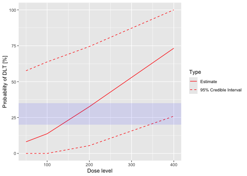
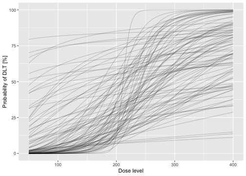
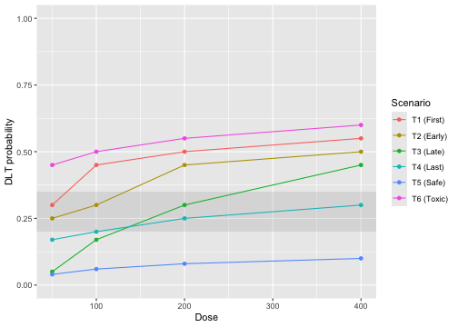
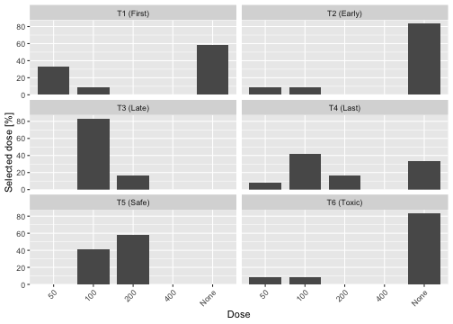
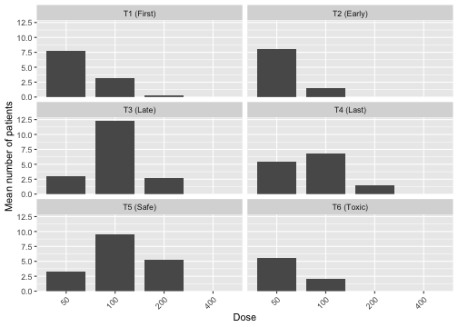
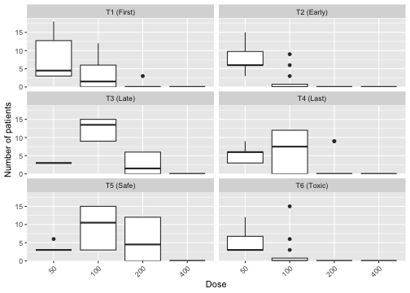
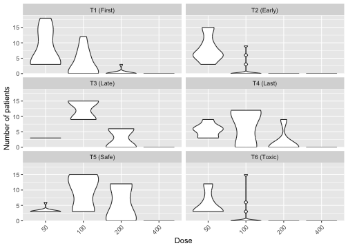

<!-- reporting-simulation-results.Rmd is generated from .Rmd.orig; edit the source. -->


## From a design to a report

This example follows one study from prior and hypothetical-data evaluations to
simulation tables and plots. The layouts address the Bayer, Boehringer Ingelheim
(BI), and Merck examples collected during the table-reporting discussion,
including a PMDA-style overview. Numerical simulation results are illustrative:
the original sponsors' models and simulation inputs are not available.

The reporting workflow has three parts: retain evaluated objects, assemble
unrounded reporting tibbles, and render them with `report_table()`. Changing a
label or rendering engine does not rerun MCMC. For HTML output we use `gt` when installed, showing native row sections and
column spanners. Other output uses the always-available markdown renderer;
`gt` remains optional.

## Define the study

We use four illustrative doses and a target DLT probability interval of 20–35%.
The stopping rules have explicit report labels, including a rule that stops
when the next-dose rule finds no admissible dose. This last event is reported
separately from the beta-rule toxicity stop.


``` r
empty_data <- Data(doseGrid = c(50, 100, 200, 400))
target <- c(0.20, 0.35)
model <- LogisticLogNormal(
  mean = c(-0.85, 1),
  cov = matrix(c(1, -0.5, -0.5, 1), nrow = 2),
  ref_dose = 200
)
design <- Design(
  model = model,
  nextBest = NextBestNCRM(
    target = target,
    overdose = c(target[2], 1),
    max_overdose_prob = 0.25
  ),
  stopping = StoppingLowestDoseHSRBeta(
    target = target[2],
    prob = 0.90,
    report_label = "Lowest dose unsafe"
  ) |
    StoppingMissingDose(report_label = "No admissible dose") |
    StoppingMinPatients(nPatients = 18, report_label = "Maximum sample size"),
  increments = IncrementsRelative(intervals = 0, increments = 1),
  cohort_size = CohortSizeConst(3),
  data = empty_data,
  startingDose = 50
)
mcmc_options <- McmcOptions(burnin = 100, step = 1, samples = 500)
```

These short chains and the small simulation count below keep the example quick.
A study report needs adequate posterior sampling, convergence assessment, and
many more simulated trials to control Monte Carlo error.

## Characterize the prior

Sample once from the model with empty data. The BI-style prior table includes
mean, SD, quantiles, and interval probabilities at each dose. Intervals are
left-closed and right-open, with the final upper endpoint included. These are
probabilities on a 0–1 scale, rather than percentages.


``` r
set.seed(966)
prior_samples <- mcmc(empty_data, model, mcmc_options)
```


``` r
prior_table <- report_prob_summary(
  prior_samples,
  model,
  empty_data,
  quantiles = c(0.025, 0.5, 0.975),
  intervals = c(0, target, 1)
)
report_table(prior_table, format = report_format, digits = 3)
```

<!--html_preserve--><div id="lzgedntybt" style="padding-left:0px;padding-right:0px;padding-top:10px;padding-bottom:10px;overflow-x:auto;overflow-y:auto;width:auto;height:auto;">
<style>#lzgedntybt table {
  font-family: system-ui, 'Segoe UI', Roboto, Helvetica, Arial, sans-serif, 'Apple Color Emoji', 'Segoe UI Emoji', 'Segoe UI Symbol', 'Noto Color Emoji';
  -webkit-font-smoothing: antialiased;
  -moz-osx-font-smoothing: grayscale;
}

#lzgedntybt thead, #lzgedntybt tbody, #lzgedntybt tfoot, #lzgedntybt tr, #lzgedntybt td, #lzgedntybt th {
  border-style: none;
}

#lzgedntybt p {
  margin: 0;
  padding: 0;
}

#lzgedntybt .gt_table {
  display: table;
  border-collapse: collapse;
  line-height: normal;
  margin-left: auto;
  margin-right: auto;
  color: #333333;
  font-size: 16px;
  font-weight: normal;
  font-style: normal;
  background-color: #FFFFFF;
  width: auto;
  border-top-style: solid;
  border-top-width: 2px;
  border-top-color: #A8A8A8;
  border-right-style: none;
  border-right-width: 2px;
  border-right-color: #D3D3D3;
  border-bottom-style: solid;
  border-bottom-width: 2px;
  border-bottom-color: #A8A8A8;
  border-left-style: none;
  border-left-width: 2px;
  border-left-color: #D3D3D3;
}

#lzgedntybt .gt_caption {
  padding-top: 4px;
  padding-bottom: 4px;
}

#lzgedntybt .gt_title {
  color: #333333;
  font-size: 125%;
  font-weight: initial;
  padding-top: 4px;
  padding-bottom: 4px;
  padding-left: 5px;
  padding-right: 5px;
  border-bottom-color: #FFFFFF;
  border-bottom-width: 0;
}

#lzgedntybt .gt_subtitle {
  color: #333333;
  font-size: 85%;
  font-weight: initial;
  padding-top: 3px;
  padding-bottom: 5px;
  padding-left: 5px;
  padding-right: 5px;
  border-top-color: #FFFFFF;
  border-top-width: 0;
}

#lzgedntybt .gt_heading {
  background-color: #FFFFFF;
  text-align: center;
  border-bottom-color: #FFFFFF;
  border-left-style: none;
  border-left-width: 1px;
  border-left-color: #D3D3D3;
  border-right-style: none;
  border-right-width: 1px;
  border-right-color: #D3D3D3;
}

#lzgedntybt .gt_bottom_border {
  border-bottom-style: solid;
  border-bottom-width: 2px;
  border-bottom-color: #D3D3D3;
}

#lzgedntybt .gt_col_headings {
  border-top-style: solid;
  border-top-width: 2px;
  border-top-color: #D3D3D3;
  border-bottom-style: solid;
  border-bottom-width: 2px;
  border-bottom-color: #D3D3D3;
  border-left-style: none;
  border-left-width: 1px;
  border-left-color: #D3D3D3;
  border-right-style: none;
  border-right-width: 1px;
  border-right-color: #D3D3D3;
}

#lzgedntybt .gt_col_heading {
  color: #333333;
  background-color: #FFFFFF;
  font-size: 100%;
  font-weight: normal;
  text-transform: inherit;
  border-left-style: none;
  border-left-width: 1px;
  border-left-color: #D3D3D3;
  border-right-style: none;
  border-right-width: 1px;
  border-right-color: #D3D3D3;
  vertical-align: bottom;
  padding-top: 5px;
  padding-bottom: 6px;
  padding-left: 5px;
  padding-right: 5px;
  overflow-x: hidden;
}

#lzgedntybt .gt_column_spanner_outer {
  color: #333333;
  background-color: #FFFFFF;
  font-size: 100%;
  font-weight: normal;
  text-transform: inherit;
  padding-top: 0;
  padding-bottom: 0;
  padding-left: 4px;
  padding-right: 4px;
}

#lzgedntybt .gt_column_spanner_outer:first-child {
  padding-left: 0;
}

#lzgedntybt .gt_column_spanner_outer:last-child {
  padding-right: 0;
}

#lzgedntybt .gt_column_spanner {
  border-bottom-style: solid;
  border-bottom-width: 2px;
  border-bottom-color: #D3D3D3;
  vertical-align: bottom;
  padding-top: 5px;
  padding-bottom: 5px;
  overflow-x: hidden;
  display: inline-block;
  width: 100%;
}

#lzgedntybt .gt_spanner_row {
  border-bottom-style: hidden;
}

#lzgedntybt .gt_group_heading {
  padding-top: 8px;
  padding-bottom: 8px;
  padding-left: 5px;
  padding-right: 5px;
  color: #333333;
  background-color: #FFFFFF;
  font-size: 100%;
  font-weight: initial;
  text-transform: inherit;
  border-top-style: solid;
  border-top-width: 2px;
  border-top-color: #D3D3D3;
  border-bottom-style: solid;
  border-bottom-width: 2px;
  border-bottom-color: #D3D3D3;
  border-left-style: none;
  border-left-width: 1px;
  border-left-color: #D3D3D3;
  border-right-style: none;
  border-right-width: 1px;
  border-right-color: #D3D3D3;
  vertical-align: middle;
  text-align: left;
}

#lzgedntybt .gt_empty_group_heading {
  padding: 0.5px;
  color: #333333;
  background-color: #FFFFFF;
  font-size: 100%;
  font-weight: initial;
  border-top-style: solid;
  border-top-width: 2px;
  border-top-color: #D3D3D3;
  border-bottom-style: solid;
  border-bottom-width: 2px;
  border-bottom-color: #D3D3D3;
  vertical-align: middle;
}

#lzgedntybt .gt_from_md > :first-child {
  margin-top: 0;
}

#lzgedntybt .gt_from_md > :last-child {
  margin-bottom: 0;
}

#lzgedntybt .gt_row {
  padding-top: 8px;
  padding-bottom: 8px;
  padding-left: 5px;
  padding-right: 5px;
  margin: 10px;
  border-top-style: solid;
  border-top-width: 1px;
  border-top-color: #D3D3D3;
  border-left-style: none;
  border-left-width: 1px;
  border-left-color: #D3D3D3;
  border-right-style: none;
  border-right-width: 1px;
  border-right-color: #D3D3D3;
  vertical-align: middle;
  overflow-x: hidden;
}

#lzgedntybt .gt_stub {
  color: #333333;
  background-color: #FFFFFF;
  font-size: 100%;
  font-weight: initial;
  text-transform: inherit;
  border-right-style: solid;
  border-right-width: 2px;
  border-right-color: #D3D3D3;
  padding-left: 5px;
  padding-right: 5px;
}

#lzgedntybt .gt_stub_row_group {
  color: #333333;
  background-color: #FFFFFF;
  font-size: 100%;
  font-weight: initial;
  text-transform: inherit;
  border-right-style: solid;
  border-right-width: 2px;
  border-right-color: #D3D3D3;
  padding-left: 5px;
  padding-right: 5px;
  vertical-align: top;
}

#lzgedntybt .gt_row_group_first td {
  border-top-width: 2px;
}

#lzgedntybt .gt_row_group_first th {
  border-top-width: 2px;
}

#lzgedntybt .gt_summary_row {
  color: #333333;
  background-color: #FFFFFF;
  text-transform: inherit;
  padding-top: 8px;
  padding-bottom: 8px;
  padding-left: 5px;
  padding-right: 5px;
}

#lzgedntybt .gt_first_summary_row {
  border-top-style: solid;
  border-top-color: #D3D3D3;
}

#lzgedntybt .gt_first_summary_row.thick {
  border-top-width: 2px;
}

#lzgedntybt .gt_last_summary_row {
  padding-top: 8px;
  padding-bottom: 8px;
  padding-left: 5px;
  padding-right: 5px;
  border-bottom-style: solid;
  border-bottom-width: 2px;
  border-bottom-color: #D3D3D3;
}

#lzgedntybt .gt_grand_summary_row {
  color: #333333;
  background-color: #FFFFFF;
  text-transform: inherit;
  padding-top: 8px;
  padding-bottom: 8px;
  padding-left: 5px;
  padding-right: 5px;
}

#lzgedntybt .gt_first_grand_summary_row {
  padding-top: 8px;
  padding-bottom: 8px;
  padding-left: 5px;
  padding-right: 5px;
  border-top-style: double;
  border-top-width: 6px;
  border-top-color: #D3D3D3;
}

#lzgedntybt .gt_last_grand_summary_row_top {
  padding-top: 8px;
  padding-bottom: 8px;
  padding-left: 5px;
  padding-right: 5px;
  border-bottom-style: double;
  border-bottom-width: 6px;
  border-bottom-color: #D3D3D3;
}

#lzgedntybt .gt_striped {
  background-color: rgba(128, 128, 128, 0.05);
}

#lzgedntybt .gt_table_body {
  border-top-style: solid;
  border-top-width: 2px;
  border-top-color: #D3D3D3;
  border-bottom-style: solid;
  border-bottom-width: 2px;
  border-bottom-color: #D3D3D3;
}

#lzgedntybt .gt_footnotes {
  color: #333333;
  background-color: #FFFFFF;
  border-bottom-style: none;
  border-bottom-width: 2px;
  border-bottom-color: #D3D3D3;
  border-left-style: none;
  border-left-width: 2px;
  border-left-color: #D3D3D3;
  border-right-style: none;
  border-right-width: 2px;
  border-right-color: #D3D3D3;
}

#lzgedntybt .gt_footnote {
  margin: 0px;
  font-size: 90%;
  padding-top: 4px;
  padding-bottom: 4px;
  padding-left: 5px;
  padding-right: 5px;
}

#lzgedntybt .gt_sourcenotes {
  color: #333333;
  background-color: #FFFFFF;
  border-bottom-style: none;
  border-bottom-width: 2px;
  border-bottom-color: #D3D3D3;
  border-left-style: none;
  border-left-width: 2px;
  border-left-color: #D3D3D3;
  border-right-style: none;
  border-right-width: 2px;
  border-right-color: #D3D3D3;
}

#lzgedntybt .gt_sourcenote {
  font-size: 90%;
  padding-top: 4px;
  padding-bottom: 4px;
  padding-left: 5px;
  padding-right: 5px;
}

#lzgedntybt .gt_left {
  text-align: left;
}

#lzgedntybt .gt_center {
  text-align: center;
}

#lzgedntybt .gt_right {
  text-align: right;
  font-variant-numeric: tabular-nums;
}

#lzgedntybt .gt_font_normal {
  font-weight: normal;
}

#lzgedntybt .gt_font_bold {
  font-weight: bold;
}

#lzgedntybt .gt_font_italic {
  font-style: italic;
}

#lzgedntybt .gt_super {
  font-size: 65%;
}

#lzgedntybt .gt_footnote_marks {
  font-size: 75%;
  vertical-align: 0.4em;
  position: initial;
}

#lzgedntybt .gt_asterisk {
  font-size: 100%;
  vertical-align: 0;
}

#lzgedntybt .gt_indent_1 {
  text-indent: 5px;
}

#lzgedntybt .gt_indent_2 {
  text-indent: 10px;
}

#lzgedntybt .gt_indent_3 {
  text-indent: 15px;
}

#lzgedntybt .gt_indent_4 {
  text-indent: 20px;
}

#lzgedntybt .gt_indent_5 {
  text-indent: 25px;
}

#lzgedntybt .katex-display {
  display: inline-flex !important;
  margin-bottom: 0.75em !important;
}

#lzgedntybt div.Reactable > div.rt-table > div.rt-thead > div.rt-tr.rt-tr-group-header > div.rt-th-group:after {
  height: 0px !important;
}
</style>
<table class="gt_table" data-quarto-disable-processing="false" data-quarto-bootstrap="false">
  <thead>
    <tr class="gt_col_headings gt_spanner_row">
      <th class="gt_col_heading gt_columns_bottom_border gt_right" rowspan="2" colspan="1" scope="col" id="dose">dose</th>
      <th class="gt_center gt_columns_top_border gt_column_spanner_outer" rowspan="1" colspan="3" scope="colgroup" id="Probability of true DLT rate in ...">
        <div class="gt_column_spanner">Probability of true DLT rate in ...</div>
      </th>
      <th class="gt_col_heading gt_columns_bottom_border gt_right" rowspan="2" colspan="1" scope="col" id="mean">mean</th>
      <th class="gt_col_heading gt_columns_bottom_border gt_right" rowspan="2" colspan="1" scope="col" id="sd">sd</th>
      <th class="gt_center gt_columns_top_border gt_column_spanner_outer" rowspan="1" colspan="3" scope="colgroup" id="Quantiles">
        <div class="gt_column_spanner">Quantiles</div>
      </th>
    </tr>
    <tr class="gt_col_headings">
      <th class="gt_col_heading gt_columns_bottom_border gt_right" rowspan="1" colspan="1" scope="col" id="p_[0,0.2)">p_[0,0.2)</th>
      <th class="gt_col_heading gt_columns_bottom_border gt_right" rowspan="1" colspan="1" scope="col" id="p_[0.2,0.35)">p_[0.2,0.35)</th>
      <th class="gt_col_heading gt_columns_bottom_border gt_right" rowspan="1" colspan="1" scope="col" id="p_[0.35,1]">p_[0.35,1]</th>
      <th class="gt_col_heading gt_columns_bottom_border gt_right" rowspan="1" colspan="1" scope="col" id="q2.5">q2.5</th>
      <th class="gt_col_heading gt_columns_bottom_border gt_right" rowspan="1" colspan="1" scope="col" id="q50">q50</th>
      <th class="gt_col_heading gt_columns_bottom_border gt_right" rowspan="1" colspan="1" scope="col" id="q97.5">q97.5</th>
    </tr>
  </thead>
  <tbody class="gt_table_body">
    <tr><td headers="dose" class="gt_row gt_right">50</td>
<td headers="p_[0,0.2)" class="gt_row gt_right">0.856</td>
<td headers="p_[0.2,0.35)" class="gt_row gt_right">0.076</td>
<td headers="p_[0.35,1]" class="gt_row gt_right">0.068</td>
<td headers="mean" class="gt_row gt_right">0.081</td>
<td headers="sd" class="gt_row gt_right">0.148</td>
<td headers="q2.5" class="gt_row gt_right">0.000</td>
<td headers="q50" class="gt_row gt_right">0.012</td>
<td headers="q97.5" class="gt_row gt_right">0.576</td></tr>
    <tr><td headers="dose" class="gt_row gt_right">100</td>
<td headers="p_[0,0.2)" class="gt_row gt_right">0.760</td>
<td headers="p_[0.2,0.35)" class="gt_row gt_right">0.104</td>
<td headers="p_[0.35,1]" class="gt_row gt_right">0.136</td>
<td headers="mean" class="gt_row gt_right">0.137</td>
<td headers="sd" class="gt_row gt_right">0.179</td>
<td headers="q2.5" class="gt_row gt_right">0.000</td>
<td headers="q50" class="gt_row gt_right">0.059</td>
<td headers="q97.5" class="gt_row gt_right">0.637</td></tr>
    <tr><td headers="dose" class="gt_row gt_right">200</td>
<td headers="p_[0,0.2)" class="gt_row gt_right">0.332</td>
<td headers="p_[0.2,0.35)" class="gt_row gt_right">0.268</td>
<td headers="p_[0.35,1]" class="gt_row gt_right">0.400</td>
<td headers="mean" class="gt_row gt_right">0.326</td>
<td headers="sd" class="gt_row gt_right">0.196</td>
<td headers="q2.5" class="gt_row gt_right">0.054</td>
<td headers="q50" class="gt_row gt_right">0.286</td>
<td headers="q97.5" class="gt_row gt_right">0.745</td></tr>
    <tr><td headers="dose" class="gt_row gt_right">400</td>
<td headers="p_[0,0.2)" class="gt_row gt_right">0.016</td>
<td headers="p_[0.2,0.35)" class="gt_row gt_right">0.048</td>
<td headers="p_[0.35,1]" class="gt_row gt_right">0.936</td>
<td headers="mean" class="gt_row gt_right">0.733</td>
<td headers="sd" class="gt_row gt_right">0.220</td>
<td headers="q2.5" class="gt_row gt_right">0.259</td>
<td headers="q50" class="gt_row gt_right">0.759</td>
<td headers="q97.5" class="gt_row gt_right">1.000</td></tr>
  </tbody>

</table>
</div><!--/html_preserve-->

The Bayer-style prior definition plot can show a mean or median and a chosen
credible interval, with a target band or a single target rate. Random curves
use a complete parameter draw across all doses.


``` r
plot(
  prior_samples,
  model,
  empty_data,
  statistic = "mean",
  level = 0.95,
  target = target
)
```




``` r
plot_prior_draws(prior_samples, model, empty_data, n = 100, seed = 967)
```



## Define the true toxicity scenarios

These six rows reproduce the assumed DLT probabilities in Bayer's safety
scenario table (Table 10-3 in the discussion notes). Dose amounts are illustrative.
`approxfun()` supplies a truth function for each row; the same functions drive
both the table and the simulations, preventing mismatched scenario definitions.


``` r
true_probabilities <- rbind(
  "T1 (First)" = c(0.30, 0.45, 0.50, 0.55),
  "T2 (Early)" = c(0.25, 0.30, 0.45, 0.50),
  "T3 (Late)" = c(0.05, 0.17, 0.30, 0.45),
  "T4 (Last)" = c(0.17, 0.20, 0.25, 0.30),
  "T5 (Safe)" = c(0.04, 0.06, 0.08, 0.10),
  "T6 (Toxic)" = c(0.45, 0.50, 0.55, 0.60)
)
truth_functions <- lapply(seq_len(nrow(true_probabilities)), function(i) {
  approxfun(empty_data@doseGrid, true_probabilities[i, ], rule = 2)
})
names(truth_functions) <- rownames(true_probabilities)
truths <- ToxicityScenarios(
  scenarios = truth_functions,
  dose_grid = empty_data@doseGrid,
  target = target
)
```


``` r
report_table(truths, digits = 2)
```


|Scenario   | Dose 50| Dose 100| Dose 200| Dose 400|
|:----------|-------:|--------:|--------:|--------:|
|T1 (First) |    0.30|     0.45|     0.50|     0.55|
|T2 (Early) |    0.25|     0.30|     0.45|     0.50|
|T3 (Late)  |    0.05|     0.17|     0.30|     0.45|
|T4 (Last)  |    0.17|     0.20|     0.25|     0.30|
|T5 (Safe)  |    0.04|     0.06|     0.08|     0.10|
|T6 (Toxic) |    0.45|     0.50|     0.55|     0.60|


``` r
plot(truths)
```



This single-agent table also supplies the single-arm counterpart of BI's scenario
definition table. Combination truth grids and hierarchical OC arm subcolumns
are deferred; do not interpret these six curves as separate treatment arms.

## Evaluate hypothetical trial data

A hypothetical data scenario is an observed trial snapshot, distinct from a
true toxicity scenario. Evaluate each snapshot with `scenario()` once, then bind
the resulting `DataScenario` objects. This reproduces the BI trial-realizations
layout for one arm, including current-dose overdose probability and posterior
interval probabilities at the proposed next dose.


``` r
hypothetical_data <- list(
  "3 patients, 0 DLTs" = Data(
    x = rep(50, 3),
    y = c(0, 0, 0),
    doseGrid = empty_data@doseGrid
  ),
  "3 patients, 1 DLT" = Data(
    x = rep(50, 3),
    y = c(0, 0, 1),
    doseGrid = empty_data@doseGrid
  ),
  "3 patients, 3 DLTs" = Data(
    x = rep(50, 3),
    y = c(1, 1, 1),
    doseGrid = empty_data@doseGrid
  )
)
set.seed(968)
evaluated_data <- lapply(hypothetical_data, function(data) {
  scenario(design, data = data, mcmcOptions = mcmc_options)
})
```


``` r
data_table <- report_data_scenarios(
  evaluated_data,
  probabilities = c("underdosing", "target", "overdose")
)
report_table(
  data_table,
  format = report_format,
  probability_labels = c(
    underdosing = "P(UDS)",
    target = "P(TDS)",
    overdose = "P(ODS)"
  ),
  digits = 3
)
```

<!--html_preserve--><div id="xhrhcfesrt" style="padding-left:0px;padding-right:0px;padding-top:10px;padding-bottom:10px;overflow-x:auto;overflow-y:auto;width:auto;height:auto;">
<style>#xhrhcfesrt table {
  font-family: system-ui, 'Segoe UI', Roboto, Helvetica, Arial, sans-serif, 'Apple Color Emoji', 'Segoe UI Emoji', 'Segoe UI Symbol', 'Noto Color Emoji';
  -webkit-font-smoothing: antialiased;
  -moz-osx-font-smoothing: grayscale;
}

#xhrhcfesrt thead, #xhrhcfesrt tbody, #xhrhcfesrt tfoot, #xhrhcfesrt tr, #xhrhcfesrt td, #xhrhcfesrt th {
  border-style: none;
}

#xhrhcfesrt p {
  margin: 0;
  padding: 0;
}

#xhrhcfesrt .gt_table {
  display: table;
  border-collapse: collapse;
  line-height: normal;
  margin-left: auto;
  margin-right: auto;
  color: #333333;
  font-size: 16px;
  font-weight: normal;
  font-style: normal;
  background-color: #FFFFFF;
  width: auto;
  border-top-style: solid;
  border-top-width: 2px;
  border-top-color: #A8A8A8;
  border-right-style: none;
  border-right-width: 2px;
  border-right-color: #D3D3D3;
  border-bottom-style: solid;
  border-bottom-width: 2px;
  border-bottom-color: #A8A8A8;
  border-left-style: none;
  border-left-width: 2px;
  border-left-color: #D3D3D3;
}

#xhrhcfesrt .gt_caption {
  padding-top: 4px;
  padding-bottom: 4px;
}

#xhrhcfesrt .gt_title {
  color: #333333;
  font-size: 125%;
  font-weight: initial;
  padding-top: 4px;
  padding-bottom: 4px;
  padding-left: 5px;
  padding-right: 5px;
  border-bottom-color: #FFFFFF;
  border-bottom-width: 0;
}

#xhrhcfesrt .gt_subtitle {
  color: #333333;
  font-size: 85%;
  font-weight: initial;
  padding-top: 3px;
  padding-bottom: 5px;
  padding-left: 5px;
  padding-right: 5px;
  border-top-color: #FFFFFF;
  border-top-width: 0;
}

#xhrhcfesrt .gt_heading {
  background-color: #FFFFFF;
  text-align: center;
  border-bottom-color: #FFFFFF;
  border-left-style: none;
  border-left-width: 1px;
  border-left-color: #D3D3D3;
  border-right-style: none;
  border-right-width: 1px;
  border-right-color: #D3D3D3;
}

#xhrhcfesrt .gt_bottom_border {
  border-bottom-style: solid;
  border-bottom-width: 2px;
  border-bottom-color: #D3D3D3;
}

#xhrhcfesrt .gt_col_headings {
  border-top-style: solid;
  border-top-width: 2px;
  border-top-color: #D3D3D3;
  border-bottom-style: solid;
  border-bottom-width: 2px;
  border-bottom-color: #D3D3D3;
  border-left-style: none;
  border-left-width: 1px;
  border-left-color: #D3D3D3;
  border-right-style: none;
  border-right-width: 1px;
  border-right-color: #D3D3D3;
}

#xhrhcfesrt .gt_col_heading {
  color: #333333;
  background-color: #FFFFFF;
  font-size: 100%;
  font-weight: normal;
  text-transform: inherit;
  border-left-style: none;
  border-left-width: 1px;
  border-left-color: #D3D3D3;
  border-right-style: none;
  border-right-width: 1px;
  border-right-color: #D3D3D3;
  vertical-align: bottom;
  padding-top: 5px;
  padding-bottom: 6px;
  padding-left: 5px;
  padding-right: 5px;
  overflow-x: hidden;
}

#xhrhcfesrt .gt_column_spanner_outer {
  color: #333333;
  background-color: #FFFFFF;
  font-size: 100%;
  font-weight: normal;
  text-transform: inherit;
  padding-top: 0;
  padding-bottom: 0;
  padding-left: 4px;
  padding-right: 4px;
}

#xhrhcfesrt .gt_column_spanner_outer:first-child {
  padding-left: 0;
}

#xhrhcfesrt .gt_column_spanner_outer:last-child {
  padding-right: 0;
}

#xhrhcfesrt .gt_column_spanner {
  border-bottom-style: solid;
  border-bottom-width: 2px;
  border-bottom-color: #D3D3D3;
  vertical-align: bottom;
  padding-top: 5px;
  padding-bottom: 5px;
  overflow-x: hidden;
  display: inline-block;
  width: 100%;
}

#xhrhcfesrt .gt_spanner_row {
  border-bottom-style: hidden;
}

#xhrhcfesrt .gt_group_heading {
  padding-top: 8px;
  padding-bottom: 8px;
  padding-left: 5px;
  padding-right: 5px;
  color: #333333;
  background-color: #FFFFFF;
  font-size: 100%;
  font-weight: initial;
  text-transform: inherit;
  border-top-style: solid;
  border-top-width: 2px;
  border-top-color: #D3D3D3;
  border-bottom-style: solid;
  border-bottom-width: 2px;
  border-bottom-color: #D3D3D3;
  border-left-style: none;
  border-left-width: 1px;
  border-left-color: #D3D3D3;
  border-right-style: none;
  border-right-width: 1px;
  border-right-color: #D3D3D3;
  vertical-align: middle;
  text-align: left;
}

#xhrhcfesrt .gt_empty_group_heading {
  padding: 0.5px;
  color: #333333;
  background-color: #FFFFFF;
  font-size: 100%;
  font-weight: initial;
  border-top-style: solid;
  border-top-width: 2px;
  border-top-color: #D3D3D3;
  border-bottom-style: solid;
  border-bottom-width: 2px;
  border-bottom-color: #D3D3D3;
  vertical-align: middle;
}

#xhrhcfesrt .gt_from_md > :first-child {
  margin-top: 0;
}

#xhrhcfesrt .gt_from_md > :last-child {
  margin-bottom: 0;
}

#xhrhcfesrt .gt_row {
  padding-top: 8px;
  padding-bottom: 8px;
  padding-left: 5px;
  padding-right: 5px;
  margin: 10px;
  border-top-style: solid;
  border-top-width: 1px;
  border-top-color: #D3D3D3;
  border-left-style: none;
  border-left-width: 1px;
  border-left-color: #D3D3D3;
  border-right-style: none;
  border-right-width: 1px;
  border-right-color: #D3D3D3;
  vertical-align: middle;
  overflow-x: hidden;
}

#xhrhcfesrt .gt_stub {
  color: #333333;
  background-color: #FFFFFF;
  font-size: 100%;
  font-weight: initial;
  text-transform: inherit;
  border-right-style: solid;
  border-right-width: 2px;
  border-right-color: #D3D3D3;
  padding-left: 5px;
  padding-right: 5px;
}

#xhrhcfesrt .gt_stub_row_group {
  color: #333333;
  background-color: #FFFFFF;
  font-size: 100%;
  font-weight: initial;
  text-transform: inherit;
  border-right-style: solid;
  border-right-width: 2px;
  border-right-color: #D3D3D3;
  padding-left: 5px;
  padding-right: 5px;
  vertical-align: top;
}

#xhrhcfesrt .gt_row_group_first td {
  border-top-width: 2px;
}

#xhrhcfesrt .gt_row_group_first th {
  border-top-width: 2px;
}

#xhrhcfesrt .gt_summary_row {
  color: #333333;
  background-color: #FFFFFF;
  text-transform: inherit;
  padding-top: 8px;
  padding-bottom: 8px;
  padding-left: 5px;
  padding-right: 5px;
}

#xhrhcfesrt .gt_first_summary_row {
  border-top-style: solid;
  border-top-color: #D3D3D3;
}

#xhrhcfesrt .gt_first_summary_row.thick {
  border-top-width: 2px;
}

#xhrhcfesrt .gt_last_summary_row {
  padding-top: 8px;
  padding-bottom: 8px;
  padding-left: 5px;
  padding-right: 5px;
  border-bottom-style: solid;
  border-bottom-width: 2px;
  border-bottom-color: #D3D3D3;
}

#xhrhcfesrt .gt_grand_summary_row {
  color: #333333;
  background-color: #FFFFFF;
  text-transform: inherit;
  padding-top: 8px;
  padding-bottom: 8px;
  padding-left: 5px;
  padding-right: 5px;
}

#xhrhcfesrt .gt_first_grand_summary_row {
  padding-top: 8px;
  padding-bottom: 8px;
  padding-left: 5px;
  padding-right: 5px;
  border-top-style: double;
  border-top-width: 6px;
  border-top-color: #D3D3D3;
}

#xhrhcfesrt .gt_last_grand_summary_row_top {
  padding-top: 8px;
  padding-bottom: 8px;
  padding-left: 5px;
  padding-right: 5px;
  border-bottom-style: double;
  border-bottom-width: 6px;
  border-bottom-color: #D3D3D3;
}

#xhrhcfesrt .gt_striped {
  background-color: rgba(128, 128, 128, 0.05);
}

#xhrhcfesrt .gt_table_body {
  border-top-style: solid;
  border-top-width: 2px;
  border-top-color: #D3D3D3;
  border-bottom-style: solid;
  border-bottom-width: 2px;
  border-bottom-color: #D3D3D3;
}

#xhrhcfesrt .gt_footnotes {
  color: #333333;
  background-color: #FFFFFF;
  border-bottom-style: none;
  border-bottom-width: 2px;
  border-bottom-color: #D3D3D3;
  border-left-style: none;
  border-left-width: 2px;
  border-left-color: #D3D3D3;
  border-right-style: none;
  border-right-width: 2px;
  border-right-color: #D3D3D3;
}

#xhrhcfesrt .gt_footnote {
  margin: 0px;
  font-size: 90%;
  padding-top: 4px;
  padding-bottom: 4px;
  padding-left: 5px;
  padding-right: 5px;
}

#xhrhcfesrt .gt_sourcenotes {
  color: #333333;
  background-color: #FFFFFF;
  border-bottom-style: none;
  border-bottom-width: 2px;
  border-bottom-color: #D3D3D3;
  border-left-style: none;
  border-left-width: 2px;
  border-left-color: #D3D3D3;
  border-right-style: none;
  border-right-width: 2px;
  border-right-color: #D3D3D3;
}

#xhrhcfesrt .gt_sourcenote {
  font-size: 90%;
  padding-top: 4px;
  padding-bottom: 4px;
  padding-left: 5px;
  padding-right: 5px;
}

#xhrhcfesrt .gt_left {
  text-align: left;
}

#xhrhcfesrt .gt_center {
  text-align: center;
}

#xhrhcfesrt .gt_right {
  text-align: right;
  font-variant-numeric: tabular-nums;
}

#xhrhcfesrt .gt_font_normal {
  font-weight: normal;
}

#xhrhcfesrt .gt_font_bold {
  font-weight: bold;
}

#xhrhcfesrt .gt_font_italic {
  font-style: italic;
}

#xhrhcfesrt .gt_super {
  font-size: 65%;
}

#xhrhcfesrt .gt_footnote_marks {
  font-size: 75%;
  vertical-align: 0.4em;
  position: initial;
}

#xhrhcfesrt .gt_asterisk {
  font-size: 100%;
  vertical-align: 0;
}

#xhrhcfesrt .gt_indent_1 {
  text-indent: 5px;
}

#xhrhcfesrt .gt_indent_2 {
  text-indent: 10px;
}

#xhrhcfesrt .gt_indent_3 {
  text-indent: 15px;
}

#xhrhcfesrt .gt_indent_4 {
  text-indent: 20px;
}

#xhrhcfesrt .gt_indent_5 {
  text-indent: 25px;
}

#xhrhcfesrt .katex-display {
  display: inline-flex !important;
  margin-bottom: 0.75em !important;
}

#xhrhcfesrt div.Reactable > div.rt-table > div.rt-thead > div.rt-tr.rt-tr-group-header > div.rt-th-group:after {
  height: 0px !important;
}
</style>
<table class="gt_table" data-quarto-disable-processing="false" data-quarto-bootstrap="false">
  <thead>
    <tr class="gt_col_headings gt_spanner_row">
      <th class="gt_center gt_columns_top_border gt_column_spanner_outer" rowspan="1" colspan="3" scope="colgroup" id="Observed data">
        <div class="gt_column_spanner">Observed data</div>
      </th>
      <th class="gt_col_heading gt_columns_bottom_border gt_right" rowspan="2" colspan="1" scope="col" id="current_dose">Current dose</th>
      <th class="gt_col_heading gt_columns_bottom_border gt_right" rowspan="2" colspan="1" scope="col" id="current_overdose_prob">Current P(ODS)</th>
      <th class="gt_col_heading gt_columns_bottom_border gt_left" rowspan="2" colspan="1" scope="col" id="next_action">Next action</th>
      <th class="gt_center gt_columns_top_border gt_column_spanner_outer" rowspan="1" colspan="3" scope="colgroup" id="Interval probabilities of proposed next dose">
        <div class="gt_column_spanner">Interval probabilities of proposed next dose</div>
      </th>
    </tr>
    <tr class="gt_col_headings">
      <th class="gt_col_heading gt_columns_bottom_border gt_right" rowspan="1" colspan="1" scope="col" id="observed_dose">Dose</th>
      <th class="gt_col_heading gt_columns_bottom_border gt_right" rowspan="1" colspan="1" scope="col" id="n_patients">Patients</th>
      <th class="gt_col_heading gt_columns_bottom_border gt_right" rowspan="1" colspan="1" scope="col" id="n_dlts">DLTs</th>
      <th class="gt_col_heading gt_columns_bottom_border gt_left" rowspan="1" colspan="1" scope="col" id="underdosing">P(UDS)</th>
      <th class="gt_col_heading gt_columns_bottom_border gt_left" rowspan="1" colspan="1" scope="col" id="target">P(TDS)</th>
      <th class="gt_col_heading gt_columns_bottom_border gt_left" rowspan="1" colspan="1" scope="col" id="overdose">P(ODS)</th>
    </tr>
  </thead>
  <tbody class="gt_table_body">
    <tr class="gt_group_heading_row">
      <th colspan="9" class="gt_group_heading" scope="colgroup" id="3 patients, 0 DLTs">3 patients, 0 DLTs</th>
    </tr>
    <tr class="gt_row_group_first"><td headers="3 patients, 0 DLTs  observed_dose" class="gt_row gt_right">50</td>
<td headers="3 patients, 0 DLTs  n_patients" class="gt_row gt_right">3</td>
<td headers="3 patients, 0 DLTs  n_dlts" class="gt_row gt_right">0</td>
<td headers="3 patients, 0 DLTs  current_dose" class="gt_row gt_right">50</td>
<td headers="3 patients, 0 DLTs  current_overdose_prob" class="gt_row gt_right">0.014</td>
<td headers="3 patients, 0 DLTs  next_action" class="gt_row gt_left">100 (n = 3)</td>
<td headers="3 patients, 0 DLTs  underdosing" class="gt_row gt_left">0.888</td>
<td headers="3 patients, 0 DLTs  target" class="gt_row gt_left">0.080</td>
<td headers="3 patients, 0 DLTs  overdose" class="gt_row gt_left">0.032</td></tr>
    <tr class="gt_group_heading_row">
      <th colspan="9" class="gt_group_heading" scope="colgroup" id="3 patients, 1 DLT">3 patients, 1 DLT</th>
    </tr>
    <tr class="gt_row_group_first"><td headers="3 patients, 1 DLT  observed_dose" class="gt_row gt_right">50</td>
<td headers="3 patients, 1 DLT  n_patients" class="gt_row gt_right">3</td>
<td headers="3 patients, 1 DLT  n_dlts" class="gt_row gt_right">1</td>
<td headers="3 patients, 1 DLT  current_dose" class="gt_row gt_right">50</td>
<td headers="3 patients, 1 DLT  current_overdose_prob" class="gt_row gt_right">0.162</td>
<td headers="3 patients, 1 DLT  next_action" class="gt_row gt_left">50 (n = 3)</td>
<td headers="3 patients, 1 DLT  underdosing" class="gt_row gt_left">0.536</td>
<td headers="3 patients, 1 DLT  target" class="gt_row gt_left">0.302</td>
<td headers="3 patients, 1 DLT  overdose" class="gt_row gt_left">0.162</td></tr>
    <tr class="gt_group_heading_row">
      <th colspan="9" class="gt_group_heading" scope="colgroup" id="3 patients, 3 DLTs">3 patients, 3 DLTs</th>
    </tr>
    <tr class="gt_row_group_first"><td headers="3 patients, 3 DLTs  observed_dose" class="gt_row gt_right">50</td>
<td headers="3 patients, 3 DLTs  n_patients" class="gt_row gt_right">3</td>
<td headers="3 patients, 3 DLTs  n_dlts" class="gt_row gt_right">3</td>
<td headers="3 patients, 3 DLTs  current_dose" class="gt_row gt_right">50</td>
<td headers="3 patients, 3 DLTs  current_overdose_prob" class="gt_row gt_right">0.934</td>
<td headers="3 patients, 3 DLTs  next_action" class="gt_row gt_left">Stop: Probability that the lowest active dose of 50 being toxic based on posterior Beta distribution using a Beta(1,1) prior is 98% and thus above the required 90% threshold.; Next dose is NA , i.e., no active dose is safe enough according to the NextBest rule.; Number of patients is 3 and thus below the prespecified minimum number 18</td>
<td headers="3 patients, 3 DLTs  underdosing" class="gt_row gt_left">—</td>
<td headers="3 patients, 3 DLTs  target" class="gt_row gt_left">—</td>
<td headers="3 patients, 3 DLTs  overdose" class="gt_row gt_left">—</td></tr>
  </tbody>

</table>
</div><!--/html_preserve-->

`NextBestNCRM` reports underdose probability directly from posterior samples
as P(toxicity < the lower target boundary), alongside target and overdose
probabilities. With a target interval of 20–35% and overdose interval (35%, 1],
these probabilities partition all draws. With other interval configurations
there can be gaps; underdose probability is never inferred by subtraction.
Only request probabilities returned by the chosen rule.
For a stopped trial the rendered action is **Stop**, and proposed-dose
probabilities are suppressed; the unrounded tibble retains the evaluated values.
Combination and hierarchical `DataScenario` results can use this same reporter,
which retains component doses and displays real arm names.

## Simulate and cache the summaries

Run the same design under each truth. `simulate()` stores its truth and stopping
metadata; `SimulationsSummaryList()` computes and caches each scenario's summary.
All subsequent tables and plots reuse this collection.


``` r
nsim <- 12L
simulations <- lapply(seq_along(truth_functions), function(i) {
  simulate(
    design,
    truth = truth_functions[[i]],
    nsim = nsim,
    seed = 970 + i,
    mcmcOptions = mcmc_options,
    parallel = FALSE
  )
})
names(simulations) <- names(truth_functions)
oc <- SimulationsSummaryList(simulations, target = target)
```

## Bayer: an extended operating-characteristics table

Select statistics by registry name and control labels and headers
programmatically. Here per-dose counts use mean (SD); set `sd = FALSE` for means
only. Quantiles are the 10th and 90th percentiles.


``` r
# Keep the PMDA collection's categories intact; this variant uses the rule labels.
bayer_oc <- SimulationsSummaryList(
  simulations,
  target = target,
  stop_categories = list()
)
bayer <- report_oc_overview(
  bayer_oc,
  stats = c(
    "prop_stop_by_label",
    "dose_selection",
    "prop_mtd_correct",
    "n_pat_mean_sd",
    "n_pat_minmax",
    "n_pat_quantiles",
    "n_above_target_mean_sd",
    "n_pat_per_dose",
    "n_dlt_per_dose"
  ),
  sd = TRUE,
  quantiles = c(0.1, 0.9),
  labels = c(
    n_pat_mean_sd = "Mean (SD)",
    n_pat_minmax = "Min–max",
    n_pat_quantiles = "10th/90th percentiles",
    `prop_stop_by_label::Lowest dose unsafe` = "Lowest dose unsafe",
    `prop_stop_by_label::No admissible dose` = "No admissible dose",
    `prop_stop_by_label::Maximum sample size` = "Maximum sample size"
  ),
  row_groups = c(
    prop_stop_by_label = "Stop reason (%)",
    dose_selection = "Dose selection (%)",
    prop_mtd_correct = "Correct dose selected (%)",
    n_pat_mean_sd = "Total patients",
    n_pat_minmax = "Total patients",
    n_pat_quantiles = "Total patients",
    n_above_target_mean_sd = "Patients above target",
    n_pat_per_dose = "Patients per dose, mean (SD)",
    n_dlt_per_dose = "DLTs per dose, mean (SD)"
  ),
  title = "Bayer-style operating characteristics",
  spanner = sprintf("%d trials per scenario; target 20–35%%", nsim)
)
bayer_table <- report_table(bayer, format = report_format)
if (report_format == "gt") {
  bayer_table <- gt::tab_options(bayer_table, row_group.as_column = TRUE)
}
bayer_table
```

<!--html_preserve--><div id="uztfrttskx" style="padding-left:0px;padding-right:0px;padding-top:10px;padding-bottom:10px;overflow-x:auto;overflow-y:auto;width:auto;height:auto;">
<style>#uztfrttskx table {
  font-family: system-ui, 'Segoe UI', Roboto, Helvetica, Arial, sans-serif, 'Apple Color Emoji', 'Segoe UI Emoji', 'Segoe UI Symbol', 'Noto Color Emoji';
  -webkit-font-smoothing: antialiased;
  -moz-osx-font-smoothing: grayscale;
}

#uztfrttskx thead, #uztfrttskx tbody, #uztfrttskx tfoot, #uztfrttskx tr, #uztfrttskx td, #uztfrttskx th {
  border-style: none;
}

#uztfrttskx p {
  margin: 0;
  padding: 0;
}

#uztfrttskx .gt_table {
  display: table;
  border-collapse: collapse;
  line-height: normal;
  margin-left: auto;
  margin-right: auto;
  color: #333333;
  font-size: 16px;
  font-weight: normal;
  font-style: normal;
  background-color: #FFFFFF;
  width: auto;
  border-top-style: solid;
  border-top-width: 2px;
  border-top-color: #A8A8A8;
  border-right-style: none;
  border-right-width: 2px;
  border-right-color: #D3D3D3;
  border-bottom-style: solid;
  border-bottom-width: 2px;
  border-bottom-color: #A8A8A8;
  border-left-style: none;
  border-left-width: 2px;
  border-left-color: #D3D3D3;
}

#uztfrttskx .gt_caption {
  padding-top: 4px;
  padding-bottom: 4px;
}

#uztfrttskx .gt_title {
  color: #333333;
  font-size: 125%;
  font-weight: initial;
  padding-top: 4px;
  padding-bottom: 4px;
  padding-left: 5px;
  padding-right: 5px;
  border-bottom-color: #FFFFFF;
  border-bottom-width: 0;
}

#uztfrttskx .gt_subtitle {
  color: #333333;
  font-size: 85%;
  font-weight: initial;
  padding-top: 3px;
  padding-bottom: 5px;
  padding-left: 5px;
  padding-right: 5px;
  border-top-color: #FFFFFF;
  border-top-width: 0;
}

#uztfrttskx .gt_heading {
  background-color: #FFFFFF;
  text-align: center;
  border-bottom-color: #FFFFFF;
  border-left-style: none;
  border-left-width: 1px;
  border-left-color: #D3D3D3;
  border-right-style: none;
  border-right-width: 1px;
  border-right-color: #D3D3D3;
}

#uztfrttskx .gt_bottom_border {
  border-bottom-style: solid;
  border-bottom-width: 2px;
  border-bottom-color: #D3D3D3;
}

#uztfrttskx .gt_col_headings {
  border-top-style: solid;
  border-top-width: 2px;
  border-top-color: #D3D3D3;
  border-bottom-style: solid;
  border-bottom-width: 2px;
  border-bottom-color: #D3D3D3;
  border-left-style: none;
  border-left-width: 1px;
  border-left-color: #D3D3D3;
  border-right-style: none;
  border-right-width: 1px;
  border-right-color: #D3D3D3;
}

#uztfrttskx .gt_col_heading {
  color: #333333;
  background-color: #FFFFFF;
  font-size: 100%;
  font-weight: normal;
  text-transform: inherit;
  border-left-style: none;
  border-left-width: 1px;
  border-left-color: #D3D3D3;
  border-right-style: none;
  border-right-width: 1px;
  border-right-color: #D3D3D3;
  vertical-align: bottom;
  padding-top: 5px;
  padding-bottom: 6px;
  padding-left: 5px;
  padding-right: 5px;
  overflow-x: hidden;
}

#uztfrttskx .gt_column_spanner_outer {
  color: #333333;
  background-color: #FFFFFF;
  font-size: 100%;
  font-weight: normal;
  text-transform: inherit;
  padding-top: 0;
  padding-bottom: 0;
  padding-left: 4px;
  padding-right: 4px;
}

#uztfrttskx .gt_column_spanner_outer:first-child {
  padding-left: 0;
}

#uztfrttskx .gt_column_spanner_outer:last-child {
  padding-right: 0;
}

#uztfrttskx .gt_column_spanner {
  border-bottom-style: solid;
  border-bottom-width: 2px;
  border-bottom-color: #D3D3D3;
  vertical-align: bottom;
  padding-top: 5px;
  padding-bottom: 5px;
  overflow-x: hidden;
  display: inline-block;
  width: 100%;
}

#uztfrttskx .gt_spanner_row {
  border-bottom-style: hidden;
}

#uztfrttskx .gt_group_heading {
  padding-top: 8px;
  padding-bottom: 8px;
  padding-left: 5px;
  padding-right: 5px;
  color: #333333;
  background-color: #FFFFFF;
  font-size: 100%;
  font-weight: initial;
  text-transform: inherit;
  border-top-style: solid;
  border-top-width: 2px;
  border-top-color: #D3D3D3;
  border-bottom-style: solid;
  border-bottom-width: 2px;
  border-bottom-color: #D3D3D3;
  border-left-style: none;
  border-left-width: 1px;
  border-left-color: #D3D3D3;
  border-right-style: none;
  border-right-width: 1px;
  border-right-color: #D3D3D3;
  vertical-align: middle;
  text-align: left;
}

#uztfrttskx .gt_empty_group_heading {
  padding: 0.5px;
  color: #333333;
  background-color: #FFFFFF;
  font-size: 100%;
  font-weight: initial;
  border-top-style: solid;
  border-top-width: 2px;
  border-top-color: #D3D3D3;
  border-bottom-style: solid;
  border-bottom-width: 2px;
  border-bottom-color: #D3D3D3;
  vertical-align: middle;
}

#uztfrttskx .gt_from_md > :first-child {
  margin-top: 0;
}

#uztfrttskx .gt_from_md > :last-child {
  margin-bottom: 0;
}

#uztfrttskx .gt_row {
  padding-top: 8px;
  padding-bottom: 8px;
  padding-left: 5px;
  padding-right: 5px;
  margin: 10px;
  border-top-style: solid;
  border-top-width: 1px;
  border-top-color: #D3D3D3;
  border-left-style: none;
  border-left-width: 1px;
  border-left-color: #D3D3D3;
  border-right-style: none;
  border-right-width: 1px;
  border-right-color: #D3D3D3;
  vertical-align: middle;
  overflow-x: hidden;
}

#uztfrttskx .gt_stub {
  color: #333333;
  background-color: #FFFFFF;
  font-size: 100%;
  font-weight: initial;
  text-transform: inherit;
  border-right-style: solid;
  border-right-width: 2px;
  border-right-color: #D3D3D3;
  padding-left: 5px;
  padding-right: 5px;
}

#uztfrttskx .gt_stub_row_group {
  color: #333333;
  background-color: #FFFFFF;
  font-size: 100%;
  font-weight: initial;
  text-transform: inherit;
  border-right-style: solid;
  border-right-width: 2px;
  border-right-color: #D3D3D3;
  padding-left: 5px;
  padding-right: 5px;
  vertical-align: top;
}

#uztfrttskx .gt_row_group_first td {
  border-top-width: 2px;
}

#uztfrttskx .gt_row_group_first th {
  border-top-width: 2px;
}

#uztfrttskx .gt_summary_row {
  color: #333333;
  background-color: #FFFFFF;
  text-transform: inherit;
  padding-top: 8px;
  padding-bottom: 8px;
  padding-left: 5px;
  padding-right: 5px;
}

#uztfrttskx .gt_first_summary_row {
  border-top-style: solid;
  border-top-color: #D3D3D3;
}

#uztfrttskx .gt_first_summary_row.thick {
  border-top-width: 2px;
}

#uztfrttskx .gt_last_summary_row {
  padding-top: 8px;
  padding-bottom: 8px;
  padding-left: 5px;
  padding-right: 5px;
  border-bottom-style: solid;
  border-bottom-width: 2px;
  border-bottom-color: #D3D3D3;
}

#uztfrttskx .gt_grand_summary_row {
  color: #333333;
  background-color: #FFFFFF;
  text-transform: inherit;
  padding-top: 8px;
  padding-bottom: 8px;
  padding-left: 5px;
  padding-right: 5px;
}

#uztfrttskx .gt_first_grand_summary_row {
  padding-top: 8px;
  padding-bottom: 8px;
  padding-left: 5px;
  padding-right: 5px;
  border-top-style: double;
  border-top-width: 6px;
  border-top-color: #D3D3D3;
}

#uztfrttskx .gt_last_grand_summary_row_top {
  padding-top: 8px;
  padding-bottom: 8px;
  padding-left: 5px;
  padding-right: 5px;
  border-bottom-style: double;
  border-bottom-width: 6px;
  border-bottom-color: #D3D3D3;
}

#uztfrttskx .gt_striped {
  background-color: rgba(128, 128, 128, 0.05);
}

#uztfrttskx .gt_table_body {
  border-top-style: solid;
  border-top-width: 2px;
  border-top-color: #D3D3D3;
  border-bottom-style: solid;
  border-bottom-width: 2px;
  border-bottom-color: #D3D3D3;
}

#uztfrttskx .gt_footnotes {
  color: #333333;
  background-color: #FFFFFF;
  border-bottom-style: none;
  border-bottom-width: 2px;
  border-bottom-color: #D3D3D3;
  border-left-style: none;
  border-left-width: 2px;
  border-left-color: #D3D3D3;
  border-right-style: none;
  border-right-width: 2px;
  border-right-color: #D3D3D3;
}

#uztfrttskx .gt_footnote {
  margin: 0px;
  font-size: 90%;
  padding-top: 4px;
  padding-bottom: 4px;
  padding-left: 5px;
  padding-right: 5px;
}

#uztfrttskx .gt_sourcenotes {
  color: #333333;
  background-color: #FFFFFF;
  border-bottom-style: none;
  border-bottom-width: 2px;
  border-bottom-color: #D3D3D3;
  border-left-style: none;
  border-left-width: 2px;
  border-left-color: #D3D3D3;
  border-right-style: none;
  border-right-width: 2px;
  border-right-color: #D3D3D3;
}

#uztfrttskx .gt_sourcenote {
  font-size: 90%;
  padding-top: 4px;
  padding-bottom: 4px;
  padding-left: 5px;
  padding-right: 5px;
}

#uztfrttskx .gt_left {
  text-align: left;
}

#uztfrttskx .gt_center {
  text-align: center;
}

#uztfrttskx .gt_right {
  text-align: right;
  font-variant-numeric: tabular-nums;
}

#uztfrttskx .gt_font_normal {
  font-weight: normal;
}

#uztfrttskx .gt_font_bold {
  font-weight: bold;
}

#uztfrttskx .gt_font_italic {
  font-style: italic;
}

#uztfrttskx .gt_super {
  font-size: 65%;
}

#uztfrttskx .gt_footnote_marks {
  font-size: 75%;
  vertical-align: 0.4em;
  position: initial;
}

#uztfrttskx .gt_asterisk {
  font-size: 100%;
  vertical-align: 0;
}

#uztfrttskx .gt_indent_1 {
  text-indent: 5px;
}

#uztfrttskx .gt_indent_2 {
  text-indent: 10px;
}

#uztfrttskx .gt_indent_3 {
  text-indent: 15px;
}

#uztfrttskx .gt_indent_4 {
  text-indent: 20px;
}

#uztfrttskx .gt_indent_5 {
  text-indent: 25px;
}

#uztfrttskx .katex-display {
  display: inline-flex !important;
  margin-bottom: 0.75em !important;
}

#uztfrttskx div.Reactable > div.rt-table > div.rt-thead > div.rt-tr.rt-tr-group-header > div.rt-th-group:after {
  height: 0px !important;
}
</style>
<table class="gt_table" data-quarto-disable-processing="false" data-quarto-bootstrap="false">
  <thead>
    <tr class="gt_heading">
      <td colspan="8" class="gt_heading gt_title gt_font_normal gt_bottom_border" style>Bayer-style operating characteristics</td>
    </tr>

    <tr class="gt_col_headings gt_spanner_row">
      <th class="gt_col_heading gt_columns_bottom_border gt_left" rowspan="2" colspan="2" scope="colgroup" id="a::stub"></th>
      <th class="gt_center gt_columns_top_border gt_column_spanner_outer" rowspan="1" colspan="6" scope="colgroup" id="12 trials per scenario; target 20–35%">
        <div class="gt_column_spanner">12 trials per scenario; target 20–35%</div>
      </th>
    </tr>
    <tr class="gt_col_headings">
      <th class="gt_col_heading gt_columns_bottom_border gt_right" rowspan="1" colspan="1" scope="col" id="a.scenario_1">T1 (First)</th>
      <th class="gt_col_heading gt_columns_bottom_border gt_right" rowspan="1" colspan="1" scope="col" id="a.scenario_2">T2 (Early)</th>
      <th class="gt_col_heading gt_columns_bottom_border gt_right" rowspan="1" colspan="1" scope="col" id="a.scenario_3">T3 (Late)</th>
      <th class="gt_col_heading gt_columns_bottom_border gt_right" rowspan="1" colspan="1" scope="col" id="a.scenario_4">T4 (Last)</th>
      <th class="gt_col_heading gt_columns_bottom_border gt_right" rowspan="1" colspan="1" scope="col" id="a.scenario_5">T5 (Safe)</th>
      <th class="gt_col_heading gt_columns_bottom_border gt_right" rowspan="1" colspan="1" scope="col" id="a.scenario_6">T6 (Toxic)</th>
    </tr>
  </thead>
  <tbody class="gt_table_body">
    <tr class="gt_row_group_first"><td headers="Stop reason (%) stub_2_1 stub_1" rowspan="3" class="gt_row gt_left gt_stub_row_group">Stop reason (%)</td>
<th id="stub_2_1" scope="row" class="gt_row gt_left gt_stub">Lowest dose unsafe</th>
<td headers="Stop reason (%) stub_2_1 .scenario_1" class="gt_row gt_right">0.0</td>
<td headers="Stop reason (%) stub_2_1 .scenario_2" class="gt_row gt_right">0.0</td>
<td headers="Stop reason (%) stub_2_1 .scenario_3" class="gt_row gt_right">0.0</td>
<td headers="Stop reason (%) stub_2_1 .scenario_4" class="gt_row gt_right">0.0</td>
<td headers="Stop reason (%) stub_2_1 .scenario_5" class="gt_row gt_right">0.0</td>
<td headers="Stop reason (%) stub_2_1 .scenario_6" class="gt_row gt_right">16.7</td></tr>
    <tr><th id="stub_2_2" scope="row" class="gt_row gt_left gt_stub">No admissible dose</th>
<td headers="Stop reason (%) stub_2_2 .scenario_1" class="gt_row gt_right">58.3</td>
<td headers="Stop reason (%) stub_2_2 .scenario_2" class="gt_row gt_right">83.3</td>
<td headers="Stop reason (%) stub_2_2 .scenario_3" class="gt_row gt_right">0.0</td>
<td headers="Stop reason (%) stub_2_2 .scenario_4" class="gt_row gt_right">33.3</td>
<td headers="Stop reason (%) stub_2_2 .scenario_5" class="gt_row gt_right">0.0</td>
<td headers="Stop reason (%) stub_2_2 .scenario_6" class="gt_row gt_right">83.3</td></tr>
    <tr><th id="stub_2_3" scope="row" class="gt_row gt_left gt_stub">Maximum sample size</th>
<td headers="Stop reason (%) stub_2_3 .scenario_1" class="gt_row gt_right">50.0</td>
<td headers="Stop reason (%) stub_2_3 .scenario_2" class="gt_row gt_right">25.0</td>
<td headers="Stop reason (%) stub_2_3 .scenario_3" class="gt_row gt_right">100.0</td>
<td headers="Stop reason (%) stub_2_3 .scenario_4" class="gt_row gt_right">66.7</td>
<td headers="Stop reason (%) stub_2_3 .scenario_5" class="gt_row gt_right">100.0</td>
<td headers="Stop reason (%) stub_2_3 .scenario_6" class="gt_row gt_right">16.7</td></tr>
    <tr class="gt_row_group_first"><td headers="Dose selection (%) stub_2_4 stub_1" rowspan="5" class="gt_row gt_left gt_stub_row_group">Dose selection (%)</td>
<th id="stub_2_4" scope="row" class="gt_row gt_left gt_stub">Dose selected: 50</th>
<td headers="Dose selection (%) stub_2_4 .scenario_1" class="gt_row gt_right">33.3</td>
<td headers="Dose selection (%) stub_2_4 .scenario_2" class="gt_row gt_right">8.3</td>
<td headers="Dose selection (%) stub_2_4 .scenario_3" class="gt_row gt_right">0.0</td>
<td headers="Dose selection (%) stub_2_4 .scenario_4" class="gt_row gt_right">8.3</td>
<td headers="Dose selection (%) stub_2_4 .scenario_5" class="gt_row gt_right">0.0</td>
<td headers="Dose selection (%) stub_2_4 .scenario_6" class="gt_row gt_right">8.3</td></tr>
    <tr><th id="stub_2_5" scope="row" class="gt_row gt_left gt_stub">Dose selected: 100</th>
<td headers="Dose selection (%) stub_2_5 .scenario_1" class="gt_row gt_right">8.3</td>
<td headers="Dose selection (%) stub_2_5 .scenario_2" class="gt_row gt_right">8.3</td>
<td headers="Dose selection (%) stub_2_5 .scenario_3" class="gt_row gt_right">83.3</td>
<td headers="Dose selection (%) stub_2_5 .scenario_4" class="gt_row gt_right">41.7</td>
<td headers="Dose selection (%) stub_2_5 .scenario_5" class="gt_row gt_right">41.7</td>
<td headers="Dose selection (%) stub_2_5 .scenario_6" class="gt_row gt_right">8.3</td></tr>
    <tr><th id="stub_2_6" scope="row" class="gt_row gt_left gt_stub">Dose selected: 200</th>
<td headers="Dose selection (%) stub_2_6 .scenario_1" class="gt_row gt_right">0.0</td>
<td headers="Dose selection (%) stub_2_6 .scenario_2" class="gt_row gt_right">0.0</td>
<td headers="Dose selection (%) stub_2_6 .scenario_3" class="gt_row gt_right">16.7</td>
<td headers="Dose selection (%) stub_2_6 .scenario_4" class="gt_row gt_right">16.7</td>
<td headers="Dose selection (%) stub_2_6 .scenario_5" class="gt_row gt_right">58.3</td>
<td headers="Dose selection (%) stub_2_6 .scenario_6" class="gt_row gt_right">0.0</td></tr>
    <tr><th id="stub_2_7" scope="row" class="gt_row gt_left gt_stub">Dose selected: 400</th>
<td headers="Dose selection (%) stub_2_7 .scenario_1" class="gt_row gt_right">0.0</td>
<td headers="Dose selection (%) stub_2_7 .scenario_2" class="gt_row gt_right">0.0</td>
<td headers="Dose selection (%) stub_2_7 .scenario_3" class="gt_row gt_right">0.0</td>
<td headers="Dose selection (%) stub_2_7 .scenario_4" class="gt_row gt_right">0.0</td>
<td headers="Dose selection (%) stub_2_7 .scenario_5" class="gt_row gt_right">0.0</td>
<td headers="Dose selection (%) stub_2_7 .scenario_6" class="gt_row gt_right">0.0</td></tr>
    <tr><th id="stub_2_8" scope="row" class="gt_row gt_left gt_stub">Dose selected: none</th>
<td headers="Dose selection (%) stub_2_8 .scenario_1" class="gt_row gt_right">58.3</td>
<td headers="Dose selection (%) stub_2_8 .scenario_2" class="gt_row gt_right">83.3</td>
<td headers="Dose selection (%) stub_2_8 .scenario_3" class="gt_row gt_right">0.0</td>
<td headers="Dose selection (%) stub_2_8 .scenario_4" class="gt_row gt_right">33.3</td>
<td headers="Dose selection (%) stub_2_8 .scenario_5" class="gt_row gt_right">0.0</td>
<td headers="Dose selection (%) stub_2_8 .scenario_6" class="gt_row gt_right">83.3</td></tr>
    <tr class="gt_row_group_first"><td headers="Correct dose selected (%) stub_2_9 stub_1" rowspan="1" class="gt_row gt_left gt_stub_row_group">Correct dose selected (%)</td>
<th id="stub_2_9" scope="row" class="gt_row gt_left gt_stub">MTD correct (%)</th>
<td headers="Correct dose selected (%) stub_2_9 .scenario_1" class="gt_row gt_right">33.3</td>
<td headers="Correct dose selected (%) stub_2_9 .scenario_2" class="gt_row gt_right">16.7</td>
<td headers="Correct dose selected (%) stub_2_9 .scenario_3" class="gt_row gt_right">16.7</td>
<td headers="Correct dose selected (%) stub_2_9 .scenario_4" class="gt_row gt_right">58.3</td>
<td headers="Correct dose selected (%) stub_2_9 .scenario_5" class="gt_row gt_right">0.0</td>
<td headers="Correct dose selected (%) stub_2_9 .scenario_6" class="gt_row gt_right">0.0</td></tr>
    <tr class="gt_row_group_first"><td headers="Total patients stub_2_10 stub_1" rowspan="3" class="gt_row gt_left gt_stub_row_group">Total patients</td>
<th id="stub_2_10" scope="row" class="gt_row gt_left gt_stub">Mean (SD)</th>
<td headers="Total patients stub_2_10 .scenario_1" class="gt_row gt_right">11.2 (7.3)</td>
<td headers="Total patients stub_2_10 .scenario_2" class="gt_row gt_right">9.5 (6.0)</td>
<td headers="Total patients stub_2_10 .scenario_3" class="gt_row gt_right">18.0 (0.0)</td>
<td headers="Total patients stub_2_10 .scenario_4" class="gt_row gt_right">13.8 (6.5)</td>
<td headers="Total patients stub_2_10 .scenario_5" class="gt_row gt_right">18.0 (0.0)</td>
<td headers="Total patients stub_2_10 .scenario_6" class="gt_row gt_right">7.5 (6.1)</td></tr>
    <tr><th id="stub_2_11" scope="row" class="gt_row gt_left gt_stub">Min–max</th>
<td headers="Total patients stub_2_11 .scenario_1" class="gt_row gt_right">[3, 18]</td>
<td headers="Total patients stub_2_11 .scenario_2" class="gt_row gt_right">[3, 18]</td>
<td headers="Total patients stub_2_11 .scenario_3" class="gt_row gt_right">[18, 18]</td>
<td headers="Total patients stub_2_11 .scenario_4" class="gt_row gt_right">[3, 18]</td>
<td headers="Total patients stub_2_11 .scenario_5" class="gt_row gt_right">[18, 18]</td>
<td headers="Total patients stub_2_11 .scenario_6" class="gt_row gt_right">[3, 18]</td></tr>
    <tr><th id="stub_2_12" scope="row" class="gt_row gt_left gt_stub">10th/90th percentiles</th>
<td headers="Total patients stub_2_12 .scenario_1" class="gt_row gt_right">[3.0, 18.0]</td>
<td headers="Total patients stub_2_12 .scenario_2" class="gt_row gt_right">[3.3, 18.0]</td>
<td headers="Total patients stub_2_12 .scenario_3" class="gt_row gt_right">[18.0, 18.0]</td>
<td headers="Total patients stub_2_12 .scenario_4" class="gt_row gt_right">[3.3, 18.0]</td>
<td headers="Total patients stub_2_12 .scenario_5" class="gt_row gt_right">[18.0, 18.0]</td>
<td headers="Total patients stub_2_12 .scenario_6" class="gt_row gt_right">[3.0, 17.7]</td></tr>
    <tr class="gt_row_group_first"><td headers="Patients above target stub_2_13 stub_1" rowspan="1" class="gt_row gt_left gt_stub_row_group">Patients above target</td>
<th id="stub_2_13" scope="row" class="gt_row gt_left gt_stub">Patients above target, mean (SD)</th>
<td headers="Patients above target stub_2_13 .scenario_1" class="gt_row gt_right">3.5 (4.8)</td>
<td headers="Patients above target stub_2_13 .scenario_2" class="gt_row gt_right">0.0 (0.0)</td>
<td headers="Patients above target stub_2_13 .scenario_3" class="gt_row gt_right">0.0 (0.0)</td>
<td headers="Patients above target stub_2_13 .scenario_4" class="gt_row gt_right">0.0 (0.0)</td>
<td headers="Patients above target stub_2_13 .scenario_5" class="gt_row gt_right">0.0 (0.0)</td>
<td headers="Patients above target stub_2_13 .scenario_6" class="gt_row gt_right">7.5 (6.1)</td></tr>
    <tr class="gt_row_group_first"><td headers="Patients per dose, mean (SD) stub_2_14 stub_1" rowspan="4" class="gt_row gt_left gt_stub_row_group">Patients per dose, mean (SD)</td>
<th id="stub_2_14" scope="row" class="gt_row gt_left gt_stub">Patients at dose 50</th>
<td headers="Patients per dose, mean (SD) stub_2_14 .scenario_1" class="gt_row gt_right">7.8 (5.8)</td>
<td headers="Patients per dose, mean (SD) stub_2_14 .scenario_2" class="gt_row gt_right">8.0 (4.1)</td>
<td headers="Patients per dose, mean (SD) stub_2_14 .scenario_3" class="gt_row gt_right">3.0 (0.0)</td>
<td headers="Patients per dose, mean (SD) stub_2_14 .scenario_4" class="gt_row gt_right">5.5 (2.2)</td>
<td headers="Patients per dose, mean (SD) stub_2_14 .scenario_5" class="gt_row gt_right">3.2 (0.9)</td>
<td headers="Patients per dose, mean (SD) stub_2_14 .scenario_6" class="gt_row gt_right">5.5 (3.6)</td></tr>
    <tr><th id="stub_2_15" scope="row" class="gt_row gt_left gt_stub">Patients at dose 100</th>
<td headers="Patients per dose, mean (SD) stub_2_15 .scenario_1" class="gt_row gt_right">3.2 (4.1)</td>
<td headers="Patients per dose, mean (SD) stub_2_15 .scenario_2" class="gt_row gt_right">1.5 (3.0)</td>
<td headers="Patients per dose, mean (SD) stub_2_15 .scenario_3" class="gt_row gt_right">12.2 (3.0)</td>
<td headers="Patients per dose, mean (SD) stub_2_15 .scenario_4" class="gt_row gt_right">6.8 (5.4)</td>
<td headers="Patients per dose, mean (SD) stub_2_15 .scenario_5" class="gt_row gt_right">9.5 (5.2)</td>
<td headers="Patients per dose, mean (SD) stub_2_15 .scenario_6" class="gt_row gt_right">2.0 (4.5)</td></tr>
    <tr><th id="stub_2_16" scope="row" class="gt_row gt_left gt_stub">Patients at dose 200</th>
<td headers="Patients per dose, mean (SD) stub_2_16 .scenario_1" class="gt_row gt_right">0.2 (0.9)</td>
<td headers="Patients per dose, mean (SD) stub_2_16 .scenario_2" class="gt_row gt_right">0.0 (0.0)</td>
<td headers="Patients per dose, mean (SD) stub_2_16 .scenario_3" class="gt_row gt_right">2.8 (3.0)</td>
<td headers="Patients per dose, mean (SD) stub_2_16 .scenario_4" class="gt_row gt_right">1.5 (3.5)</td>
<td headers="Patients per dose, mean (SD) stub_2_16 .scenario_5" class="gt_row gt_right">5.2 (5.4)</td>
<td headers="Patients per dose, mean (SD) stub_2_16 .scenario_6" class="gt_row gt_right">0.0 (0.0)</td></tr>
    <tr><th id="stub_2_17" scope="row" class="gt_row gt_left gt_stub">Patients at dose 400</th>
<td headers="Patients per dose, mean (SD) stub_2_17 .scenario_1" class="gt_row gt_right">0.0 (0.0)</td>
<td headers="Patients per dose, mean (SD) stub_2_17 .scenario_2" class="gt_row gt_right">0.0 (0.0)</td>
<td headers="Patients per dose, mean (SD) stub_2_17 .scenario_3" class="gt_row gt_right">0.0 (0.0)</td>
<td headers="Patients per dose, mean (SD) stub_2_17 .scenario_4" class="gt_row gt_right">0.0 (0.0)</td>
<td headers="Patients per dose, mean (SD) stub_2_17 .scenario_5" class="gt_row gt_right">0.0 (0.0)</td>
<td headers="Patients per dose, mean (SD) stub_2_17 .scenario_6" class="gt_row gt_right">0.0 (0.0)</td></tr>
    <tr class="gt_row_group_first"><td headers="DLTs per dose, mean (SD) stub_2_18 stub_1" rowspan="4" class="gt_row gt_left gt_stub_row_group">DLTs per dose, mean (SD)</td>
<th id="stub_2_18" scope="row" class="gt_row gt_left gt_stub">DLTs at dose 50</th>
<td headers="DLTs per dose, mean (SD) stub_2_18 .scenario_1" class="gt_row gt_right">2.0 (1.7)</td>
<td headers="DLTs per dose, mean (SD) stub_2_18 .scenario_2" class="gt_row gt_right">2.5 (1.2)</td>
<td headers="DLTs per dose, mean (SD) stub_2_18 .scenario_3" class="gt_row gt_right">0.0 (0.0)</td>
<td headers="DLTs per dose, mean (SD) stub_2_18 .scenario_4" class="gt_row gt_right">1.2 (1.2)</td>
<td headers="DLTs per dose, mean (SD) stub_2_18 .scenario_5" class="gt_row gt_right">0.1 (0.3)</td>
<td headers="DLTs per dose, mean (SD) stub_2_18 .scenario_6" class="gt_row gt_right">2.3 (1.2)</td></tr>
    <tr><th id="stub_2_19" scope="row" class="gt_row gt_left gt_stub">DLTs at dose 100</th>
<td headers="DLTs per dose, mean (SD) stub_2_19 .scenario_1" class="gt_row gt_right">1.7 (2.0)</td>
<td headers="DLTs per dose, mean (SD) stub_2_19 .scenario_2" class="gt_row gt_right">0.5 (1.0)</td>
<td headers="DLTs per dose, mean (SD) stub_2_19 .scenario_3" class="gt_row gt_right">2.1 (1.4)</td>
<td headers="DLTs per dose, mean (SD) stub_2_19 .scenario_4" class="gt_row gt_right">1.2 (1.8)</td>
<td headers="DLTs per dose, mean (SD) stub_2_19 .scenario_5" class="gt_row gt_right">0.7 (1.0)</td>
<td headers="DLTs per dose, mean (SD) stub_2_19 .scenario_6" class="gt_row gt_right">0.8 (1.4)</td></tr>
    <tr><th id="stub_2_20" scope="row" class="gt_row gt_left gt_stub">DLTs at dose 200</th>
<td headers="DLTs per dose, mean (SD) stub_2_20 .scenario_1" class="gt_row gt_right">0.1 (0.3)</td>
<td headers="DLTs per dose, mean (SD) stub_2_20 .scenario_2" class="gt_row gt_right">0.0 (0.0)</td>
<td headers="DLTs per dose, mean (SD) stub_2_20 .scenario_3" class="gt_row gt_right">1.0 (1.3)</td>
<td headers="DLTs per dose, mean (SD) stub_2_20 .scenario_4" class="gt_row gt_right">0.4 (1.0)</td>
<td headers="DLTs per dose, mean (SD) stub_2_20 .scenario_5" class="gt_row gt_right">0.8 (1.0)</td>
<td headers="DLTs per dose, mean (SD) stub_2_20 .scenario_6" class="gt_row gt_right">0.0 (0.0)</td></tr>
    <tr><th id="stub_2_21" scope="row" class="gt_row gt_left gt_stub">DLTs at dose 400</th>
<td headers="DLTs per dose, mean (SD) stub_2_21 .scenario_1" class="gt_row gt_right">0.0 (0.0)</td>
<td headers="DLTs per dose, mean (SD) stub_2_21 .scenario_2" class="gt_row gt_right">0.0 (0.0)</td>
<td headers="DLTs per dose, mean (SD) stub_2_21 .scenario_3" class="gt_row gt_right">0.0 (0.0)</td>
<td headers="DLTs per dose, mean (SD) stub_2_21 .scenario_4" class="gt_row gt_right">0.0 (0.0)</td>
<td headers="DLTs per dose, mean (SD) stub_2_21 .scenario_5" class="gt_row gt_right">0.0 (0.0)</td>
<td headers="DLTs per dose, mean (SD) stub_2_21 .scenario_6" class="gt_row gt_right">0.0 (0.0)</td></tr>
  </tbody>

</table>
</div><!--/html_preserve-->

The Bayer collection uses `stop_categories = list()` so each supplied
`report_label` appears in the stop reasons. The PMDA collection retains its
class-based categories. `row_groups` maps statistic IDs to section labels;
expanded row IDs can override the group of an individual row.
The gt option `row_group.as_column = TRUE` places group labels in the left stub,
closer to the PDF's criterion/category layout; the default places section
headings above the rows. Categories count the
union of activated rules within each trial and can overlap. Dose selection is a
percentage of all simulated trials, including **None**.

The screenshot's special "highest planned dose safe" outcome requires a separate
rule-based definition: selecting the highest dose alone does not establish it.
Likewise, below-target scenarios are not automatically successful highest-dose
selections. Recorded duration mean/SD is available as `duration_mean_sd` for
`DASimulations`, in its recorded units; this ordinary `Design` has no elapsed-time
measure. Duration min/max and quantiles remain deferred. The next example shows
how to add the remaining above-target distribution summaries without changing
the reporting implementation.


``` r
above_range <- OCStat(
  label = "Patients above target, min–max",
  fun = function(sims, summary, scenario) range(summary@n_above_target),
  format = "[%.0f–%.0f]"
)
above_quantiles <- OCStat(
  label = "Patients above target, 10th/90th percentiles",
  fun = function(sims, summary, scenario) {
    quantile(summary@n_above_target, c(0.1, 0.9), names = FALSE)
  },
  format = "[%.1f–%.1f]"
)
report_oc_overview(
  oc,
  stats = list(
    "n_above_target_mean_sd",
    range = above_range,
    quantiles = above_quantiles
  ),
  format = "kable"
)
```


|Statistic                                    | T1 (First)| T2 (Early)| T3 (Late)| T4 (Last)| T5 (Safe)| T6 (Toxic)|
|:--------------------------------------------|----------:|----------:|---------:|---------:|---------:|----------:|
|Patients above target, mean (SD)             |  3.5 (4.8)|  0.0 (0.0)| 0.0 (0.0)| 0.0 (0.0)| 0.0 (0.0)|  7.5 (6.1)|
|Patients above target, min–max               |     [0–15]|      [0–0]|     [0–0]|     [0–0]|     [0–0]|     [3–18]|
|Patients above target, 10th/90th percentiles |  [0.0–8.7]|  [0.0–0.0]| [0.0–0.0]| [0.0–0.0]| [0.0–0.0]| [3.0–17.7]|


## BI: outcome classification and sample-size ranges

BI's table reports selection below, within, and above the target interval,
no final recommendation, and patient/DLT means and ranges. The percentages use
all trials as denominator. `report_transpose()` places scenarios in rows, as in the BI screenshot.
This is a single-arm counterpart; hierarchical OC arm subcolumns are not
implemented. Means and min/max remain separate columns.


``` r
bi <- report_oc_overview(
  oc,
  stats = c(
    "prop_mtd_under",
    "prop_mtd_correct",
    "prop_mtd_over",
    "prop_mtd_none",
    "n_pat_mean",
    "n_pat_minmax",
    "n_dlt_mean",
    "n_dlt_minmax"
  ),
  labels = c(prop_mtd_none = "No final recommendation (%)"),
  title = "BI-style operating characteristics"
)
report_table(report_transpose(bi), format = report_format)
```

<!--html_preserve--><div id="viuopmfuxv" style="padding-left:0px;padding-right:0px;padding-top:10px;padding-bottom:10px;overflow-x:auto;overflow-y:auto;width:auto;height:auto;">
<style>#viuopmfuxv table {
  font-family: system-ui, 'Segoe UI', Roboto, Helvetica, Arial, sans-serif, 'Apple Color Emoji', 'Segoe UI Emoji', 'Segoe UI Symbol', 'Noto Color Emoji';
  -webkit-font-smoothing: antialiased;
  -moz-osx-font-smoothing: grayscale;
}

#viuopmfuxv thead, #viuopmfuxv tbody, #viuopmfuxv tfoot, #viuopmfuxv tr, #viuopmfuxv td, #viuopmfuxv th {
  border-style: none;
}

#viuopmfuxv p {
  margin: 0;
  padding: 0;
}

#viuopmfuxv .gt_table {
  display: table;
  border-collapse: collapse;
  line-height: normal;
  margin-left: auto;
  margin-right: auto;
  color: #333333;
  font-size: 16px;
  font-weight: normal;
  font-style: normal;
  background-color: #FFFFFF;
  width: auto;
  border-top-style: solid;
  border-top-width: 2px;
  border-top-color: #A8A8A8;
  border-right-style: none;
  border-right-width: 2px;
  border-right-color: #D3D3D3;
  border-bottom-style: solid;
  border-bottom-width: 2px;
  border-bottom-color: #A8A8A8;
  border-left-style: none;
  border-left-width: 2px;
  border-left-color: #D3D3D3;
}

#viuopmfuxv .gt_caption {
  padding-top: 4px;
  padding-bottom: 4px;
}

#viuopmfuxv .gt_title {
  color: #333333;
  font-size: 125%;
  font-weight: initial;
  padding-top: 4px;
  padding-bottom: 4px;
  padding-left: 5px;
  padding-right: 5px;
  border-bottom-color: #FFFFFF;
  border-bottom-width: 0;
}

#viuopmfuxv .gt_subtitle {
  color: #333333;
  font-size: 85%;
  font-weight: initial;
  padding-top: 3px;
  padding-bottom: 5px;
  padding-left: 5px;
  padding-right: 5px;
  border-top-color: #FFFFFF;
  border-top-width: 0;
}

#viuopmfuxv .gt_heading {
  background-color: #FFFFFF;
  text-align: center;
  border-bottom-color: #FFFFFF;
  border-left-style: none;
  border-left-width: 1px;
  border-left-color: #D3D3D3;
  border-right-style: none;
  border-right-width: 1px;
  border-right-color: #D3D3D3;
}

#viuopmfuxv .gt_bottom_border {
  border-bottom-style: solid;
  border-bottom-width: 2px;
  border-bottom-color: #D3D3D3;
}

#viuopmfuxv .gt_col_headings {
  border-top-style: solid;
  border-top-width: 2px;
  border-top-color: #D3D3D3;
  border-bottom-style: solid;
  border-bottom-width: 2px;
  border-bottom-color: #D3D3D3;
  border-left-style: none;
  border-left-width: 1px;
  border-left-color: #D3D3D3;
  border-right-style: none;
  border-right-width: 1px;
  border-right-color: #D3D3D3;
}

#viuopmfuxv .gt_col_heading {
  color: #333333;
  background-color: #FFFFFF;
  font-size: 100%;
  font-weight: normal;
  text-transform: inherit;
  border-left-style: none;
  border-left-width: 1px;
  border-left-color: #D3D3D3;
  border-right-style: none;
  border-right-width: 1px;
  border-right-color: #D3D3D3;
  vertical-align: bottom;
  padding-top: 5px;
  padding-bottom: 6px;
  padding-left: 5px;
  padding-right: 5px;
  overflow-x: hidden;
}

#viuopmfuxv .gt_column_spanner_outer {
  color: #333333;
  background-color: #FFFFFF;
  font-size: 100%;
  font-weight: normal;
  text-transform: inherit;
  padding-top: 0;
  padding-bottom: 0;
  padding-left: 4px;
  padding-right: 4px;
}

#viuopmfuxv .gt_column_spanner_outer:first-child {
  padding-left: 0;
}

#viuopmfuxv .gt_column_spanner_outer:last-child {
  padding-right: 0;
}

#viuopmfuxv .gt_column_spanner {
  border-bottom-style: solid;
  border-bottom-width: 2px;
  border-bottom-color: #D3D3D3;
  vertical-align: bottom;
  padding-top: 5px;
  padding-bottom: 5px;
  overflow-x: hidden;
  display: inline-block;
  width: 100%;
}

#viuopmfuxv .gt_spanner_row {
  border-bottom-style: hidden;
}

#viuopmfuxv .gt_group_heading {
  padding-top: 8px;
  padding-bottom: 8px;
  padding-left: 5px;
  padding-right: 5px;
  color: #333333;
  background-color: #FFFFFF;
  font-size: 100%;
  font-weight: initial;
  text-transform: inherit;
  border-top-style: solid;
  border-top-width: 2px;
  border-top-color: #D3D3D3;
  border-bottom-style: solid;
  border-bottom-width: 2px;
  border-bottom-color: #D3D3D3;
  border-left-style: none;
  border-left-width: 1px;
  border-left-color: #D3D3D3;
  border-right-style: none;
  border-right-width: 1px;
  border-right-color: #D3D3D3;
  vertical-align: middle;
  text-align: left;
}

#viuopmfuxv .gt_empty_group_heading {
  padding: 0.5px;
  color: #333333;
  background-color: #FFFFFF;
  font-size: 100%;
  font-weight: initial;
  border-top-style: solid;
  border-top-width: 2px;
  border-top-color: #D3D3D3;
  border-bottom-style: solid;
  border-bottom-width: 2px;
  border-bottom-color: #D3D3D3;
  vertical-align: middle;
}

#viuopmfuxv .gt_from_md > :first-child {
  margin-top: 0;
}

#viuopmfuxv .gt_from_md > :last-child {
  margin-bottom: 0;
}

#viuopmfuxv .gt_row {
  padding-top: 8px;
  padding-bottom: 8px;
  padding-left: 5px;
  padding-right: 5px;
  margin: 10px;
  border-top-style: solid;
  border-top-width: 1px;
  border-top-color: #D3D3D3;
  border-left-style: none;
  border-left-width: 1px;
  border-left-color: #D3D3D3;
  border-right-style: none;
  border-right-width: 1px;
  border-right-color: #D3D3D3;
  vertical-align: middle;
  overflow-x: hidden;
}

#viuopmfuxv .gt_stub {
  color: #333333;
  background-color: #FFFFFF;
  font-size: 100%;
  font-weight: initial;
  text-transform: inherit;
  border-right-style: solid;
  border-right-width: 2px;
  border-right-color: #D3D3D3;
  padding-left: 5px;
  padding-right: 5px;
}

#viuopmfuxv .gt_stub_row_group {
  color: #333333;
  background-color: #FFFFFF;
  font-size: 100%;
  font-weight: initial;
  text-transform: inherit;
  border-right-style: solid;
  border-right-width: 2px;
  border-right-color: #D3D3D3;
  padding-left: 5px;
  padding-right: 5px;
  vertical-align: top;
}

#viuopmfuxv .gt_row_group_first td {
  border-top-width: 2px;
}

#viuopmfuxv .gt_row_group_first th {
  border-top-width: 2px;
}

#viuopmfuxv .gt_summary_row {
  color: #333333;
  background-color: #FFFFFF;
  text-transform: inherit;
  padding-top: 8px;
  padding-bottom: 8px;
  padding-left: 5px;
  padding-right: 5px;
}

#viuopmfuxv .gt_first_summary_row {
  border-top-style: solid;
  border-top-color: #D3D3D3;
}

#viuopmfuxv .gt_first_summary_row.thick {
  border-top-width: 2px;
}

#viuopmfuxv .gt_last_summary_row {
  padding-top: 8px;
  padding-bottom: 8px;
  padding-left: 5px;
  padding-right: 5px;
  border-bottom-style: solid;
  border-bottom-width: 2px;
  border-bottom-color: #D3D3D3;
}

#viuopmfuxv .gt_grand_summary_row {
  color: #333333;
  background-color: #FFFFFF;
  text-transform: inherit;
  padding-top: 8px;
  padding-bottom: 8px;
  padding-left: 5px;
  padding-right: 5px;
}

#viuopmfuxv .gt_first_grand_summary_row {
  padding-top: 8px;
  padding-bottom: 8px;
  padding-left: 5px;
  padding-right: 5px;
  border-top-style: double;
  border-top-width: 6px;
  border-top-color: #D3D3D3;
}

#viuopmfuxv .gt_last_grand_summary_row_top {
  padding-top: 8px;
  padding-bottom: 8px;
  padding-left: 5px;
  padding-right: 5px;
  border-bottom-style: double;
  border-bottom-width: 6px;
  border-bottom-color: #D3D3D3;
}

#viuopmfuxv .gt_striped {
  background-color: rgba(128, 128, 128, 0.05);
}

#viuopmfuxv .gt_table_body {
  border-top-style: solid;
  border-top-width: 2px;
  border-top-color: #D3D3D3;
  border-bottom-style: solid;
  border-bottom-width: 2px;
  border-bottom-color: #D3D3D3;
}

#viuopmfuxv .gt_footnotes {
  color: #333333;
  background-color: #FFFFFF;
  border-bottom-style: none;
  border-bottom-width: 2px;
  border-bottom-color: #D3D3D3;
  border-left-style: none;
  border-left-width: 2px;
  border-left-color: #D3D3D3;
  border-right-style: none;
  border-right-width: 2px;
  border-right-color: #D3D3D3;
}

#viuopmfuxv .gt_footnote {
  margin: 0px;
  font-size: 90%;
  padding-top: 4px;
  padding-bottom: 4px;
  padding-left: 5px;
  padding-right: 5px;
}

#viuopmfuxv .gt_sourcenotes {
  color: #333333;
  background-color: #FFFFFF;
  border-bottom-style: none;
  border-bottom-width: 2px;
  border-bottom-color: #D3D3D3;
  border-left-style: none;
  border-left-width: 2px;
  border-left-color: #D3D3D3;
  border-right-style: none;
  border-right-width: 2px;
  border-right-color: #D3D3D3;
}

#viuopmfuxv .gt_sourcenote {
  font-size: 90%;
  padding-top: 4px;
  padding-bottom: 4px;
  padding-left: 5px;
  padding-right: 5px;
}

#viuopmfuxv .gt_left {
  text-align: left;
}

#viuopmfuxv .gt_center {
  text-align: center;
}

#viuopmfuxv .gt_right {
  text-align: right;
  font-variant-numeric: tabular-nums;
}

#viuopmfuxv .gt_font_normal {
  font-weight: normal;
}

#viuopmfuxv .gt_font_bold {
  font-weight: bold;
}

#viuopmfuxv .gt_font_italic {
  font-style: italic;
}

#viuopmfuxv .gt_super {
  font-size: 65%;
}

#viuopmfuxv .gt_footnote_marks {
  font-size: 75%;
  vertical-align: 0.4em;
  position: initial;
}

#viuopmfuxv .gt_asterisk {
  font-size: 100%;
  vertical-align: 0;
}

#viuopmfuxv .gt_indent_1 {
  text-indent: 5px;
}

#viuopmfuxv .gt_indent_2 {
  text-indent: 10px;
}

#viuopmfuxv .gt_indent_3 {
  text-indent: 15px;
}

#viuopmfuxv .gt_indent_4 {
  text-indent: 20px;
}

#viuopmfuxv .gt_indent_5 {
  text-indent: 25px;
}

#viuopmfuxv .katex-display {
  display: inline-flex !important;
  margin-bottom: 0.75em !important;
}

#viuopmfuxv div.Reactable > div.rt-table > div.rt-thead > div.rt-tr.rt-tr-group-header > div.rt-th-group:after {
  height: 0px !important;
}
</style>
<table class="gt_table" data-quarto-disable-processing="false" data-quarto-bootstrap="false">
  <thead>
    <tr class="gt_heading">
      <td colspan="9" class="gt_heading gt_title gt_font_normal gt_bottom_border" style>BI-style operating characteristics</td>
    </tr>

    <tr class="gt_col_headings">
      <th class="gt_col_heading gt_columns_bottom_border gt_left" rowspan="1" colspan="1" scope="col" id="a::stub">Scenario</th>
      <th class="gt_col_heading gt_columns_bottom_border gt_right" rowspan="1" colspan="1" scope="col" id="a.row_1">MTD underestimated (%)</th>
      <th class="gt_col_heading gt_columns_bottom_border gt_right" rowspan="1" colspan="1" scope="col" id="a.row_2">MTD correct (%)</th>
      <th class="gt_col_heading gt_columns_bottom_border gt_right" rowspan="1" colspan="1" scope="col" id="a.row_3">MTD overestimated (%)</th>
      <th class="gt_col_heading gt_columns_bottom_border gt_right" rowspan="1" colspan="1" scope="col" id="a.row_4">No final recommendation (%)</th>
      <th class="gt_col_heading gt_columns_bottom_border gt_right" rowspan="1" colspan="1" scope="col" id="a.row_5">Patients mean</th>
      <th class="gt_col_heading gt_columns_bottom_border gt_left" rowspan="1" colspan="1" scope="col" id="a.row_6">Patients minmax</th>
      <th class="gt_col_heading gt_columns_bottom_border gt_right" rowspan="1" colspan="1" scope="col" id="a.row_7">DLTs mean</th>
      <th class="gt_col_heading gt_columns_bottom_border gt_left" rowspan="1" colspan="1" scope="col" id="a.row_8">DLTs minmax</th>
    </tr>
  </thead>
  <tbody class="gt_table_body">
    <tr><th id="stub_1_1" scope="row" class="gt_row gt_left gt_stub">T1 (First)</th>
<td headers="stub_1_1 .row_1" class="gt_row gt_right">0.0</td>
<td headers="stub_1_1 .row_2" class="gt_row gt_right">33.3</td>
<td headers="stub_1_1 .row_3" class="gt_row gt_right">8.3</td>
<td headers="stub_1_1 .row_4" class="gt_row gt_right">58.3</td>
<td headers="stub_1_1 .row_5" class="gt_row gt_right">11.2</td>
<td headers="stub_1_1 .row_6" class="gt_row gt_left">[3, 18]</td>
<td headers="stub_1_1 .row_7" class="gt_row gt_right">3.8</td>
<td headers="stub_1_1 .row_8" class="gt_row gt_left">[2, 6]</td></tr>
    <tr><th id="stub_1_2" scope="row" class="gt_row gt_left gt_stub">T2 (Early)</th>
<td headers="stub_1_2 .row_1" class="gt_row gt_right">0.0</td>
<td headers="stub_1_2 .row_2" class="gt_row gt_right">16.7</td>
<td headers="stub_1_2 .row_3" class="gt_row gt_right">0.0</td>
<td headers="stub_1_2 .row_4" class="gt_row gt_right">83.3</td>
<td headers="stub_1_2 .row_5" class="gt_row gt_right">9.5</td>
<td headers="stub_1_2 .row_6" class="gt_row gt_left">[3, 18]</td>
<td headers="stub_1_2 .row_7" class="gt_row gt_right">3.0</td>
<td headers="stub_1_2 .row_8" class="gt_row gt_left">[2, 7]</td></tr>
    <tr><th id="stub_1_3" scope="row" class="gt_row gt_left gt_stub">T3 (Late)</th>
<td headers="stub_1_3 .row_1" class="gt_row gt_right">83.3</td>
<td headers="stub_1_3 .row_2" class="gt_row gt_right">16.7</td>
<td headers="stub_1_3 .row_3" class="gt_row gt_right">0.0</td>
<td headers="stub_1_3 .row_4" class="gt_row gt_right">0.0</td>
<td headers="stub_1_3 .row_5" class="gt_row gt_right">18.0</td>
<td headers="stub_1_3 .row_6" class="gt_row gt_left">[18, 18]</td>
<td headers="stub_1_3 .row_7" class="gt_row gt_right">3.1</td>
<td headers="stub_1_3 .row_8" class="gt_row gt_left">[0, 5]</td></tr>
    <tr><th id="stub_1_4" scope="row" class="gt_row gt_left gt_stub">T4 (Last)</th>
<td headers="stub_1_4 .row_1" class="gt_row gt_right">8.3</td>
<td headers="stub_1_4 .row_2" class="gt_row gt_right">58.3</td>
<td headers="stub_1_4 .row_3" class="gt_row gt_right">0.0</td>
<td headers="stub_1_4 .row_4" class="gt_row gt_right">33.3</td>
<td headers="stub_1_4 .row_5" class="gt_row gt_right">13.8</td>
<td headers="stub_1_4 .row_6" class="gt_row gt_left">[3, 18]</td>
<td headers="stub_1_4 .row_7" class="gt_row gt_right">2.8</td>
<td headers="stub_1_4 .row_8" class="gt_row gt_left">[1, 5]</td></tr>
    <tr><th id="stub_1_5" scope="row" class="gt_row gt_left gt_stub">T5 (Safe)</th>
<td headers="stub_1_5 .row_1" class="gt_row gt_right">100.0</td>
<td headers="stub_1_5 .row_2" class="gt_row gt_right">0.0</td>
<td headers="stub_1_5 .row_3" class="gt_row gt_right">0.0</td>
<td headers="stub_1_5 .row_4" class="gt_row gt_right">0.0</td>
<td headers="stub_1_5 .row_5" class="gt_row gt_right">18.0</td>
<td headers="stub_1_5 .row_6" class="gt_row gt_left">[18, 18]</td>
<td headers="stub_1_5 .row_7" class="gt_row gt_right">1.5</td>
<td headers="stub_1_5 .row_8" class="gt_row gt_left">[0, 4]</td></tr>
    <tr><th id="stub_1_6" scope="row" class="gt_row gt_left gt_stub">T6 (Toxic)</th>
<td headers="stub_1_6 .row_1" class="gt_row gt_right">0.0</td>
<td headers="stub_1_6 .row_2" class="gt_row gt_right">0.0</td>
<td headers="stub_1_6 .row_3" class="gt_row gt_right">16.7</td>
<td headers="stub_1_6 .row_4" class="gt_row gt_right">83.3</td>
<td headers="stub_1_6 .row_5" class="gt_row gt_right">7.5</td>
<td headers="stub_1_6 .row_6" class="gt_row gt_left">[3, 18]</td>
<td headers="stub_1_6 .row_7" class="gt_row gt_right">3.1</td>
<td headers="stub_1_6 .row_8" class="gt_row gt_left">[1, 6]</td></tr>
  </tbody>

</table>
</div><!--/html_preserve-->

## Merck and PMDA: overview and per-dose detail

The default overview supplies six PMDA-style metrics. The built-in
`prop_stop_max_patients` counts maximum-size rule activations, even when a dose
is recommended. To match the notes' narrower "maximum patients **without MTD**"
row, calculate the joint event explicitly. Adding stopping-category percentages
would double-count overlaps and would not calculate this event.


``` r
max_without_mtd <- OCStat(
  label = "Maximum patients without MTD (%)",
  fun = function(sims, summary, scenario) {
    100 * mean(sims@stop_report[, "Maximum sample size"] & is.na(sims@doses))
  },
  format = "%.1f"
)
pmda <- report_oc_overview(
  oc,
  stats = list(
    "n_pat_mean",
    "n_dlt_mean",
    "prop_stop_tox",
    "prop_mtd_correct",
    max_without_mtd = max_without_mtd,
    "prop_mtd_over"
  ),
  title = "Merck / PMDA-style overview",
  spanner = sprintf("Simulation results: %d trials; target 20–35%%", nsim)
)
report_table(pmda, format = report_format)
```

<!--html_preserve--><div id="knxvvxdnda" style="padding-left:0px;padding-right:0px;padding-top:10px;padding-bottom:10px;overflow-x:auto;overflow-y:auto;width:auto;height:auto;">
<style>#knxvvxdnda table {
  font-family: system-ui, 'Segoe UI', Roboto, Helvetica, Arial, sans-serif, 'Apple Color Emoji', 'Segoe UI Emoji', 'Segoe UI Symbol', 'Noto Color Emoji';
  -webkit-font-smoothing: antialiased;
  -moz-osx-font-smoothing: grayscale;
}

#knxvvxdnda thead, #knxvvxdnda tbody, #knxvvxdnda tfoot, #knxvvxdnda tr, #knxvvxdnda td, #knxvvxdnda th {
  border-style: none;
}

#knxvvxdnda p {
  margin: 0;
  padding: 0;
}

#knxvvxdnda .gt_table {
  display: table;
  border-collapse: collapse;
  line-height: normal;
  margin-left: auto;
  margin-right: auto;
  color: #333333;
  font-size: 16px;
  font-weight: normal;
  font-style: normal;
  background-color: #FFFFFF;
  width: auto;
  border-top-style: solid;
  border-top-width: 2px;
  border-top-color: #A8A8A8;
  border-right-style: none;
  border-right-width: 2px;
  border-right-color: #D3D3D3;
  border-bottom-style: solid;
  border-bottom-width: 2px;
  border-bottom-color: #A8A8A8;
  border-left-style: none;
  border-left-width: 2px;
  border-left-color: #D3D3D3;
}

#knxvvxdnda .gt_caption {
  padding-top: 4px;
  padding-bottom: 4px;
}

#knxvvxdnda .gt_title {
  color: #333333;
  font-size: 125%;
  font-weight: initial;
  padding-top: 4px;
  padding-bottom: 4px;
  padding-left: 5px;
  padding-right: 5px;
  border-bottom-color: #FFFFFF;
  border-bottom-width: 0;
}

#knxvvxdnda .gt_subtitle {
  color: #333333;
  font-size: 85%;
  font-weight: initial;
  padding-top: 3px;
  padding-bottom: 5px;
  padding-left: 5px;
  padding-right: 5px;
  border-top-color: #FFFFFF;
  border-top-width: 0;
}

#knxvvxdnda .gt_heading {
  background-color: #FFFFFF;
  text-align: center;
  border-bottom-color: #FFFFFF;
  border-left-style: none;
  border-left-width: 1px;
  border-left-color: #D3D3D3;
  border-right-style: none;
  border-right-width: 1px;
  border-right-color: #D3D3D3;
}

#knxvvxdnda .gt_bottom_border {
  border-bottom-style: solid;
  border-bottom-width: 2px;
  border-bottom-color: #D3D3D3;
}

#knxvvxdnda .gt_col_headings {
  border-top-style: solid;
  border-top-width: 2px;
  border-top-color: #D3D3D3;
  border-bottom-style: solid;
  border-bottom-width: 2px;
  border-bottom-color: #D3D3D3;
  border-left-style: none;
  border-left-width: 1px;
  border-left-color: #D3D3D3;
  border-right-style: none;
  border-right-width: 1px;
  border-right-color: #D3D3D3;
}

#knxvvxdnda .gt_col_heading {
  color: #333333;
  background-color: #FFFFFF;
  font-size: 100%;
  font-weight: normal;
  text-transform: inherit;
  border-left-style: none;
  border-left-width: 1px;
  border-left-color: #D3D3D3;
  border-right-style: none;
  border-right-width: 1px;
  border-right-color: #D3D3D3;
  vertical-align: bottom;
  padding-top: 5px;
  padding-bottom: 6px;
  padding-left: 5px;
  padding-right: 5px;
  overflow-x: hidden;
}

#knxvvxdnda .gt_column_spanner_outer {
  color: #333333;
  background-color: #FFFFFF;
  font-size: 100%;
  font-weight: normal;
  text-transform: inherit;
  padding-top: 0;
  padding-bottom: 0;
  padding-left: 4px;
  padding-right: 4px;
}

#knxvvxdnda .gt_column_spanner_outer:first-child {
  padding-left: 0;
}

#knxvvxdnda .gt_column_spanner_outer:last-child {
  padding-right: 0;
}

#knxvvxdnda .gt_column_spanner {
  border-bottom-style: solid;
  border-bottom-width: 2px;
  border-bottom-color: #D3D3D3;
  vertical-align: bottom;
  padding-top: 5px;
  padding-bottom: 5px;
  overflow-x: hidden;
  display: inline-block;
  width: 100%;
}

#knxvvxdnda .gt_spanner_row {
  border-bottom-style: hidden;
}

#knxvvxdnda .gt_group_heading {
  padding-top: 8px;
  padding-bottom: 8px;
  padding-left: 5px;
  padding-right: 5px;
  color: #333333;
  background-color: #FFFFFF;
  font-size: 100%;
  font-weight: initial;
  text-transform: inherit;
  border-top-style: solid;
  border-top-width: 2px;
  border-top-color: #D3D3D3;
  border-bottom-style: solid;
  border-bottom-width: 2px;
  border-bottom-color: #D3D3D3;
  border-left-style: none;
  border-left-width: 1px;
  border-left-color: #D3D3D3;
  border-right-style: none;
  border-right-width: 1px;
  border-right-color: #D3D3D3;
  vertical-align: middle;
  text-align: left;
}

#knxvvxdnda .gt_empty_group_heading {
  padding: 0.5px;
  color: #333333;
  background-color: #FFFFFF;
  font-size: 100%;
  font-weight: initial;
  border-top-style: solid;
  border-top-width: 2px;
  border-top-color: #D3D3D3;
  border-bottom-style: solid;
  border-bottom-width: 2px;
  border-bottom-color: #D3D3D3;
  vertical-align: middle;
}

#knxvvxdnda .gt_from_md > :first-child {
  margin-top: 0;
}

#knxvvxdnda .gt_from_md > :last-child {
  margin-bottom: 0;
}

#knxvvxdnda .gt_row {
  padding-top: 8px;
  padding-bottom: 8px;
  padding-left: 5px;
  padding-right: 5px;
  margin: 10px;
  border-top-style: solid;
  border-top-width: 1px;
  border-top-color: #D3D3D3;
  border-left-style: none;
  border-left-width: 1px;
  border-left-color: #D3D3D3;
  border-right-style: none;
  border-right-width: 1px;
  border-right-color: #D3D3D3;
  vertical-align: middle;
  overflow-x: hidden;
}

#knxvvxdnda .gt_stub {
  color: #333333;
  background-color: #FFFFFF;
  font-size: 100%;
  font-weight: initial;
  text-transform: inherit;
  border-right-style: solid;
  border-right-width: 2px;
  border-right-color: #D3D3D3;
  padding-left: 5px;
  padding-right: 5px;
}

#knxvvxdnda .gt_stub_row_group {
  color: #333333;
  background-color: #FFFFFF;
  font-size: 100%;
  font-weight: initial;
  text-transform: inherit;
  border-right-style: solid;
  border-right-width: 2px;
  border-right-color: #D3D3D3;
  padding-left: 5px;
  padding-right: 5px;
  vertical-align: top;
}

#knxvvxdnda .gt_row_group_first td {
  border-top-width: 2px;
}

#knxvvxdnda .gt_row_group_first th {
  border-top-width: 2px;
}

#knxvvxdnda .gt_summary_row {
  color: #333333;
  background-color: #FFFFFF;
  text-transform: inherit;
  padding-top: 8px;
  padding-bottom: 8px;
  padding-left: 5px;
  padding-right: 5px;
}

#knxvvxdnda .gt_first_summary_row {
  border-top-style: solid;
  border-top-color: #D3D3D3;
}

#knxvvxdnda .gt_first_summary_row.thick {
  border-top-width: 2px;
}

#knxvvxdnda .gt_last_summary_row {
  padding-top: 8px;
  padding-bottom: 8px;
  padding-left: 5px;
  padding-right: 5px;
  border-bottom-style: solid;
  border-bottom-width: 2px;
  border-bottom-color: #D3D3D3;
}

#knxvvxdnda .gt_grand_summary_row {
  color: #333333;
  background-color: #FFFFFF;
  text-transform: inherit;
  padding-top: 8px;
  padding-bottom: 8px;
  padding-left: 5px;
  padding-right: 5px;
}

#knxvvxdnda .gt_first_grand_summary_row {
  padding-top: 8px;
  padding-bottom: 8px;
  padding-left: 5px;
  padding-right: 5px;
  border-top-style: double;
  border-top-width: 6px;
  border-top-color: #D3D3D3;
}

#knxvvxdnda .gt_last_grand_summary_row_top {
  padding-top: 8px;
  padding-bottom: 8px;
  padding-left: 5px;
  padding-right: 5px;
  border-bottom-style: double;
  border-bottom-width: 6px;
  border-bottom-color: #D3D3D3;
}

#knxvvxdnda .gt_striped {
  background-color: rgba(128, 128, 128, 0.05);
}

#knxvvxdnda .gt_table_body {
  border-top-style: solid;
  border-top-width: 2px;
  border-top-color: #D3D3D3;
  border-bottom-style: solid;
  border-bottom-width: 2px;
  border-bottom-color: #D3D3D3;
}

#knxvvxdnda .gt_footnotes {
  color: #333333;
  background-color: #FFFFFF;
  border-bottom-style: none;
  border-bottom-width: 2px;
  border-bottom-color: #D3D3D3;
  border-left-style: none;
  border-left-width: 2px;
  border-left-color: #D3D3D3;
  border-right-style: none;
  border-right-width: 2px;
  border-right-color: #D3D3D3;
}

#knxvvxdnda .gt_footnote {
  margin: 0px;
  font-size: 90%;
  padding-top: 4px;
  padding-bottom: 4px;
  padding-left: 5px;
  padding-right: 5px;
}

#knxvvxdnda .gt_sourcenotes {
  color: #333333;
  background-color: #FFFFFF;
  border-bottom-style: none;
  border-bottom-width: 2px;
  border-bottom-color: #D3D3D3;
  border-left-style: none;
  border-left-width: 2px;
  border-left-color: #D3D3D3;
  border-right-style: none;
  border-right-width: 2px;
  border-right-color: #D3D3D3;
}

#knxvvxdnda .gt_sourcenote {
  font-size: 90%;
  padding-top: 4px;
  padding-bottom: 4px;
  padding-left: 5px;
  padding-right: 5px;
}

#knxvvxdnda .gt_left {
  text-align: left;
}

#knxvvxdnda .gt_center {
  text-align: center;
}

#knxvvxdnda .gt_right {
  text-align: right;
  font-variant-numeric: tabular-nums;
}

#knxvvxdnda .gt_font_normal {
  font-weight: normal;
}

#knxvvxdnda .gt_font_bold {
  font-weight: bold;
}

#knxvvxdnda .gt_font_italic {
  font-style: italic;
}

#knxvvxdnda .gt_super {
  font-size: 65%;
}

#knxvvxdnda .gt_footnote_marks {
  font-size: 75%;
  vertical-align: 0.4em;
  position: initial;
}

#knxvvxdnda .gt_asterisk {
  font-size: 100%;
  vertical-align: 0;
}

#knxvvxdnda .gt_indent_1 {
  text-indent: 5px;
}

#knxvvxdnda .gt_indent_2 {
  text-indent: 10px;
}

#knxvvxdnda .gt_indent_3 {
  text-indent: 15px;
}

#knxvvxdnda .gt_indent_4 {
  text-indent: 20px;
}

#knxvvxdnda .gt_indent_5 {
  text-indent: 25px;
}

#knxvvxdnda .katex-display {
  display: inline-flex !important;
  margin-bottom: 0.75em !important;
}

#knxvvxdnda div.Reactable > div.rt-table > div.rt-thead > div.rt-tr.rt-tr-group-header > div.rt-th-group:after {
  height: 0px !important;
}
</style>
<table class="gt_table" data-quarto-disable-processing="false" data-quarto-bootstrap="false">
  <thead>
    <tr class="gt_heading">
      <td colspan="7" class="gt_heading gt_title gt_font_normal gt_bottom_border" style>Merck / PMDA-style overview</td>
    </tr>

    <tr class="gt_col_headings gt_spanner_row">
      <th class="gt_col_heading gt_columns_bottom_border gt_left" rowspan="2" colspan="1" scope="col" id="a.label">Statistic</th>
      <th class="gt_center gt_columns_top_border gt_column_spanner_outer" rowspan="1" colspan="6" scope="colgroup" id="Simulation results: 12 trials; target 20–35%">
        <div class="gt_column_spanner">Simulation results: 12 trials; target 20–35%</div>
      </th>
    </tr>
    <tr class="gt_col_headings">
      <th class="gt_col_heading gt_columns_bottom_border gt_right" rowspan="1" colspan="1" scope="col" id="a.scenario_1">T1 (First)</th>
      <th class="gt_col_heading gt_columns_bottom_border gt_right" rowspan="1" colspan="1" scope="col" id="a.scenario_2">T2 (Early)</th>
      <th class="gt_col_heading gt_columns_bottom_border gt_right" rowspan="1" colspan="1" scope="col" id="a.scenario_3">T3 (Late)</th>
      <th class="gt_col_heading gt_columns_bottom_border gt_right" rowspan="1" colspan="1" scope="col" id="a.scenario_4">T4 (Last)</th>
      <th class="gt_col_heading gt_columns_bottom_border gt_right" rowspan="1" colspan="1" scope="col" id="a.scenario_5">T5 (Safe)</th>
      <th class="gt_col_heading gt_columns_bottom_border gt_right" rowspan="1" colspan="1" scope="col" id="a.scenario_6">T6 (Toxic)</th>
    </tr>
  </thead>
  <tbody class="gt_table_body">
    <tr><td headers=".label" class="gt_row gt_left">Patients mean</td>
<td headers=".scenario_1" class="gt_row gt_right">11.2</td>
<td headers=".scenario_2" class="gt_row gt_right">9.5</td>
<td headers=".scenario_3" class="gt_row gt_right">18.0</td>
<td headers=".scenario_4" class="gt_row gt_right">13.8</td>
<td headers=".scenario_5" class="gt_row gt_right">18.0</td>
<td headers=".scenario_6" class="gt_row gt_right">7.5</td></tr>
    <tr><td headers=".label" class="gt_row gt_left">DLTs mean</td>
<td headers=".scenario_1" class="gt_row gt_right">3.8</td>
<td headers=".scenario_2" class="gt_row gt_right">3.0</td>
<td headers=".scenario_3" class="gt_row gt_right">3.1</td>
<td headers=".scenario_4" class="gt_row gt_right">2.8</td>
<td headers=".scenario_5" class="gt_row gt_right">1.5</td>
<td headers=".scenario_6" class="gt_row gt_right">3.1</td></tr>
    <tr><td headers=".label" class="gt_row gt_left">Stop: Toxicity (%)</td>
<td headers=".scenario_1" class="gt_row gt_right">0.0</td>
<td headers=".scenario_2" class="gt_row gt_right">0.0</td>
<td headers=".scenario_3" class="gt_row gt_right">0.0</td>
<td headers=".scenario_4" class="gt_row gt_right">0.0</td>
<td headers=".scenario_5" class="gt_row gt_right">0.0</td>
<td headers=".scenario_6" class="gt_row gt_right">16.7</td></tr>
    <tr><td headers=".label" class="gt_row gt_left">MTD correct (%)</td>
<td headers=".scenario_1" class="gt_row gt_right">33.3</td>
<td headers=".scenario_2" class="gt_row gt_right">16.7</td>
<td headers=".scenario_3" class="gt_row gt_right">16.7</td>
<td headers=".scenario_4" class="gt_row gt_right">58.3</td>
<td headers=".scenario_5" class="gt_row gt_right">0.0</td>
<td headers=".scenario_6" class="gt_row gt_right">0.0</td></tr>
    <tr><td headers=".label" class="gt_row gt_left">Maximum patients without MTD (%)</td>
<td headers=".scenario_1" class="gt_row gt_right">8.3</td>
<td headers=".scenario_2" class="gt_row gt_right">8.3</td>
<td headers=".scenario_3" class="gt_row gt_right">0.0</td>
<td headers=".scenario_4" class="gt_row gt_right">0.0</td>
<td headers=".scenario_5" class="gt_row gt_right">0.0</td>
<td headers=".scenario_6" class="gt_row gt_right">0.0</td></tr>
    <tr><td headers=".label" class="gt_row gt_left">MTD overestimated (%)</td>
<td headers=".scenario_1" class="gt_row gt_right">8.3</td>
<td headers=".scenario_2" class="gt_row gt_right">0.0</td>
<td headers=".scenario_3" class="gt_row gt_right">0.0</td>
<td headers=".scenario_4" class="gt_row gt_right">0.0</td>
<td headers=".scenario_5" class="gt_row gt_right">0.0</td>
<td headers=".scenario_6" class="gt_row gt_right">16.7</td></tr>
  </tbody>

</table>
</div><!--/html_preserve-->


``` r
merck <- report_oc_detail(
  oc,
  sd = TRUE,
  labels = c(
    n_dlt_per_dose = "Patients with DLTs, mean (SD)",
    n_pat_per_dose = "Patients, mean (SD)"
  ),
  title = "Merck-style per-dose operating characteristics"
)
report_table(merck, format = report_format)
```

<!--html_preserve--><div id="enmsictjgv" style="padding-left:0px;padding-right:0px;padding-top:10px;padding-bottom:10px;overflow-x:auto;overflow-y:auto;width:auto;height:auto;">
<style>#enmsictjgv table {
  font-family: system-ui, 'Segoe UI', Roboto, Helvetica, Arial, sans-serif, 'Apple Color Emoji', 'Segoe UI Emoji', 'Segoe UI Symbol', 'Noto Color Emoji';
  -webkit-font-smoothing: antialiased;
  -moz-osx-font-smoothing: grayscale;
}

#enmsictjgv thead, #enmsictjgv tbody, #enmsictjgv tfoot, #enmsictjgv tr, #enmsictjgv td, #enmsictjgv th {
  border-style: none;
}

#enmsictjgv p {
  margin: 0;
  padding: 0;
}

#enmsictjgv .gt_table {
  display: table;
  border-collapse: collapse;
  line-height: normal;
  margin-left: auto;
  margin-right: auto;
  color: #333333;
  font-size: 16px;
  font-weight: normal;
  font-style: normal;
  background-color: #FFFFFF;
  width: auto;
  border-top-style: solid;
  border-top-width: 2px;
  border-top-color: #A8A8A8;
  border-right-style: none;
  border-right-width: 2px;
  border-right-color: #D3D3D3;
  border-bottom-style: solid;
  border-bottom-width: 2px;
  border-bottom-color: #A8A8A8;
  border-left-style: none;
  border-left-width: 2px;
  border-left-color: #D3D3D3;
}

#enmsictjgv .gt_caption {
  padding-top: 4px;
  padding-bottom: 4px;
}

#enmsictjgv .gt_title {
  color: #333333;
  font-size: 125%;
  font-weight: initial;
  padding-top: 4px;
  padding-bottom: 4px;
  padding-left: 5px;
  padding-right: 5px;
  border-bottom-color: #FFFFFF;
  border-bottom-width: 0;
}

#enmsictjgv .gt_subtitle {
  color: #333333;
  font-size: 85%;
  font-weight: initial;
  padding-top: 3px;
  padding-bottom: 5px;
  padding-left: 5px;
  padding-right: 5px;
  border-top-color: #FFFFFF;
  border-top-width: 0;
}

#enmsictjgv .gt_heading {
  background-color: #FFFFFF;
  text-align: center;
  border-bottom-color: #FFFFFF;
  border-left-style: none;
  border-left-width: 1px;
  border-left-color: #D3D3D3;
  border-right-style: none;
  border-right-width: 1px;
  border-right-color: #D3D3D3;
}

#enmsictjgv .gt_bottom_border {
  border-bottom-style: solid;
  border-bottom-width: 2px;
  border-bottom-color: #D3D3D3;
}

#enmsictjgv .gt_col_headings {
  border-top-style: solid;
  border-top-width: 2px;
  border-top-color: #D3D3D3;
  border-bottom-style: solid;
  border-bottom-width: 2px;
  border-bottom-color: #D3D3D3;
  border-left-style: none;
  border-left-width: 1px;
  border-left-color: #D3D3D3;
  border-right-style: none;
  border-right-width: 1px;
  border-right-color: #D3D3D3;
}

#enmsictjgv .gt_col_heading {
  color: #333333;
  background-color: #FFFFFF;
  font-size: 100%;
  font-weight: normal;
  text-transform: inherit;
  border-left-style: none;
  border-left-width: 1px;
  border-left-color: #D3D3D3;
  border-right-style: none;
  border-right-width: 1px;
  border-right-color: #D3D3D3;
  vertical-align: bottom;
  padding-top: 5px;
  padding-bottom: 6px;
  padding-left: 5px;
  padding-right: 5px;
  overflow-x: hidden;
}

#enmsictjgv .gt_column_spanner_outer {
  color: #333333;
  background-color: #FFFFFF;
  font-size: 100%;
  font-weight: normal;
  text-transform: inherit;
  padding-top: 0;
  padding-bottom: 0;
  padding-left: 4px;
  padding-right: 4px;
}

#enmsictjgv .gt_column_spanner_outer:first-child {
  padding-left: 0;
}

#enmsictjgv .gt_column_spanner_outer:last-child {
  padding-right: 0;
}

#enmsictjgv .gt_column_spanner {
  border-bottom-style: solid;
  border-bottom-width: 2px;
  border-bottom-color: #D3D3D3;
  vertical-align: bottom;
  padding-top: 5px;
  padding-bottom: 5px;
  overflow-x: hidden;
  display: inline-block;
  width: 100%;
}

#enmsictjgv .gt_spanner_row {
  border-bottom-style: hidden;
}

#enmsictjgv .gt_group_heading {
  padding-top: 8px;
  padding-bottom: 8px;
  padding-left: 5px;
  padding-right: 5px;
  color: #333333;
  background-color: #FFFFFF;
  font-size: 100%;
  font-weight: initial;
  text-transform: inherit;
  border-top-style: solid;
  border-top-width: 2px;
  border-top-color: #D3D3D3;
  border-bottom-style: solid;
  border-bottom-width: 2px;
  border-bottom-color: #D3D3D3;
  border-left-style: none;
  border-left-width: 1px;
  border-left-color: #D3D3D3;
  border-right-style: none;
  border-right-width: 1px;
  border-right-color: #D3D3D3;
  vertical-align: middle;
  text-align: left;
}

#enmsictjgv .gt_empty_group_heading {
  padding: 0.5px;
  color: #333333;
  background-color: #FFFFFF;
  font-size: 100%;
  font-weight: initial;
  border-top-style: solid;
  border-top-width: 2px;
  border-top-color: #D3D3D3;
  border-bottom-style: solid;
  border-bottom-width: 2px;
  border-bottom-color: #D3D3D3;
  vertical-align: middle;
}

#enmsictjgv .gt_from_md > :first-child {
  margin-top: 0;
}

#enmsictjgv .gt_from_md > :last-child {
  margin-bottom: 0;
}

#enmsictjgv .gt_row {
  padding-top: 8px;
  padding-bottom: 8px;
  padding-left: 5px;
  padding-right: 5px;
  margin: 10px;
  border-top-style: solid;
  border-top-width: 1px;
  border-top-color: #D3D3D3;
  border-left-style: none;
  border-left-width: 1px;
  border-left-color: #D3D3D3;
  border-right-style: none;
  border-right-width: 1px;
  border-right-color: #D3D3D3;
  vertical-align: middle;
  overflow-x: hidden;
}

#enmsictjgv .gt_stub {
  color: #333333;
  background-color: #FFFFFF;
  font-size: 100%;
  font-weight: initial;
  text-transform: inherit;
  border-right-style: solid;
  border-right-width: 2px;
  border-right-color: #D3D3D3;
  padding-left: 5px;
  padding-right: 5px;
}

#enmsictjgv .gt_stub_row_group {
  color: #333333;
  background-color: #FFFFFF;
  font-size: 100%;
  font-weight: initial;
  text-transform: inherit;
  border-right-style: solid;
  border-right-width: 2px;
  border-right-color: #D3D3D3;
  padding-left: 5px;
  padding-right: 5px;
  vertical-align: top;
}

#enmsictjgv .gt_row_group_first td {
  border-top-width: 2px;
}

#enmsictjgv .gt_row_group_first th {
  border-top-width: 2px;
}

#enmsictjgv .gt_summary_row {
  color: #333333;
  background-color: #FFFFFF;
  text-transform: inherit;
  padding-top: 8px;
  padding-bottom: 8px;
  padding-left: 5px;
  padding-right: 5px;
}

#enmsictjgv .gt_first_summary_row {
  border-top-style: solid;
  border-top-color: #D3D3D3;
}

#enmsictjgv .gt_first_summary_row.thick {
  border-top-width: 2px;
}

#enmsictjgv .gt_last_summary_row {
  padding-top: 8px;
  padding-bottom: 8px;
  padding-left: 5px;
  padding-right: 5px;
  border-bottom-style: solid;
  border-bottom-width: 2px;
  border-bottom-color: #D3D3D3;
}

#enmsictjgv .gt_grand_summary_row {
  color: #333333;
  background-color: #FFFFFF;
  text-transform: inherit;
  padding-top: 8px;
  padding-bottom: 8px;
  padding-left: 5px;
  padding-right: 5px;
}

#enmsictjgv .gt_first_grand_summary_row {
  padding-top: 8px;
  padding-bottom: 8px;
  padding-left: 5px;
  padding-right: 5px;
  border-top-style: double;
  border-top-width: 6px;
  border-top-color: #D3D3D3;
}

#enmsictjgv .gt_last_grand_summary_row_top {
  padding-top: 8px;
  padding-bottom: 8px;
  padding-left: 5px;
  padding-right: 5px;
  border-bottom-style: double;
  border-bottom-width: 6px;
  border-bottom-color: #D3D3D3;
}

#enmsictjgv .gt_striped {
  background-color: rgba(128, 128, 128, 0.05);
}

#enmsictjgv .gt_table_body {
  border-top-style: solid;
  border-top-width: 2px;
  border-top-color: #D3D3D3;
  border-bottom-style: solid;
  border-bottom-width: 2px;
  border-bottom-color: #D3D3D3;
}

#enmsictjgv .gt_footnotes {
  color: #333333;
  background-color: #FFFFFF;
  border-bottom-style: none;
  border-bottom-width: 2px;
  border-bottom-color: #D3D3D3;
  border-left-style: none;
  border-left-width: 2px;
  border-left-color: #D3D3D3;
  border-right-style: none;
  border-right-width: 2px;
  border-right-color: #D3D3D3;
}

#enmsictjgv .gt_footnote {
  margin: 0px;
  font-size: 90%;
  padding-top: 4px;
  padding-bottom: 4px;
  padding-left: 5px;
  padding-right: 5px;
}

#enmsictjgv .gt_sourcenotes {
  color: #333333;
  background-color: #FFFFFF;
  border-bottom-style: none;
  border-bottom-width: 2px;
  border-bottom-color: #D3D3D3;
  border-left-style: none;
  border-left-width: 2px;
  border-left-color: #D3D3D3;
  border-right-style: none;
  border-right-width: 2px;
  border-right-color: #D3D3D3;
}

#enmsictjgv .gt_sourcenote {
  font-size: 90%;
  padding-top: 4px;
  padding-bottom: 4px;
  padding-left: 5px;
  padding-right: 5px;
}

#enmsictjgv .gt_left {
  text-align: left;
}

#enmsictjgv .gt_center {
  text-align: center;
}

#enmsictjgv .gt_right {
  text-align: right;
  font-variant-numeric: tabular-nums;
}

#enmsictjgv .gt_font_normal {
  font-weight: normal;
}

#enmsictjgv .gt_font_bold {
  font-weight: bold;
}

#enmsictjgv .gt_font_italic {
  font-style: italic;
}

#enmsictjgv .gt_super {
  font-size: 65%;
}

#enmsictjgv .gt_footnote_marks {
  font-size: 75%;
  vertical-align: 0.4em;
  position: initial;
}

#enmsictjgv .gt_asterisk {
  font-size: 100%;
  vertical-align: 0;
}

#enmsictjgv .gt_indent_1 {
  text-indent: 5px;
}

#enmsictjgv .gt_indent_2 {
  text-indent: 10px;
}

#enmsictjgv .gt_indent_3 {
  text-indent: 15px;
}

#enmsictjgv .gt_indent_4 {
  text-indent: 20px;
}

#enmsictjgv .gt_indent_5 {
  text-indent: 25px;
}

#enmsictjgv .katex-display {
  display: inline-flex !important;
  margin-bottom: 0.75em !important;
}

#enmsictjgv div.Reactable > div.rt-table > div.rt-thead > div.rt-tr.rt-tr-group-header > div.rt-th-group:after {
  height: 0px !important;
}
</style>
<table class="gt_table" data-quarto-disable-processing="false" data-quarto-bootstrap="false">
  <thead>
    <tr class="gt_heading">
      <td colspan="8" class="gt_heading gt_title gt_font_normal gt_bottom_border" style>Merck-style per-dose operating characteristics</td>
    </tr>

    <tr class="gt_col_headings">
      <th class="gt_col_heading gt_columns_bottom_border gt_left" rowspan="1" colspan="1" scope="col" id="a::stub"></th>
      <th class="gt_col_heading gt_columns_bottom_border gt_right" rowspan="1" colspan="1" scope="col" id="a.column_1">50</th>
      <th class="gt_col_heading gt_columns_bottom_border gt_right" rowspan="1" colspan="1" scope="col" id="a.column_2">100</th>
      <th class="gt_col_heading gt_columns_bottom_border gt_right" rowspan="1" colspan="1" scope="col" id="a.column_3">200</th>
      <th class="gt_col_heading gt_columns_bottom_border gt_right" rowspan="1" colspan="1" scope="col" id="a.column_4">400</th>
      <th class="gt_col_heading gt_columns_bottom_border gt_right" rowspan="1" colspan="1" scope="col" id="a.column_5">SUM</th>
      <th class="gt_col_heading gt_columns_bottom_border gt_right" rowspan="1" colspan="1" scope="col" id="a.column_6">STOP</th>
      <th class="gt_col_heading gt_columns_bottom_border gt_right" rowspan="1" colspan="1" scope="col" id="a.column_7">MAX</th>
    </tr>
  </thead>
  <tbody class="gt_table_body">
    <tr class="gt_group_heading_row">
      <th colspan="8" class="gt_group_heading" scope="colgroup" id="T1 (First)">T1 (First)</th>
    </tr>
    <tr class="gt_row_group_first"><th id="stub_1_1" scope="row" class="gt_row gt_left gt_stub">Patients with DLTs, mean (SD)</th>
<td headers="T1 (First) stub_1_1 .column_1" class="gt_row gt_right">2.0 (1.7)</td>
<td headers="T1 (First) stub_1_1 .column_2" class="gt_row gt_right">1.7 (2.0)</td>
<td headers="T1 (First) stub_1_1 .column_3" class="gt_row gt_right">0.1 (0.3)</td>
<td headers="T1 (First) stub_1_1 .column_4" class="gt_row gt_right">0.0 (0.0)</td>
<td headers="T1 (First) stub_1_1 .column_5" class="gt_row gt_right">3.8 (1.5)</td>
<td headers="T1 (First) stub_1_1 .column_6" class="gt_row gt_right">—</td>
<td headers="T1 (First) stub_1_1 .column_7" class="gt_row gt_right">—</td></tr>
    <tr><th id="stub_1_2" scope="row" class="gt_row gt_left gt_stub">Patients, mean (SD)</th>
<td headers="T1 (First) stub_1_2 .column_1" class="gt_row gt_right">7.8 (5.8)</td>
<td headers="T1 (First) stub_1_2 .column_2" class="gt_row gt_right">3.2 (4.1)</td>
<td headers="T1 (First) stub_1_2 .column_3" class="gt_row gt_right">0.2 (0.9)</td>
<td headers="T1 (First) stub_1_2 .column_4" class="gt_row gt_right">0.0 (0.0)</td>
<td headers="T1 (First) stub_1_2 .column_5" class="gt_row gt_right">11.2 (7.3)</td>
<td headers="T1 (First) stub_1_2 .column_6" class="gt_row gt_right">—</td>
<td headers="T1 (First) stub_1_2 .column_7" class="gt_row gt_right">—</td></tr>
    <tr><th id="stub_1_3" scope="row" class="gt_row gt_left gt_stub">Dose selected:</th>
<td headers="T1 (First) stub_1_3 .column_1" class="gt_row gt_right">33.3</td>
<td headers="T1 (First) stub_1_3 .column_2" class="gt_row gt_right">8.3</td>
<td headers="T1 (First) stub_1_3 .column_3" class="gt_row gt_right">0.0</td>
<td headers="T1 (First) stub_1_3 .column_4" class="gt_row gt_right">0.0</td>
<td headers="T1 (First) stub_1_3 .column_5" class="gt_row gt_right">—</td>
<td headers="T1 (First) stub_1_3 .column_6" class="gt_row gt_right">0.0</td>
<td headers="T1 (First) stub_1_3 .column_7" class="gt_row gt_right">50.0</td></tr>
    <tr><th id="stub_1_4" scope="row" class="gt_row gt_left gt_stub">True P(DLT):</th>
<td headers="T1 (First) stub_1_4 .column_1" class="gt_row gt_right">0.300</td>
<td headers="T1 (First) stub_1_4 .column_2" class="gt_row gt_right">0.450</td>
<td headers="T1 (First) stub_1_4 .column_3" class="gt_row gt_right">0.500</td>
<td headers="T1 (First) stub_1_4 .column_4" class="gt_row gt_right">0.550</td>
<td headers="T1 (First) stub_1_4 .column_5" class="gt_row gt_right">—</td>
<td headers="T1 (First) stub_1_4 .column_6" class="gt_row gt_right">—</td>
<td headers="T1 (First) stub_1_4 .column_7" class="gt_row gt_right">—</td></tr>
    <tr class="gt_group_heading_row">
      <th colspan="8" class="gt_group_heading" scope="colgroup" id="T2 (Early)">T2 (Early)</th>
    </tr>
    <tr class="gt_row_group_first"><th id="stub_1_5" scope="row" class="gt_row gt_left gt_stub">Patients with DLTs, mean (SD)</th>
<td headers="T2 (Early) stub_1_5 .column_1" class="gt_row gt_right">2.5 (1.2)</td>
<td headers="T2 (Early) stub_1_5 .column_2" class="gt_row gt_right">0.5 (1.0)</td>
<td headers="T2 (Early) stub_1_5 .column_3" class="gt_row gt_right">0.0 (0.0)</td>
<td headers="T2 (Early) stub_1_5 .column_4" class="gt_row gt_right">0.0 (0.0)</td>
<td headers="T2 (Early) stub_1_5 .column_5" class="gt_row gt_right">3.0 (1.7)</td>
<td headers="T2 (Early) stub_1_5 .column_6" class="gt_row gt_right">—</td>
<td headers="T2 (Early) stub_1_5 .column_7" class="gt_row gt_right">—</td></tr>
    <tr><th id="stub_1_6" scope="row" class="gt_row gt_left gt_stub">Patients, mean (SD)</th>
<td headers="T2 (Early) stub_1_6 .column_1" class="gt_row gt_right">8.0 (4.1)</td>
<td headers="T2 (Early) stub_1_6 .column_2" class="gt_row gt_right">1.5 (3.0)</td>
<td headers="T2 (Early) stub_1_6 .column_3" class="gt_row gt_right">0.0 (0.0)</td>
<td headers="T2 (Early) stub_1_6 .column_4" class="gt_row gt_right">0.0 (0.0)</td>
<td headers="T2 (Early) stub_1_6 .column_5" class="gt_row gt_right">9.5 (6.0)</td>
<td headers="T2 (Early) stub_1_6 .column_6" class="gt_row gt_right">—</td>
<td headers="T2 (Early) stub_1_6 .column_7" class="gt_row gt_right">—</td></tr>
    <tr><th id="stub_1_7" scope="row" class="gt_row gt_left gt_stub">Dose selected:</th>
<td headers="T2 (Early) stub_1_7 .column_1" class="gt_row gt_right">8.3</td>
<td headers="T2 (Early) stub_1_7 .column_2" class="gt_row gt_right">8.3</td>
<td headers="T2 (Early) stub_1_7 .column_3" class="gt_row gt_right">0.0</td>
<td headers="T2 (Early) stub_1_7 .column_4" class="gt_row gt_right">0.0</td>
<td headers="T2 (Early) stub_1_7 .column_5" class="gt_row gt_right">—</td>
<td headers="T2 (Early) stub_1_7 .column_6" class="gt_row gt_right">0.0</td>
<td headers="T2 (Early) stub_1_7 .column_7" class="gt_row gt_right">25.0</td></tr>
    <tr><th id="stub_1_8" scope="row" class="gt_row gt_left gt_stub">True P(DLT):</th>
<td headers="T2 (Early) stub_1_8 .column_1" class="gt_row gt_right">0.250</td>
<td headers="T2 (Early) stub_1_8 .column_2" class="gt_row gt_right">0.300</td>
<td headers="T2 (Early) stub_1_8 .column_3" class="gt_row gt_right">0.450</td>
<td headers="T2 (Early) stub_1_8 .column_4" class="gt_row gt_right">0.500</td>
<td headers="T2 (Early) stub_1_8 .column_5" class="gt_row gt_right">—</td>
<td headers="T2 (Early) stub_1_8 .column_6" class="gt_row gt_right">—</td>
<td headers="T2 (Early) stub_1_8 .column_7" class="gt_row gt_right">—</td></tr>
    <tr class="gt_group_heading_row">
      <th colspan="8" class="gt_group_heading" scope="colgroup" id="T3 (Late)">T3 (Late)</th>
    </tr>
    <tr class="gt_row_group_first"><th id="stub_1_9" scope="row" class="gt_row gt_left gt_stub">Patients with DLTs, mean (SD)</th>
<td headers="T3 (Late) stub_1_9 .column_1" class="gt_row gt_right">0.0 (0.0)</td>
<td headers="T3 (Late) stub_1_9 .column_2" class="gt_row gt_right">2.1 (1.4)</td>
<td headers="T3 (Late) stub_1_9 .column_3" class="gt_row gt_right">1.0 (1.3)</td>
<td headers="T3 (Late) stub_1_9 .column_4" class="gt_row gt_right">0.0 (0.0)</td>
<td headers="T3 (Late) stub_1_9 .column_5" class="gt_row gt_right">3.1 (1.4)</td>
<td headers="T3 (Late) stub_1_9 .column_6" class="gt_row gt_right">—</td>
<td headers="T3 (Late) stub_1_9 .column_7" class="gt_row gt_right">—</td></tr>
    <tr><th id="stub_1_10" scope="row" class="gt_row gt_left gt_stub">Patients, mean (SD)</th>
<td headers="T3 (Late) stub_1_10 .column_1" class="gt_row gt_right">3.0 (0.0)</td>
<td headers="T3 (Late) stub_1_10 .column_2" class="gt_row gt_right">12.2 (3.0)</td>
<td headers="T3 (Late) stub_1_10 .column_3" class="gt_row gt_right">2.8 (3.0)</td>
<td headers="T3 (Late) stub_1_10 .column_4" class="gt_row gt_right">0.0 (0.0)</td>
<td headers="T3 (Late) stub_1_10 .column_5" class="gt_row gt_right">18.0 (0.0)</td>
<td headers="T3 (Late) stub_1_10 .column_6" class="gt_row gt_right">—</td>
<td headers="T3 (Late) stub_1_10 .column_7" class="gt_row gt_right">—</td></tr>
    <tr><th id="stub_1_11" scope="row" class="gt_row gt_left gt_stub">Dose selected:</th>
<td headers="T3 (Late) stub_1_11 .column_1" class="gt_row gt_right">0.0</td>
<td headers="T3 (Late) stub_1_11 .column_2" class="gt_row gt_right">83.3</td>
<td headers="T3 (Late) stub_1_11 .column_3" class="gt_row gt_right">16.7</td>
<td headers="T3 (Late) stub_1_11 .column_4" class="gt_row gt_right">0.0</td>
<td headers="T3 (Late) stub_1_11 .column_5" class="gt_row gt_right">—</td>
<td headers="T3 (Late) stub_1_11 .column_6" class="gt_row gt_right">0.0</td>
<td headers="T3 (Late) stub_1_11 .column_7" class="gt_row gt_right">100.0</td></tr>
    <tr><th id="stub_1_12" scope="row" class="gt_row gt_left gt_stub">True P(DLT):</th>
<td headers="T3 (Late) stub_1_12 .column_1" class="gt_row gt_right">0.050</td>
<td headers="T3 (Late) stub_1_12 .column_2" class="gt_row gt_right">0.170</td>
<td headers="T3 (Late) stub_1_12 .column_3" class="gt_row gt_right">0.300</td>
<td headers="T3 (Late) stub_1_12 .column_4" class="gt_row gt_right">0.450</td>
<td headers="T3 (Late) stub_1_12 .column_5" class="gt_row gt_right">—</td>
<td headers="T3 (Late) stub_1_12 .column_6" class="gt_row gt_right">—</td>
<td headers="T3 (Late) stub_1_12 .column_7" class="gt_row gt_right">—</td></tr>
    <tr class="gt_group_heading_row">
      <th colspan="8" class="gt_group_heading" scope="colgroup" id="T4 (Last)">T4 (Last)</th>
    </tr>
    <tr class="gt_row_group_first"><th id="stub_1_13" scope="row" class="gt_row gt_left gt_stub">Patients with DLTs, mean (SD)</th>
<td headers="T4 (Last) stub_1_13 .column_1" class="gt_row gt_right">1.2 (1.2)</td>
<td headers="T4 (Last) stub_1_13 .column_2" class="gt_row gt_right">1.2 (1.8)</td>
<td headers="T4 (Last) stub_1_13 .column_3" class="gt_row gt_right">0.4 (1.0)</td>
<td headers="T4 (Last) stub_1_13 .column_4" class="gt_row gt_right">0.0 (0.0)</td>
<td headers="T4 (Last) stub_1_13 .column_5" class="gt_row gt_right">2.8 (1.2)</td>
<td headers="T4 (Last) stub_1_13 .column_6" class="gt_row gt_right">—</td>
<td headers="T4 (Last) stub_1_13 .column_7" class="gt_row gt_right">—</td></tr>
    <tr><th id="stub_1_14" scope="row" class="gt_row gt_left gt_stub">Patients, mean (SD)</th>
<td headers="T4 (Last) stub_1_14 .column_1" class="gt_row gt_right">5.5 (2.2)</td>
<td headers="T4 (Last) stub_1_14 .column_2" class="gt_row gt_right">6.8 (5.4)</td>
<td headers="T4 (Last) stub_1_14 .column_3" class="gt_row gt_right">1.5 (3.5)</td>
<td headers="T4 (Last) stub_1_14 .column_4" class="gt_row gt_right">0.0 (0.0)</td>
<td headers="T4 (Last) stub_1_14 .column_5" class="gt_row gt_right">13.8 (6.5)</td>
<td headers="T4 (Last) stub_1_14 .column_6" class="gt_row gt_right">—</td>
<td headers="T4 (Last) stub_1_14 .column_7" class="gt_row gt_right">—</td></tr>
    <tr><th id="stub_1_15" scope="row" class="gt_row gt_left gt_stub">Dose selected:</th>
<td headers="T4 (Last) stub_1_15 .column_1" class="gt_row gt_right">8.3</td>
<td headers="T4 (Last) stub_1_15 .column_2" class="gt_row gt_right">41.7</td>
<td headers="T4 (Last) stub_1_15 .column_3" class="gt_row gt_right">16.7</td>
<td headers="T4 (Last) stub_1_15 .column_4" class="gt_row gt_right">0.0</td>
<td headers="T4 (Last) stub_1_15 .column_5" class="gt_row gt_right">—</td>
<td headers="T4 (Last) stub_1_15 .column_6" class="gt_row gt_right">0.0</td>
<td headers="T4 (Last) stub_1_15 .column_7" class="gt_row gt_right">66.7</td></tr>
    <tr><th id="stub_1_16" scope="row" class="gt_row gt_left gt_stub">True P(DLT):</th>
<td headers="T4 (Last) stub_1_16 .column_1" class="gt_row gt_right">0.170</td>
<td headers="T4 (Last) stub_1_16 .column_2" class="gt_row gt_right">0.200</td>
<td headers="T4 (Last) stub_1_16 .column_3" class="gt_row gt_right">0.250</td>
<td headers="T4 (Last) stub_1_16 .column_4" class="gt_row gt_right">0.300</td>
<td headers="T4 (Last) stub_1_16 .column_5" class="gt_row gt_right">—</td>
<td headers="T4 (Last) stub_1_16 .column_6" class="gt_row gt_right">—</td>
<td headers="T4 (Last) stub_1_16 .column_7" class="gt_row gt_right">—</td></tr>
    <tr class="gt_group_heading_row">
      <th colspan="8" class="gt_group_heading" scope="colgroup" id="T5 (Safe)">T5 (Safe)</th>
    </tr>
    <tr class="gt_row_group_first"><th id="stub_1_17" scope="row" class="gt_row gt_left gt_stub">Patients with DLTs, mean (SD)</th>
<td headers="T5 (Safe) stub_1_17 .column_1" class="gt_row gt_right">0.1 (0.3)</td>
<td headers="T5 (Safe) stub_1_17 .column_2" class="gt_row gt_right">0.7 (1.0)</td>
<td headers="T5 (Safe) stub_1_17 .column_3" class="gt_row gt_right">0.8 (1.0)</td>
<td headers="T5 (Safe) stub_1_17 .column_4" class="gt_row gt_right">0.0 (0.0)</td>
<td headers="T5 (Safe) stub_1_17 .column_5" class="gt_row gt_right">1.5 (1.1)</td>
<td headers="T5 (Safe) stub_1_17 .column_6" class="gt_row gt_right">—</td>
<td headers="T5 (Safe) stub_1_17 .column_7" class="gt_row gt_right">—</td></tr>
    <tr><th id="stub_1_18" scope="row" class="gt_row gt_left gt_stub">Patients, mean (SD)</th>
<td headers="T5 (Safe) stub_1_18 .column_1" class="gt_row gt_right">3.2 (0.9)</td>
<td headers="T5 (Safe) stub_1_18 .column_2" class="gt_row gt_right">9.5 (5.2)</td>
<td headers="T5 (Safe) stub_1_18 .column_3" class="gt_row gt_right">5.2 (5.4)</td>
<td headers="T5 (Safe) stub_1_18 .column_4" class="gt_row gt_right">0.0 (0.0)</td>
<td headers="T5 (Safe) stub_1_18 .column_5" class="gt_row gt_right">18.0 (0.0)</td>
<td headers="T5 (Safe) stub_1_18 .column_6" class="gt_row gt_right">—</td>
<td headers="T5 (Safe) stub_1_18 .column_7" class="gt_row gt_right">—</td></tr>
    <tr><th id="stub_1_19" scope="row" class="gt_row gt_left gt_stub">Dose selected:</th>
<td headers="T5 (Safe) stub_1_19 .column_1" class="gt_row gt_right">0.0</td>
<td headers="T5 (Safe) stub_1_19 .column_2" class="gt_row gt_right">41.7</td>
<td headers="T5 (Safe) stub_1_19 .column_3" class="gt_row gt_right">58.3</td>
<td headers="T5 (Safe) stub_1_19 .column_4" class="gt_row gt_right">0.0</td>
<td headers="T5 (Safe) stub_1_19 .column_5" class="gt_row gt_right">—</td>
<td headers="T5 (Safe) stub_1_19 .column_6" class="gt_row gt_right">0.0</td>
<td headers="T5 (Safe) stub_1_19 .column_7" class="gt_row gt_right">100.0</td></tr>
    <tr><th id="stub_1_20" scope="row" class="gt_row gt_left gt_stub">True P(DLT):</th>
<td headers="T5 (Safe) stub_1_20 .column_1" class="gt_row gt_right">0.040</td>
<td headers="T5 (Safe) stub_1_20 .column_2" class="gt_row gt_right">0.060</td>
<td headers="T5 (Safe) stub_1_20 .column_3" class="gt_row gt_right">0.080</td>
<td headers="T5 (Safe) stub_1_20 .column_4" class="gt_row gt_right">0.100</td>
<td headers="T5 (Safe) stub_1_20 .column_5" class="gt_row gt_right">—</td>
<td headers="T5 (Safe) stub_1_20 .column_6" class="gt_row gt_right">—</td>
<td headers="T5 (Safe) stub_1_20 .column_7" class="gt_row gt_right">—</td></tr>
    <tr class="gt_group_heading_row">
      <th colspan="8" class="gt_group_heading" scope="colgroup" id="T6 (Toxic)">T6 (Toxic)</th>
    </tr>
    <tr class="gt_row_group_first"><th id="stub_1_21" scope="row" class="gt_row gt_left gt_stub">Patients with DLTs, mean (SD)</th>
<td headers="T6 (Toxic) stub_1_21 .column_1" class="gt_row gt_right">2.3 (1.2)</td>
<td headers="T6 (Toxic) stub_1_21 .column_2" class="gt_row gt_right">0.8 (1.4)</td>
<td headers="T6 (Toxic) stub_1_21 .column_3" class="gt_row gt_right">0.0 (0.0)</td>
<td headers="T6 (Toxic) stub_1_21 .column_4" class="gt_row gt_right">0.0 (0.0)</td>
<td headers="T6 (Toxic) stub_1_21 .column_5" class="gt_row gt_right">3.1 (1.5)</td>
<td headers="T6 (Toxic) stub_1_21 .column_6" class="gt_row gt_right">—</td>
<td headers="T6 (Toxic) stub_1_21 .column_7" class="gt_row gt_right">—</td></tr>
    <tr><th id="stub_1_22" scope="row" class="gt_row gt_left gt_stub">Patients, mean (SD)</th>
<td headers="T6 (Toxic) stub_1_22 .column_1" class="gt_row gt_right">5.5 (3.6)</td>
<td headers="T6 (Toxic) stub_1_22 .column_2" class="gt_row gt_right">2.0 (4.5)</td>
<td headers="T6 (Toxic) stub_1_22 .column_3" class="gt_row gt_right">0.0 (0.0)</td>
<td headers="T6 (Toxic) stub_1_22 .column_4" class="gt_row gt_right">0.0 (0.0)</td>
<td headers="T6 (Toxic) stub_1_22 .column_5" class="gt_row gt_right">7.5 (6.1)</td>
<td headers="T6 (Toxic) stub_1_22 .column_6" class="gt_row gt_right">—</td>
<td headers="T6 (Toxic) stub_1_22 .column_7" class="gt_row gt_right">—</td></tr>
    <tr><th id="stub_1_23" scope="row" class="gt_row gt_left gt_stub">Dose selected:</th>
<td headers="T6 (Toxic) stub_1_23 .column_1" class="gt_row gt_right">8.3</td>
<td headers="T6 (Toxic) stub_1_23 .column_2" class="gt_row gt_right">8.3</td>
<td headers="T6 (Toxic) stub_1_23 .column_3" class="gt_row gt_right">0.0</td>
<td headers="T6 (Toxic) stub_1_23 .column_4" class="gt_row gt_right">0.0</td>
<td headers="T6 (Toxic) stub_1_23 .column_5" class="gt_row gt_right">—</td>
<td headers="T6 (Toxic) stub_1_23 .column_6" class="gt_row gt_right">16.7</td>
<td headers="T6 (Toxic) stub_1_23 .column_7" class="gt_row gt_right">16.7</td></tr>
    <tr><th id="stub_1_24" scope="row" class="gt_row gt_left gt_stub">True P(DLT):</th>
<td headers="T6 (Toxic) stub_1_24 .column_1" class="gt_row gt_right">0.450</td>
<td headers="T6 (Toxic) stub_1_24 .column_2" class="gt_row gt_right">0.500</td>
<td headers="T6 (Toxic) stub_1_24 .column_3" class="gt_row gt_right">0.550</td>
<td headers="T6 (Toxic) stub_1_24 .column_4" class="gt_row gt_right">0.600</td>
<td headers="T6 (Toxic) stub_1_24 .column_5" class="gt_row gt_right">—</td>
<td headers="T6 (Toxic) stub_1_24 .column_6" class="gt_row gt_right">—</td>
<td headers="T6 (Toxic) stub_1_24 .column_7" class="gt_row gt_right">—</td></tr>
  </tbody>

</table>
</div><!--/html_preserve-->

**SUM** uses each trial's total for patient and DLT count rows. Its SD is the SD
of those totals, rather than the sum of per-dose SDs. **STOP** and **MAX** appear
only on the selection row and count toxicity and maximum-size rule activations.
They can overlap with one another and with dose recommendations, so this row is
not a partition summing to 100%. Selection and stopping entries are percentages;
true P(DLT) remains on the 0–1 scale. Inapplicable cells display an em dash.

## Plot selection and patients per dose

The reporting collection gives scenario-faceted selection percentages and mean
patient counts, including zero-count doses. These complement the tables.


``` r
plot(oc, type = "doseSelected", ncol = 2)
```




``` r
plot(oc, type = "nPatients", ncol = 2)
```



Use `plot_type` to display the distribution of per-trial patient counts at each
dose. Each trial contributes one count per grid dose, including zero when that
dose was unvisited. These plots share the same scenario facets as the barplots.


``` r
plot(oc, type = "nPatients", plot_type = "boxplot", ncol = 2)
```



``` r
plot(oc, type = "nPatients", plot_type = "violin", ncol = 2)
```



## Inspect, paginate, and export

The default reporting return values are tibbles. OC cells retain their numeric
components in `value` and display text in `formatted`. They can be inspected or
post-processed without parsing rounded strings.


``` r
as.data.frame(pmda)[1:3, c("scenario", "stat", "value", "formatted")]
#>     scenario       stat value formatted
#> 1 T1 (First) n_pat_mean 11.25      11.2
#> 2 T2 (Early) n_pat_mean   9.5       9.5
#> 3  T3 (Late) n_pat_mean    18      18.0
```

Split wide tables while repeating identifiers. `max_cols` counts all rendered
columns, including identifier columns. `keep` names original column keys.
Pagination splits tables; physical page breaks depend on the output document.


``` r
report_table(report_paginate(pmda, max_cols = 4), format = report_format)
```

<!--html_preserve--><div id="xfcenoucct" style="padding-left:0px;padding-right:0px;padding-top:10px;padding-bottom:10px;overflow-x:auto;overflow-y:auto;width:auto;height:auto;">
<style>#xfcenoucct table {
  font-family: system-ui, 'Segoe UI', Roboto, Helvetica, Arial, sans-serif, 'Apple Color Emoji', 'Segoe UI Emoji', 'Segoe UI Symbol', 'Noto Color Emoji';
  -webkit-font-smoothing: antialiased;
  -moz-osx-font-smoothing: grayscale;
}

#xfcenoucct thead, #xfcenoucct tbody, #xfcenoucct tfoot, #xfcenoucct tr, #xfcenoucct td, #xfcenoucct th {
  border-style: none;
}

#xfcenoucct p {
  margin: 0;
  padding: 0;
}

#xfcenoucct .gt_table {
  display: table;
  border-collapse: collapse;
  line-height: normal;
  margin-left: auto;
  margin-right: auto;
  color: #333333;
  font-size: 16px;
  font-weight: normal;
  font-style: normal;
  background-color: #FFFFFF;
  width: auto;
  border-top-style: solid;
  border-top-width: 2px;
  border-top-color: #A8A8A8;
  border-right-style: none;
  border-right-width: 2px;
  border-right-color: #D3D3D3;
  border-bottom-style: solid;
  border-bottom-width: 2px;
  border-bottom-color: #A8A8A8;
  border-left-style: none;
  border-left-width: 2px;
  border-left-color: #D3D3D3;
}

#xfcenoucct .gt_caption {
  padding-top: 4px;
  padding-bottom: 4px;
}

#xfcenoucct .gt_title {
  color: #333333;
  font-size: 125%;
  font-weight: initial;
  padding-top: 4px;
  padding-bottom: 4px;
  padding-left: 5px;
  padding-right: 5px;
  border-bottom-color: #FFFFFF;
  border-bottom-width: 0;
}

#xfcenoucct .gt_subtitle {
  color: #333333;
  font-size: 85%;
  font-weight: initial;
  padding-top: 3px;
  padding-bottom: 5px;
  padding-left: 5px;
  padding-right: 5px;
  border-top-color: #FFFFFF;
  border-top-width: 0;
}

#xfcenoucct .gt_heading {
  background-color: #FFFFFF;
  text-align: center;
  border-bottom-color: #FFFFFF;
  border-left-style: none;
  border-left-width: 1px;
  border-left-color: #D3D3D3;
  border-right-style: none;
  border-right-width: 1px;
  border-right-color: #D3D3D3;
}

#xfcenoucct .gt_bottom_border {
  border-bottom-style: solid;
  border-bottom-width: 2px;
  border-bottom-color: #D3D3D3;
}

#xfcenoucct .gt_col_headings {
  border-top-style: solid;
  border-top-width: 2px;
  border-top-color: #D3D3D3;
  border-bottom-style: solid;
  border-bottom-width: 2px;
  border-bottom-color: #D3D3D3;
  border-left-style: none;
  border-left-width: 1px;
  border-left-color: #D3D3D3;
  border-right-style: none;
  border-right-width: 1px;
  border-right-color: #D3D3D3;
}

#xfcenoucct .gt_col_heading {
  color: #333333;
  background-color: #FFFFFF;
  font-size: 100%;
  font-weight: normal;
  text-transform: inherit;
  border-left-style: none;
  border-left-width: 1px;
  border-left-color: #D3D3D3;
  border-right-style: none;
  border-right-width: 1px;
  border-right-color: #D3D3D3;
  vertical-align: bottom;
  padding-top: 5px;
  padding-bottom: 6px;
  padding-left: 5px;
  padding-right: 5px;
  overflow-x: hidden;
}

#xfcenoucct .gt_column_spanner_outer {
  color: #333333;
  background-color: #FFFFFF;
  font-size: 100%;
  font-weight: normal;
  text-transform: inherit;
  padding-top: 0;
  padding-bottom: 0;
  padding-left: 4px;
  padding-right: 4px;
}

#xfcenoucct .gt_column_spanner_outer:first-child {
  padding-left: 0;
}

#xfcenoucct .gt_column_spanner_outer:last-child {
  padding-right: 0;
}

#xfcenoucct .gt_column_spanner {
  border-bottom-style: solid;
  border-bottom-width: 2px;
  border-bottom-color: #D3D3D3;
  vertical-align: bottom;
  padding-top: 5px;
  padding-bottom: 5px;
  overflow-x: hidden;
  display: inline-block;
  width: 100%;
}

#xfcenoucct .gt_spanner_row {
  border-bottom-style: hidden;
}

#xfcenoucct .gt_group_heading {
  padding-top: 8px;
  padding-bottom: 8px;
  padding-left: 5px;
  padding-right: 5px;
  color: #333333;
  background-color: #FFFFFF;
  font-size: 100%;
  font-weight: initial;
  text-transform: inherit;
  border-top-style: solid;
  border-top-width: 2px;
  border-top-color: #D3D3D3;
  border-bottom-style: solid;
  border-bottom-width: 2px;
  border-bottom-color: #D3D3D3;
  border-left-style: none;
  border-left-width: 1px;
  border-left-color: #D3D3D3;
  border-right-style: none;
  border-right-width: 1px;
  border-right-color: #D3D3D3;
  vertical-align: middle;
  text-align: left;
}

#xfcenoucct .gt_empty_group_heading {
  padding: 0.5px;
  color: #333333;
  background-color: #FFFFFF;
  font-size: 100%;
  font-weight: initial;
  border-top-style: solid;
  border-top-width: 2px;
  border-top-color: #D3D3D3;
  border-bottom-style: solid;
  border-bottom-width: 2px;
  border-bottom-color: #D3D3D3;
  vertical-align: middle;
}

#xfcenoucct .gt_from_md > :first-child {
  margin-top: 0;
}

#xfcenoucct .gt_from_md > :last-child {
  margin-bottom: 0;
}

#xfcenoucct .gt_row {
  padding-top: 8px;
  padding-bottom: 8px;
  padding-left: 5px;
  padding-right: 5px;
  margin: 10px;
  border-top-style: solid;
  border-top-width: 1px;
  border-top-color: #D3D3D3;
  border-left-style: none;
  border-left-width: 1px;
  border-left-color: #D3D3D3;
  border-right-style: none;
  border-right-width: 1px;
  border-right-color: #D3D3D3;
  vertical-align: middle;
  overflow-x: hidden;
}

#xfcenoucct .gt_stub {
  color: #333333;
  background-color: #FFFFFF;
  font-size: 100%;
  font-weight: initial;
  text-transform: inherit;
  border-right-style: solid;
  border-right-width: 2px;
  border-right-color: #D3D3D3;
  padding-left: 5px;
  padding-right: 5px;
}

#xfcenoucct .gt_stub_row_group {
  color: #333333;
  background-color: #FFFFFF;
  font-size: 100%;
  font-weight: initial;
  text-transform: inherit;
  border-right-style: solid;
  border-right-width: 2px;
  border-right-color: #D3D3D3;
  padding-left: 5px;
  padding-right: 5px;
  vertical-align: top;
}

#xfcenoucct .gt_row_group_first td {
  border-top-width: 2px;
}

#xfcenoucct .gt_row_group_first th {
  border-top-width: 2px;
}

#xfcenoucct .gt_summary_row {
  color: #333333;
  background-color: #FFFFFF;
  text-transform: inherit;
  padding-top: 8px;
  padding-bottom: 8px;
  padding-left: 5px;
  padding-right: 5px;
}

#xfcenoucct .gt_first_summary_row {
  border-top-style: solid;
  border-top-color: #D3D3D3;
}

#xfcenoucct .gt_first_summary_row.thick {
  border-top-width: 2px;
}

#xfcenoucct .gt_last_summary_row {
  padding-top: 8px;
  padding-bottom: 8px;
  padding-left: 5px;
  padding-right: 5px;
  border-bottom-style: solid;
  border-bottom-width: 2px;
  border-bottom-color: #D3D3D3;
}

#xfcenoucct .gt_grand_summary_row {
  color: #333333;
  background-color: #FFFFFF;
  text-transform: inherit;
  padding-top: 8px;
  padding-bottom: 8px;
  padding-left: 5px;
  padding-right: 5px;
}

#xfcenoucct .gt_first_grand_summary_row {
  padding-top: 8px;
  padding-bottom: 8px;
  padding-left: 5px;
  padding-right: 5px;
  border-top-style: double;
  border-top-width: 6px;
  border-top-color: #D3D3D3;
}

#xfcenoucct .gt_last_grand_summary_row_top {
  padding-top: 8px;
  padding-bottom: 8px;
  padding-left: 5px;
  padding-right: 5px;
  border-bottom-style: double;
  border-bottom-width: 6px;
  border-bottom-color: #D3D3D3;
}

#xfcenoucct .gt_striped {
  background-color: rgba(128, 128, 128, 0.05);
}

#xfcenoucct .gt_table_body {
  border-top-style: solid;
  border-top-width: 2px;
  border-top-color: #D3D3D3;
  border-bottom-style: solid;
  border-bottom-width: 2px;
  border-bottom-color: #D3D3D3;
}

#xfcenoucct .gt_footnotes {
  color: #333333;
  background-color: #FFFFFF;
  border-bottom-style: none;
  border-bottom-width: 2px;
  border-bottom-color: #D3D3D3;
  border-left-style: none;
  border-left-width: 2px;
  border-left-color: #D3D3D3;
  border-right-style: none;
  border-right-width: 2px;
  border-right-color: #D3D3D3;
}

#xfcenoucct .gt_footnote {
  margin: 0px;
  font-size: 90%;
  padding-top: 4px;
  padding-bottom: 4px;
  padding-left: 5px;
  padding-right: 5px;
}

#xfcenoucct .gt_sourcenotes {
  color: #333333;
  background-color: #FFFFFF;
  border-bottom-style: none;
  border-bottom-width: 2px;
  border-bottom-color: #D3D3D3;
  border-left-style: none;
  border-left-width: 2px;
  border-left-color: #D3D3D3;
  border-right-style: none;
  border-right-width: 2px;
  border-right-color: #D3D3D3;
}

#xfcenoucct .gt_sourcenote {
  font-size: 90%;
  padding-top: 4px;
  padding-bottom: 4px;
  padding-left: 5px;
  padding-right: 5px;
}

#xfcenoucct .gt_left {
  text-align: left;
}

#xfcenoucct .gt_center {
  text-align: center;
}

#xfcenoucct .gt_right {
  text-align: right;
  font-variant-numeric: tabular-nums;
}

#xfcenoucct .gt_font_normal {
  font-weight: normal;
}

#xfcenoucct .gt_font_bold {
  font-weight: bold;
}

#xfcenoucct .gt_font_italic {
  font-style: italic;
}

#xfcenoucct .gt_super {
  font-size: 65%;
}

#xfcenoucct .gt_footnote_marks {
  font-size: 75%;
  vertical-align: 0.4em;
  position: initial;
}

#xfcenoucct .gt_asterisk {
  font-size: 100%;
  vertical-align: 0;
}

#xfcenoucct .gt_indent_1 {
  text-indent: 5px;
}

#xfcenoucct .gt_indent_2 {
  text-indent: 10px;
}

#xfcenoucct .gt_indent_3 {
  text-indent: 15px;
}

#xfcenoucct .gt_indent_4 {
  text-indent: 20px;
}

#xfcenoucct .gt_indent_5 {
  text-indent: 25px;
}

#xfcenoucct .katex-display {
  display: inline-flex !important;
  margin-bottom: 0.75em !important;
}

#xfcenoucct div.Reactable > div.rt-table > div.rt-thead > div.rt-tr.rt-tr-group-header > div.rt-th-group:after {
  height: 0px !important;
}
</style>
<table class="gt_table" data-quarto-disable-processing="false" data-quarto-bootstrap="false">
  <thead>
    <tr class="gt_heading">
      <td colspan="4" class="gt_heading gt_title gt_font_normal gt_bottom_border" style>Merck / PMDA-style overview</td>
    </tr>

    <tr class="gt_col_headings gt_spanner_row">
      <th class="gt_col_heading gt_columns_bottom_border gt_left" rowspan="2" colspan="1" scope="col" id="a.label">Statistic</th>
      <th class="gt_center gt_columns_top_border gt_column_spanner_outer" rowspan="1" colspan="3" scope="colgroup" id="Simulation results: 12 trials; target 20–35%">
        <div class="gt_column_spanner">Simulation results: 12 trials; target 20–35%</div>
      </th>
    </tr>
    <tr class="gt_col_headings">
      <th class="gt_col_heading gt_columns_bottom_border gt_right" rowspan="1" colspan="1" scope="col" id="a.scenario_1">T1 (First)</th>
      <th class="gt_col_heading gt_columns_bottom_border gt_right" rowspan="1" colspan="1" scope="col" id="a.scenario_2">T2 (Early)</th>
      <th class="gt_col_heading gt_columns_bottom_border gt_right" rowspan="1" colspan="1" scope="col" id="a.scenario_3">T3 (Late)</th>
    </tr>
  </thead>
  <tbody class="gt_table_body">
    <tr><td headers=".label" class="gt_row gt_left">Patients mean</td>
<td headers=".scenario_1" class="gt_row gt_right">11.2</td>
<td headers=".scenario_2" class="gt_row gt_right">9.5</td>
<td headers=".scenario_3" class="gt_row gt_right">18.0</td></tr>
    <tr><td headers=".label" class="gt_row gt_left">DLTs mean</td>
<td headers=".scenario_1" class="gt_row gt_right">3.8</td>
<td headers=".scenario_2" class="gt_row gt_right">3.0</td>
<td headers=".scenario_3" class="gt_row gt_right">3.1</td></tr>
    <tr><td headers=".label" class="gt_row gt_left">Stop: Toxicity (%)</td>
<td headers=".scenario_1" class="gt_row gt_right">0.0</td>
<td headers=".scenario_2" class="gt_row gt_right">0.0</td>
<td headers=".scenario_3" class="gt_row gt_right">0.0</td></tr>
    <tr><td headers=".label" class="gt_row gt_left">MTD correct (%)</td>
<td headers=".scenario_1" class="gt_row gt_right">33.3</td>
<td headers=".scenario_2" class="gt_row gt_right">16.7</td>
<td headers=".scenario_3" class="gt_row gt_right">16.7</td></tr>
    <tr><td headers=".label" class="gt_row gt_left">Maximum patients without MTD (%)</td>
<td headers=".scenario_1" class="gt_row gt_right">8.3</td>
<td headers=".scenario_2" class="gt_row gt_right">8.3</td>
<td headers=".scenario_3" class="gt_row gt_right">0.0</td></tr>
    <tr><td headers=".label" class="gt_row gt_left">MTD overestimated (%)</td>
<td headers=".scenario_1" class="gt_row gt_right">8.3</td>
<td headers=".scenario_2" class="gt_row gt_right">0.0</td>
<td headers=".scenario_3" class="gt_row gt_right">0.0</td></tr>
  </tbody>

</table>
</div><!--/html_preserve-->

<!--html_preserve--><div id="iemffgcgfv" style="padding-left:0px;padding-right:0px;padding-top:10px;padding-bottom:10px;overflow-x:auto;overflow-y:auto;width:auto;height:auto;">
<style>#iemffgcgfv table {
  font-family: system-ui, 'Segoe UI', Roboto, Helvetica, Arial, sans-serif, 'Apple Color Emoji', 'Segoe UI Emoji', 'Segoe UI Symbol', 'Noto Color Emoji';
  -webkit-font-smoothing: antialiased;
  -moz-osx-font-smoothing: grayscale;
}

#iemffgcgfv thead, #iemffgcgfv tbody, #iemffgcgfv tfoot, #iemffgcgfv tr, #iemffgcgfv td, #iemffgcgfv th {
  border-style: none;
}

#iemffgcgfv p {
  margin: 0;
  padding: 0;
}

#iemffgcgfv .gt_table {
  display: table;
  border-collapse: collapse;
  line-height: normal;
  margin-left: auto;
  margin-right: auto;
  color: #333333;
  font-size: 16px;
  font-weight: normal;
  font-style: normal;
  background-color: #FFFFFF;
  width: auto;
  border-top-style: solid;
  border-top-width: 2px;
  border-top-color: #A8A8A8;
  border-right-style: none;
  border-right-width: 2px;
  border-right-color: #D3D3D3;
  border-bottom-style: solid;
  border-bottom-width: 2px;
  border-bottom-color: #A8A8A8;
  border-left-style: none;
  border-left-width: 2px;
  border-left-color: #D3D3D3;
}

#iemffgcgfv .gt_caption {
  padding-top: 4px;
  padding-bottom: 4px;
}

#iemffgcgfv .gt_title {
  color: #333333;
  font-size: 125%;
  font-weight: initial;
  padding-top: 4px;
  padding-bottom: 4px;
  padding-left: 5px;
  padding-right: 5px;
  border-bottom-color: #FFFFFF;
  border-bottom-width: 0;
}

#iemffgcgfv .gt_subtitle {
  color: #333333;
  font-size: 85%;
  font-weight: initial;
  padding-top: 3px;
  padding-bottom: 5px;
  padding-left: 5px;
  padding-right: 5px;
  border-top-color: #FFFFFF;
  border-top-width: 0;
}

#iemffgcgfv .gt_heading {
  background-color: #FFFFFF;
  text-align: center;
  border-bottom-color: #FFFFFF;
  border-left-style: none;
  border-left-width: 1px;
  border-left-color: #D3D3D3;
  border-right-style: none;
  border-right-width: 1px;
  border-right-color: #D3D3D3;
}

#iemffgcgfv .gt_bottom_border {
  border-bottom-style: solid;
  border-bottom-width: 2px;
  border-bottom-color: #D3D3D3;
}

#iemffgcgfv .gt_col_headings {
  border-top-style: solid;
  border-top-width: 2px;
  border-top-color: #D3D3D3;
  border-bottom-style: solid;
  border-bottom-width: 2px;
  border-bottom-color: #D3D3D3;
  border-left-style: none;
  border-left-width: 1px;
  border-left-color: #D3D3D3;
  border-right-style: none;
  border-right-width: 1px;
  border-right-color: #D3D3D3;
}

#iemffgcgfv .gt_col_heading {
  color: #333333;
  background-color: #FFFFFF;
  font-size: 100%;
  font-weight: normal;
  text-transform: inherit;
  border-left-style: none;
  border-left-width: 1px;
  border-left-color: #D3D3D3;
  border-right-style: none;
  border-right-width: 1px;
  border-right-color: #D3D3D3;
  vertical-align: bottom;
  padding-top: 5px;
  padding-bottom: 6px;
  padding-left: 5px;
  padding-right: 5px;
  overflow-x: hidden;
}

#iemffgcgfv .gt_column_spanner_outer {
  color: #333333;
  background-color: #FFFFFF;
  font-size: 100%;
  font-weight: normal;
  text-transform: inherit;
  padding-top: 0;
  padding-bottom: 0;
  padding-left: 4px;
  padding-right: 4px;
}

#iemffgcgfv .gt_column_spanner_outer:first-child {
  padding-left: 0;
}

#iemffgcgfv .gt_column_spanner_outer:last-child {
  padding-right: 0;
}

#iemffgcgfv .gt_column_spanner {
  border-bottom-style: solid;
  border-bottom-width: 2px;
  border-bottom-color: #D3D3D3;
  vertical-align: bottom;
  padding-top: 5px;
  padding-bottom: 5px;
  overflow-x: hidden;
  display: inline-block;
  width: 100%;
}

#iemffgcgfv .gt_spanner_row {
  border-bottom-style: hidden;
}

#iemffgcgfv .gt_group_heading {
  padding-top: 8px;
  padding-bottom: 8px;
  padding-left: 5px;
  padding-right: 5px;
  color: #333333;
  background-color: #FFFFFF;
  font-size: 100%;
  font-weight: initial;
  text-transform: inherit;
  border-top-style: solid;
  border-top-width: 2px;
  border-top-color: #D3D3D3;
  border-bottom-style: solid;
  border-bottom-width: 2px;
  border-bottom-color: #D3D3D3;
  border-left-style: none;
  border-left-width: 1px;
  border-left-color: #D3D3D3;
  border-right-style: none;
  border-right-width: 1px;
  border-right-color: #D3D3D3;
  vertical-align: middle;
  text-align: left;
}

#iemffgcgfv .gt_empty_group_heading {
  padding: 0.5px;
  color: #333333;
  background-color: #FFFFFF;
  font-size: 100%;
  font-weight: initial;
  border-top-style: solid;
  border-top-width: 2px;
  border-top-color: #D3D3D3;
  border-bottom-style: solid;
  border-bottom-width: 2px;
  border-bottom-color: #D3D3D3;
  vertical-align: middle;
}

#iemffgcgfv .gt_from_md > :first-child {
  margin-top: 0;
}

#iemffgcgfv .gt_from_md > :last-child {
  margin-bottom: 0;
}

#iemffgcgfv .gt_row {
  padding-top: 8px;
  padding-bottom: 8px;
  padding-left: 5px;
  padding-right: 5px;
  margin: 10px;
  border-top-style: solid;
  border-top-width: 1px;
  border-top-color: #D3D3D3;
  border-left-style: none;
  border-left-width: 1px;
  border-left-color: #D3D3D3;
  border-right-style: none;
  border-right-width: 1px;
  border-right-color: #D3D3D3;
  vertical-align: middle;
  overflow-x: hidden;
}

#iemffgcgfv .gt_stub {
  color: #333333;
  background-color: #FFFFFF;
  font-size: 100%;
  font-weight: initial;
  text-transform: inherit;
  border-right-style: solid;
  border-right-width: 2px;
  border-right-color: #D3D3D3;
  padding-left: 5px;
  padding-right: 5px;
}

#iemffgcgfv .gt_stub_row_group {
  color: #333333;
  background-color: #FFFFFF;
  font-size: 100%;
  font-weight: initial;
  text-transform: inherit;
  border-right-style: solid;
  border-right-width: 2px;
  border-right-color: #D3D3D3;
  padding-left: 5px;
  padding-right: 5px;
  vertical-align: top;
}

#iemffgcgfv .gt_row_group_first td {
  border-top-width: 2px;
}

#iemffgcgfv .gt_row_group_first th {
  border-top-width: 2px;
}

#iemffgcgfv .gt_summary_row {
  color: #333333;
  background-color: #FFFFFF;
  text-transform: inherit;
  padding-top: 8px;
  padding-bottom: 8px;
  padding-left: 5px;
  padding-right: 5px;
}

#iemffgcgfv .gt_first_summary_row {
  border-top-style: solid;
  border-top-color: #D3D3D3;
}

#iemffgcgfv .gt_first_summary_row.thick {
  border-top-width: 2px;
}

#iemffgcgfv .gt_last_summary_row {
  padding-top: 8px;
  padding-bottom: 8px;
  padding-left: 5px;
  padding-right: 5px;
  border-bottom-style: solid;
  border-bottom-width: 2px;
  border-bottom-color: #D3D3D3;
}

#iemffgcgfv .gt_grand_summary_row {
  color: #333333;
  background-color: #FFFFFF;
  text-transform: inherit;
  padding-top: 8px;
  padding-bottom: 8px;
  padding-left: 5px;
  padding-right: 5px;
}

#iemffgcgfv .gt_first_grand_summary_row {
  padding-top: 8px;
  padding-bottom: 8px;
  padding-left: 5px;
  padding-right: 5px;
  border-top-style: double;
  border-top-width: 6px;
  border-top-color: #D3D3D3;
}

#iemffgcgfv .gt_last_grand_summary_row_top {
  padding-top: 8px;
  padding-bottom: 8px;
  padding-left: 5px;
  padding-right: 5px;
  border-bottom-style: double;
  border-bottom-width: 6px;
  border-bottom-color: #D3D3D3;
}

#iemffgcgfv .gt_striped {
  background-color: rgba(128, 128, 128, 0.05);
}

#iemffgcgfv .gt_table_body {
  border-top-style: solid;
  border-top-width: 2px;
  border-top-color: #D3D3D3;
  border-bottom-style: solid;
  border-bottom-width: 2px;
  border-bottom-color: #D3D3D3;
}

#iemffgcgfv .gt_footnotes {
  color: #333333;
  background-color: #FFFFFF;
  border-bottom-style: none;
  border-bottom-width: 2px;
  border-bottom-color: #D3D3D3;
  border-left-style: none;
  border-left-width: 2px;
  border-left-color: #D3D3D3;
  border-right-style: none;
  border-right-width: 2px;
  border-right-color: #D3D3D3;
}

#iemffgcgfv .gt_footnote {
  margin: 0px;
  font-size: 90%;
  padding-top: 4px;
  padding-bottom: 4px;
  padding-left: 5px;
  padding-right: 5px;
}

#iemffgcgfv .gt_sourcenotes {
  color: #333333;
  background-color: #FFFFFF;
  border-bottom-style: none;
  border-bottom-width: 2px;
  border-bottom-color: #D3D3D3;
  border-left-style: none;
  border-left-width: 2px;
  border-left-color: #D3D3D3;
  border-right-style: none;
  border-right-width: 2px;
  border-right-color: #D3D3D3;
}

#iemffgcgfv .gt_sourcenote {
  font-size: 90%;
  padding-top: 4px;
  padding-bottom: 4px;
  padding-left: 5px;
  padding-right: 5px;
}

#iemffgcgfv .gt_left {
  text-align: left;
}

#iemffgcgfv .gt_center {
  text-align: center;
}

#iemffgcgfv .gt_right {
  text-align: right;
  font-variant-numeric: tabular-nums;
}

#iemffgcgfv .gt_font_normal {
  font-weight: normal;
}

#iemffgcgfv .gt_font_bold {
  font-weight: bold;
}

#iemffgcgfv .gt_font_italic {
  font-style: italic;
}

#iemffgcgfv .gt_super {
  font-size: 65%;
}

#iemffgcgfv .gt_footnote_marks {
  font-size: 75%;
  vertical-align: 0.4em;
  position: initial;
}

#iemffgcgfv .gt_asterisk {
  font-size: 100%;
  vertical-align: 0;
}

#iemffgcgfv .gt_indent_1 {
  text-indent: 5px;
}

#iemffgcgfv .gt_indent_2 {
  text-indent: 10px;
}

#iemffgcgfv .gt_indent_3 {
  text-indent: 15px;
}

#iemffgcgfv .gt_indent_4 {
  text-indent: 20px;
}

#iemffgcgfv .gt_indent_5 {
  text-indent: 25px;
}

#iemffgcgfv .katex-display {
  display: inline-flex !important;
  margin-bottom: 0.75em !important;
}

#iemffgcgfv div.Reactable > div.rt-table > div.rt-thead > div.rt-tr.rt-tr-group-header > div.rt-th-group:after {
  height: 0px !important;
}
</style>
<table class="gt_table" data-quarto-disable-processing="false" data-quarto-bootstrap="false">
  <thead>
    <tr class="gt_heading">
      <td colspan="4" class="gt_heading gt_title gt_font_normal gt_bottom_border" style>Merck / PMDA-style overview</td>
    </tr>

    <tr class="gt_col_headings gt_spanner_row">
      <th class="gt_col_heading gt_columns_bottom_border gt_left" rowspan="2" colspan="1" scope="col" id="a.label">Statistic</th>
      <th class="gt_center gt_columns_top_border gt_column_spanner_outer" rowspan="1" colspan="3" scope="colgroup" id="Simulation results: 12 trials; target 20–35%">
        <div class="gt_column_spanner">Simulation results: 12 trials; target 20–35%</div>
      </th>
    </tr>
    <tr class="gt_col_headings">
      <th class="gt_col_heading gt_columns_bottom_border gt_right" rowspan="1" colspan="1" scope="col" id="a.scenario_1">T4 (Last)</th>
      <th class="gt_col_heading gt_columns_bottom_border gt_right" rowspan="1" colspan="1" scope="col" id="a.scenario_2">T5 (Safe)</th>
      <th class="gt_col_heading gt_columns_bottom_border gt_right" rowspan="1" colspan="1" scope="col" id="a.scenario_3">T6 (Toxic)</th>
    </tr>
  </thead>
  <tbody class="gt_table_body">
    <tr><td headers=".label" class="gt_row gt_left">Patients mean</td>
<td headers=".scenario_1" class="gt_row gt_right">13.8</td>
<td headers=".scenario_2" class="gt_row gt_right">18.0</td>
<td headers=".scenario_3" class="gt_row gt_right">7.5</td></tr>
    <tr><td headers=".label" class="gt_row gt_left">DLTs mean</td>
<td headers=".scenario_1" class="gt_row gt_right">2.8</td>
<td headers=".scenario_2" class="gt_row gt_right">1.5</td>
<td headers=".scenario_3" class="gt_row gt_right">3.1</td></tr>
    <tr><td headers=".label" class="gt_row gt_left">Stop: Toxicity (%)</td>
<td headers=".scenario_1" class="gt_row gt_right">0.0</td>
<td headers=".scenario_2" class="gt_row gt_right">0.0</td>
<td headers=".scenario_3" class="gt_row gt_right">16.7</td></tr>
    <tr><td headers=".label" class="gt_row gt_left">MTD correct (%)</td>
<td headers=".scenario_1" class="gt_row gt_right">58.3</td>
<td headers=".scenario_2" class="gt_row gt_right">0.0</td>
<td headers=".scenario_3" class="gt_row gt_right">0.0</td></tr>
    <tr><td headers=".label" class="gt_row gt_left">Maximum patients without MTD (%)</td>
<td headers=".scenario_1" class="gt_row gt_right">0.0</td>
<td headers=".scenario_2" class="gt_row gt_right">0.0</td>
<td headers=".scenario_3" class="gt_row gt_right">0.0</td></tr>
    <tr><td headers=".label" class="gt_row gt_left">MTD overestimated (%)</td>
<td headers=".scenario_1" class="gt_row gt_right">0.0</td>
<td headers=".scenario_2" class="gt_row gt_right">0.0</td>
<td headers=".scenario_3" class="gt_row gt_right">16.7</td></tr>
  </tbody>

</table>
</div><!--/html_preserve-->

``` r
report_table(
  report_paginate(merck, max_cols = 6, keep = c("label", "SUM")),
  format = report_format
)
```

<!--html_preserve--><div id="rqouyugwfi" style="padding-left:0px;padding-right:0px;padding-top:10px;padding-bottom:10px;overflow-x:auto;overflow-y:auto;width:auto;height:auto;">
<style>#rqouyugwfi table {
  font-family: system-ui, 'Segoe UI', Roboto, Helvetica, Arial, sans-serif, 'Apple Color Emoji', 'Segoe UI Emoji', 'Segoe UI Symbol', 'Noto Color Emoji';
  -webkit-font-smoothing: antialiased;
  -moz-osx-font-smoothing: grayscale;
}

#rqouyugwfi thead, #rqouyugwfi tbody, #rqouyugwfi tfoot, #rqouyugwfi tr, #rqouyugwfi td, #rqouyugwfi th {
  border-style: none;
}

#rqouyugwfi p {
  margin: 0;
  padding: 0;
}

#rqouyugwfi .gt_table {
  display: table;
  border-collapse: collapse;
  line-height: normal;
  margin-left: auto;
  margin-right: auto;
  color: #333333;
  font-size: 16px;
  font-weight: normal;
  font-style: normal;
  background-color: #FFFFFF;
  width: auto;
  border-top-style: solid;
  border-top-width: 2px;
  border-top-color: #A8A8A8;
  border-right-style: none;
  border-right-width: 2px;
  border-right-color: #D3D3D3;
  border-bottom-style: solid;
  border-bottom-width: 2px;
  border-bottom-color: #A8A8A8;
  border-left-style: none;
  border-left-width: 2px;
  border-left-color: #D3D3D3;
}

#rqouyugwfi .gt_caption {
  padding-top: 4px;
  padding-bottom: 4px;
}

#rqouyugwfi .gt_title {
  color: #333333;
  font-size: 125%;
  font-weight: initial;
  padding-top: 4px;
  padding-bottom: 4px;
  padding-left: 5px;
  padding-right: 5px;
  border-bottom-color: #FFFFFF;
  border-bottom-width: 0;
}

#rqouyugwfi .gt_subtitle {
  color: #333333;
  font-size: 85%;
  font-weight: initial;
  padding-top: 3px;
  padding-bottom: 5px;
  padding-left: 5px;
  padding-right: 5px;
  border-top-color: #FFFFFF;
  border-top-width: 0;
}

#rqouyugwfi .gt_heading {
  background-color: #FFFFFF;
  text-align: center;
  border-bottom-color: #FFFFFF;
  border-left-style: none;
  border-left-width: 1px;
  border-left-color: #D3D3D3;
  border-right-style: none;
  border-right-width: 1px;
  border-right-color: #D3D3D3;
}

#rqouyugwfi .gt_bottom_border {
  border-bottom-style: solid;
  border-bottom-width: 2px;
  border-bottom-color: #D3D3D3;
}

#rqouyugwfi .gt_col_headings {
  border-top-style: solid;
  border-top-width: 2px;
  border-top-color: #D3D3D3;
  border-bottom-style: solid;
  border-bottom-width: 2px;
  border-bottom-color: #D3D3D3;
  border-left-style: none;
  border-left-width: 1px;
  border-left-color: #D3D3D3;
  border-right-style: none;
  border-right-width: 1px;
  border-right-color: #D3D3D3;
}

#rqouyugwfi .gt_col_heading {
  color: #333333;
  background-color: #FFFFFF;
  font-size: 100%;
  font-weight: normal;
  text-transform: inherit;
  border-left-style: none;
  border-left-width: 1px;
  border-left-color: #D3D3D3;
  border-right-style: none;
  border-right-width: 1px;
  border-right-color: #D3D3D3;
  vertical-align: bottom;
  padding-top: 5px;
  padding-bottom: 6px;
  padding-left: 5px;
  padding-right: 5px;
  overflow-x: hidden;
}

#rqouyugwfi .gt_column_spanner_outer {
  color: #333333;
  background-color: #FFFFFF;
  font-size: 100%;
  font-weight: normal;
  text-transform: inherit;
  padding-top: 0;
  padding-bottom: 0;
  padding-left: 4px;
  padding-right: 4px;
}

#rqouyugwfi .gt_column_spanner_outer:first-child {
  padding-left: 0;
}

#rqouyugwfi .gt_column_spanner_outer:last-child {
  padding-right: 0;
}

#rqouyugwfi .gt_column_spanner {
  border-bottom-style: solid;
  border-bottom-width: 2px;
  border-bottom-color: #D3D3D3;
  vertical-align: bottom;
  padding-top: 5px;
  padding-bottom: 5px;
  overflow-x: hidden;
  display: inline-block;
  width: 100%;
}

#rqouyugwfi .gt_spanner_row {
  border-bottom-style: hidden;
}

#rqouyugwfi .gt_group_heading {
  padding-top: 8px;
  padding-bottom: 8px;
  padding-left: 5px;
  padding-right: 5px;
  color: #333333;
  background-color: #FFFFFF;
  font-size: 100%;
  font-weight: initial;
  text-transform: inherit;
  border-top-style: solid;
  border-top-width: 2px;
  border-top-color: #D3D3D3;
  border-bottom-style: solid;
  border-bottom-width: 2px;
  border-bottom-color: #D3D3D3;
  border-left-style: none;
  border-left-width: 1px;
  border-left-color: #D3D3D3;
  border-right-style: none;
  border-right-width: 1px;
  border-right-color: #D3D3D3;
  vertical-align: middle;
  text-align: left;
}

#rqouyugwfi .gt_empty_group_heading {
  padding: 0.5px;
  color: #333333;
  background-color: #FFFFFF;
  font-size: 100%;
  font-weight: initial;
  border-top-style: solid;
  border-top-width: 2px;
  border-top-color: #D3D3D3;
  border-bottom-style: solid;
  border-bottom-width: 2px;
  border-bottom-color: #D3D3D3;
  vertical-align: middle;
}

#rqouyugwfi .gt_from_md > :first-child {
  margin-top: 0;
}

#rqouyugwfi .gt_from_md > :last-child {
  margin-bottom: 0;
}

#rqouyugwfi .gt_row {
  padding-top: 8px;
  padding-bottom: 8px;
  padding-left: 5px;
  padding-right: 5px;
  margin: 10px;
  border-top-style: solid;
  border-top-width: 1px;
  border-top-color: #D3D3D3;
  border-left-style: none;
  border-left-width: 1px;
  border-left-color: #D3D3D3;
  border-right-style: none;
  border-right-width: 1px;
  border-right-color: #D3D3D3;
  vertical-align: middle;
  overflow-x: hidden;
}

#rqouyugwfi .gt_stub {
  color: #333333;
  background-color: #FFFFFF;
  font-size: 100%;
  font-weight: initial;
  text-transform: inherit;
  border-right-style: solid;
  border-right-width: 2px;
  border-right-color: #D3D3D3;
  padding-left: 5px;
  padding-right: 5px;
}

#rqouyugwfi .gt_stub_row_group {
  color: #333333;
  background-color: #FFFFFF;
  font-size: 100%;
  font-weight: initial;
  text-transform: inherit;
  border-right-style: solid;
  border-right-width: 2px;
  border-right-color: #D3D3D3;
  padding-left: 5px;
  padding-right: 5px;
  vertical-align: top;
}

#rqouyugwfi .gt_row_group_first td {
  border-top-width: 2px;
}

#rqouyugwfi .gt_row_group_first th {
  border-top-width: 2px;
}

#rqouyugwfi .gt_summary_row {
  color: #333333;
  background-color: #FFFFFF;
  text-transform: inherit;
  padding-top: 8px;
  padding-bottom: 8px;
  padding-left: 5px;
  padding-right: 5px;
}

#rqouyugwfi .gt_first_summary_row {
  border-top-style: solid;
  border-top-color: #D3D3D3;
}

#rqouyugwfi .gt_first_summary_row.thick {
  border-top-width: 2px;
}

#rqouyugwfi .gt_last_summary_row {
  padding-top: 8px;
  padding-bottom: 8px;
  padding-left: 5px;
  padding-right: 5px;
  border-bottom-style: solid;
  border-bottom-width: 2px;
  border-bottom-color: #D3D3D3;
}

#rqouyugwfi .gt_grand_summary_row {
  color: #333333;
  background-color: #FFFFFF;
  text-transform: inherit;
  padding-top: 8px;
  padding-bottom: 8px;
  padding-left: 5px;
  padding-right: 5px;
}

#rqouyugwfi .gt_first_grand_summary_row {
  padding-top: 8px;
  padding-bottom: 8px;
  padding-left: 5px;
  padding-right: 5px;
  border-top-style: double;
  border-top-width: 6px;
  border-top-color: #D3D3D3;
}

#rqouyugwfi .gt_last_grand_summary_row_top {
  padding-top: 8px;
  padding-bottom: 8px;
  padding-left: 5px;
  padding-right: 5px;
  border-bottom-style: double;
  border-bottom-width: 6px;
  border-bottom-color: #D3D3D3;
}

#rqouyugwfi .gt_striped {
  background-color: rgba(128, 128, 128, 0.05);
}

#rqouyugwfi .gt_table_body {
  border-top-style: solid;
  border-top-width: 2px;
  border-top-color: #D3D3D3;
  border-bottom-style: solid;
  border-bottom-width: 2px;
  border-bottom-color: #D3D3D3;
}

#rqouyugwfi .gt_footnotes {
  color: #333333;
  background-color: #FFFFFF;
  border-bottom-style: none;
  border-bottom-width: 2px;
  border-bottom-color: #D3D3D3;
  border-left-style: none;
  border-left-width: 2px;
  border-left-color: #D3D3D3;
  border-right-style: none;
  border-right-width: 2px;
  border-right-color: #D3D3D3;
}

#rqouyugwfi .gt_footnote {
  margin: 0px;
  font-size: 90%;
  padding-top: 4px;
  padding-bottom: 4px;
  padding-left: 5px;
  padding-right: 5px;
}

#rqouyugwfi .gt_sourcenotes {
  color: #333333;
  background-color: #FFFFFF;
  border-bottom-style: none;
  border-bottom-width: 2px;
  border-bottom-color: #D3D3D3;
  border-left-style: none;
  border-left-width: 2px;
  border-left-color: #D3D3D3;
  border-right-style: none;
  border-right-width: 2px;
  border-right-color: #D3D3D3;
}

#rqouyugwfi .gt_sourcenote {
  font-size: 90%;
  padding-top: 4px;
  padding-bottom: 4px;
  padding-left: 5px;
  padding-right: 5px;
}

#rqouyugwfi .gt_left {
  text-align: left;
}

#rqouyugwfi .gt_center {
  text-align: center;
}

#rqouyugwfi .gt_right {
  text-align: right;
  font-variant-numeric: tabular-nums;
}

#rqouyugwfi .gt_font_normal {
  font-weight: normal;
}

#rqouyugwfi .gt_font_bold {
  font-weight: bold;
}

#rqouyugwfi .gt_font_italic {
  font-style: italic;
}

#rqouyugwfi .gt_super {
  font-size: 65%;
}

#rqouyugwfi .gt_footnote_marks {
  font-size: 75%;
  vertical-align: 0.4em;
  position: initial;
}

#rqouyugwfi .gt_asterisk {
  font-size: 100%;
  vertical-align: 0;
}

#rqouyugwfi .gt_indent_1 {
  text-indent: 5px;
}

#rqouyugwfi .gt_indent_2 {
  text-indent: 10px;
}

#rqouyugwfi .gt_indent_3 {
  text-indent: 15px;
}

#rqouyugwfi .gt_indent_4 {
  text-indent: 20px;
}

#rqouyugwfi .gt_indent_5 {
  text-indent: 25px;
}

#rqouyugwfi .katex-display {
  display: inline-flex !important;
  margin-bottom: 0.75em !important;
}

#rqouyugwfi div.Reactable > div.rt-table > div.rt-thead > div.rt-tr.rt-tr-group-header > div.rt-th-group:after {
  height: 0px !important;
}
</style>
<table class="gt_table" data-quarto-disable-processing="false" data-quarto-bootstrap="false">
  <thead>
    <tr class="gt_heading">
      <td colspan="5" class="gt_heading gt_title gt_font_normal gt_bottom_border" style>Merck-style per-dose operating characteristics</td>
    </tr>

    <tr class="gt_col_headings">
      <th class="gt_col_heading gt_columns_bottom_border gt_left" rowspan="1" colspan="1" scope="col" id="a::stub"></th>
      <th class="gt_col_heading gt_columns_bottom_border gt_right" rowspan="1" colspan="1" scope="col" id="a.column_1">50</th>
      <th class="gt_col_heading gt_columns_bottom_border gt_right" rowspan="1" colspan="1" scope="col" id="a.column_2">100</th>
      <th class="gt_col_heading gt_columns_bottom_border gt_right" rowspan="1" colspan="1" scope="col" id="a.column_3">200</th>
      <th class="gt_col_heading gt_columns_bottom_border gt_right" rowspan="1" colspan="1" scope="col" id="a.column_4">SUM</th>
    </tr>
  </thead>
  <tbody class="gt_table_body">
    <tr class="gt_group_heading_row">
      <th colspan="5" class="gt_group_heading" scope="colgroup" id="T1 (First)">T1 (First)</th>
    </tr>
    <tr class="gt_row_group_first"><th id="stub_1_1" scope="row" class="gt_row gt_left gt_stub">Patients with DLTs, mean (SD)</th>
<td headers="T1 (First) stub_1_1 .column_1" class="gt_row gt_right">2.0 (1.7)</td>
<td headers="T1 (First) stub_1_1 .column_2" class="gt_row gt_right">1.7 (2.0)</td>
<td headers="T1 (First) stub_1_1 .column_3" class="gt_row gt_right">0.1 (0.3)</td>
<td headers="T1 (First) stub_1_1 .column_4" class="gt_row gt_right">3.8 (1.5)</td></tr>
    <tr><th id="stub_1_2" scope="row" class="gt_row gt_left gt_stub">Patients, mean (SD)</th>
<td headers="T1 (First) stub_1_2 .column_1" class="gt_row gt_right">7.8 (5.8)</td>
<td headers="T1 (First) stub_1_2 .column_2" class="gt_row gt_right">3.2 (4.1)</td>
<td headers="T1 (First) stub_1_2 .column_3" class="gt_row gt_right">0.2 (0.9)</td>
<td headers="T1 (First) stub_1_2 .column_4" class="gt_row gt_right">11.2 (7.3)</td></tr>
    <tr><th id="stub_1_3" scope="row" class="gt_row gt_left gt_stub">Dose selected:</th>
<td headers="T1 (First) stub_1_3 .column_1" class="gt_row gt_right">33.3</td>
<td headers="T1 (First) stub_1_3 .column_2" class="gt_row gt_right">8.3</td>
<td headers="T1 (First) stub_1_3 .column_3" class="gt_row gt_right">0.0</td>
<td headers="T1 (First) stub_1_3 .column_4" class="gt_row gt_right">—</td></tr>
    <tr><th id="stub_1_4" scope="row" class="gt_row gt_left gt_stub">True P(DLT):</th>
<td headers="T1 (First) stub_1_4 .column_1" class="gt_row gt_right">0.300</td>
<td headers="T1 (First) stub_1_4 .column_2" class="gt_row gt_right">0.450</td>
<td headers="T1 (First) stub_1_4 .column_3" class="gt_row gt_right">0.500</td>
<td headers="T1 (First) stub_1_4 .column_4" class="gt_row gt_right">—</td></tr>
    <tr class="gt_group_heading_row">
      <th colspan="5" class="gt_group_heading" scope="colgroup" id="T2 (Early)">T2 (Early)</th>
    </tr>
    <tr class="gt_row_group_first"><th id="stub_1_5" scope="row" class="gt_row gt_left gt_stub">Patients with DLTs, mean (SD)</th>
<td headers="T2 (Early) stub_1_5 .column_1" class="gt_row gt_right">2.5 (1.2)</td>
<td headers="T2 (Early) stub_1_5 .column_2" class="gt_row gt_right">0.5 (1.0)</td>
<td headers="T2 (Early) stub_1_5 .column_3" class="gt_row gt_right">0.0 (0.0)</td>
<td headers="T2 (Early) stub_1_5 .column_4" class="gt_row gt_right">3.0 (1.7)</td></tr>
    <tr><th id="stub_1_6" scope="row" class="gt_row gt_left gt_stub">Patients, mean (SD)</th>
<td headers="T2 (Early) stub_1_6 .column_1" class="gt_row gt_right">8.0 (4.1)</td>
<td headers="T2 (Early) stub_1_6 .column_2" class="gt_row gt_right">1.5 (3.0)</td>
<td headers="T2 (Early) stub_1_6 .column_3" class="gt_row gt_right">0.0 (0.0)</td>
<td headers="T2 (Early) stub_1_6 .column_4" class="gt_row gt_right">9.5 (6.0)</td></tr>
    <tr><th id="stub_1_7" scope="row" class="gt_row gt_left gt_stub">Dose selected:</th>
<td headers="T2 (Early) stub_1_7 .column_1" class="gt_row gt_right">8.3</td>
<td headers="T2 (Early) stub_1_7 .column_2" class="gt_row gt_right">8.3</td>
<td headers="T2 (Early) stub_1_7 .column_3" class="gt_row gt_right">0.0</td>
<td headers="T2 (Early) stub_1_7 .column_4" class="gt_row gt_right">—</td></tr>
    <tr><th id="stub_1_8" scope="row" class="gt_row gt_left gt_stub">True P(DLT):</th>
<td headers="T2 (Early) stub_1_8 .column_1" class="gt_row gt_right">0.250</td>
<td headers="T2 (Early) stub_1_8 .column_2" class="gt_row gt_right">0.300</td>
<td headers="T2 (Early) stub_1_8 .column_3" class="gt_row gt_right">0.450</td>
<td headers="T2 (Early) stub_1_8 .column_4" class="gt_row gt_right">—</td></tr>
    <tr class="gt_group_heading_row">
      <th colspan="5" class="gt_group_heading" scope="colgroup" id="T3 (Late)">T3 (Late)</th>
    </tr>
    <tr class="gt_row_group_first"><th id="stub_1_9" scope="row" class="gt_row gt_left gt_stub">Patients with DLTs, mean (SD)</th>
<td headers="T3 (Late) stub_1_9 .column_1" class="gt_row gt_right">0.0 (0.0)</td>
<td headers="T3 (Late) stub_1_9 .column_2" class="gt_row gt_right">2.1 (1.4)</td>
<td headers="T3 (Late) stub_1_9 .column_3" class="gt_row gt_right">1.0 (1.3)</td>
<td headers="T3 (Late) stub_1_9 .column_4" class="gt_row gt_right">3.1 (1.4)</td></tr>
    <tr><th id="stub_1_10" scope="row" class="gt_row gt_left gt_stub">Patients, mean (SD)</th>
<td headers="T3 (Late) stub_1_10 .column_1" class="gt_row gt_right">3.0 (0.0)</td>
<td headers="T3 (Late) stub_1_10 .column_2" class="gt_row gt_right">12.2 (3.0)</td>
<td headers="T3 (Late) stub_1_10 .column_3" class="gt_row gt_right">2.8 (3.0)</td>
<td headers="T3 (Late) stub_1_10 .column_4" class="gt_row gt_right">18.0 (0.0)</td></tr>
    <tr><th id="stub_1_11" scope="row" class="gt_row gt_left gt_stub">Dose selected:</th>
<td headers="T3 (Late) stub_1_11 .column_1" class="gt_row gt_right">0.0</td>
<td headers="T3 (Late) stub_1_11 .column_2" class="gt_row gt_right">83.3</td>
<td headers="T3 (Late) stub_1_11 .column_3" class="gt_row gt_right">16.7</td>
<td headers="T3 (Late) stub_1_11 .column_4" class="gt_row gt_right">—</td></tr>
    <tr><th id="stub_1_12" scope="row" class="gt_row gt_left gt_stub">True P(DLT):</th>
<td headers="T3 (Late) stub_1_12 .column_1" class="gt_row gt_right">0.050</td>
<td headers="T3 (Late) stub_1_12 .column_2" class="gt_row gt_right">0.170</td>
<td headers="T3 (Late) stub_1_12 .column_3" class="gt_row gt_right">0.300</td>
<td headers="T3 (Late) stub_1_12 .column_4" class="gt_row gt_right">—</td></tr>
    <tr class="gt_group_heading_row">
      <th colspan="5" class="gt_group_heading" scope="colgroup" id="T4 (Last)">T4 (Last)</th>
    </tr>
    <tr class="gt_row_group_first"><th id="stub_1_13" scope="row" class="gt_row gt_left gt_stub">Patients with DLTs, mean (SD)</th>
<td headers="T4 (Last) stub_1_13 .column_1" class="gt_row gt_right">1.2 (1.2)</td>
<td headers="T4 (Last) stub_1_13 .column_2" class="gt_row gt_right">1.2 (1.8)</td>
<td headers="T4 (Last) stub_1_13 .column_3" class="gt_row gt_right">0.4 (1.0)</td>
<td headers="T4 (Last) stub_1_13 .column_4" class="gt_row gt_right">2.8 (1.2)</td></tr>
    <tr><th id="stub_1_14" scope="row" class="gt_row gt_left gt_stub">Patients, mean (SD)</th>
<td headers="T4 (Last) stub_1_14 .column_1" class="gt_row gt_right">5.5 (2.2)</td>
<td headers="T4 (Last) stub_1_14 .column_2" class="gt_row gt_right">6.8 (5.4)</td>
<td headers="T4 (Last) stub_1_14 .column_3" class="gt_row gt_right">1.5 (3.5)</td>
<td headers="T4 (Last) stub_1_14 .column_4" class="gt_row gt_right">13.8 (6.5)</td></tr>
    <tr><th id="stub_1_15" scope="row" class="gt_row gt_left gt_stub">Dose selected:</th>
<td headers="T4 (Last) stub_1_15 .column_1" class="gt_row gt_right">8.3</td>
<td headers="T4 (Last) stub_1_15 .column_2" class="gt_row gt_right">41.7</td>
<td headers="T4 (Last) stub_1_15 .column_3" class="gt_row gt_right">16.7</td>
<td headers="T4 (Last) stub_1_15 .column_4" class="gt_row gt_right">—</td></tr>
    <tr><th id="stub_1_16" scope="row" class="gt_row gt_left gt_stub">True P(DLT):</th>
<td headers="T4 (Last) stub_1_16 .column_1" class="gt_row gt_right">0.170</td>
<td headers="T4 (Last) stub_1_16 .column_2" class="gt_row gt_right">0.200</td>
<td headers="T4 (Last) stub_1_16 .column_3" class="gt_row gt_right">0.250</td>
<td headers="T4 (Last) stub_1_16 .column_4" class="gt_row gt_right">—</td></tr>
    <tr class="gt_group_heading_row">
      <th colspan="5" class="gt_group_heading" scope="colgroup" id="T5 (Safe)">T5 (Safe)</th>
    </tr>
    <tr class="gt_row_group_first"><th id="stub_1_17" scope="row" class="gt_row gt_left gt_stub">Patients with DLTs, mean (SD)</th>
<td headers="T5 (Safe) stub_1_17 .column_1" class="gt_row gt_right">0.1 (0.3)</td>
<td headers="T5 (Safe) stub_1_17 .column_2" class="gt_row gt_right">0.7 (1.0)</td>
<td headers="T5 (Safe) stub_1_17 .column_3" class="gt_row gt_right">0.8 (1.0)</td>
<td headers="T5 (Safe) stub_1_17 .column_4" class="gt_row gt_right">1.5 (1.1)</td></tr>
    <tr><th id="stub_1_18" scope="row" class="gt_row gt_left gt_stub">Patients, mean (SD)</th>
<td headers="T5 (Safe) stub_1_18 .column_1" class="gt_row gt_right">3.2 (0.9)</td>
<td headers="T5 (Safe) stub_1_18 .column_2" class="gt_row gt_right">9.5 (5.2)</td>
<td headers="T5 (Safe) stub_1_18 .column_3" class="gt_row gt_right">5.2 (5.4)</td>
<td headers="T5 (Safe) stub_1_18 .column_4" class="gt_row gt_right">18.0 (0.0)</td></tr>
    <tr><th id="stub_1_19" scope="row" class="gt_row gt_left gt_stub">Dose selected:</th>
<td headers="T5 (Safe) stub_1_19 .column_1" class="gt_row gt_right">0.0</td>
<td headers="T5 (Safe) stub_1_19 .column_2" class="gt_row gt_right">41.7</td>
<td headers="T5 (Safe) stub_1_19 .column_3" class="gt_row gt_right">58.3</td>
<td headers="T5 (Safe) stub_1_19 .column_4" class="gt_row gt_right">—</td></tr>
    <tr><th id="stub_1_20" scope="row" class="gt_row gt_left gt_stub">True P(DLT):</th>
<td headers="T5 (Safe) stub_1_20 .column_1" class="gt_row gt_right">0.040</td>
<td headers="T5 (Safe) stub_1_20 .column_2" class="gt_row gt_right">0.060</td>
<td headers="T5 (Safe) stub_1_20 .column_3" class="gt_row gt_right">0.080</td>
<td headers="T5 (Safe) stub_1_20 .column_4" class="gt_row gt_right">—</td></tr>
    <tr class="gt_group_heading_row">
      <th colspan="5" class="gt_group_heading" scope="colgroup" id="T6 (Toxic)">T6 (Toxic)</th>
    </tr>
    <tr class="gt_row_group_first"><th id="stub_1_21" scope="row" class="gt_row gt_left gt_stub">Patients with DLTs, mean (SD)</th>
<td headers="T6 (Toxic) stub_1_21 .column_1" class="gt_row gt_right">2.3 (1.2)</td>
<td headers="T6 (Toxic) stub_1_21 .column_2" class="gt_row gt_right">0.8 (1.4)</td>
<td headers="T6 (Toxic) stub_1_21 .column_3" class="gt_row gt_right">0.0 (0.0)</td>
<td headers="T6 (Toxic) stub_1_21 .column_4" class="gt_row gt_right">3.1 (1.5)</td></tr>
    <tr><th id="stub_1_22" scope="row" class="gt_row gt_left gt_stub">Patients, mean (SD)</th>
<td headers="T6 (Toxic) stub_1_22 .column_1" class="gt_row gt_right">5.5 (3.6)</td>
<td headers="T6 (Toxic) stub_1_22 .column_2" class="gt_row gt_right">2.0 (4.5)</td>
<td headers="T6 (Toxic) stub_1_22 .column_3" class="gt_row gt_right">0.0 (0.0)</td>
<td headers="T6 (Toxic) stub_1_22 .column_4" class="gt_row gt_right">7.5 (6.1)</td></tr>
    <tr><th id="stub_1_23" scope="row" class="gt_row gt_left gt_stub">Dose selected:</th>
<td headers="T6 (Toxic) stub_1_23 .column_1" class="gt_row gt_right">8.3</td>
<td headers="T6 (Toxic) stub_1_23 .column_2" class="gt_row gt_right">8.3</td>
<td headers="T6 (Toxic) stub_1_23 .column_3" class="gt_row gt_right">0.0</td>
<td headers="T6 (Toxic) stub_1_23 .column_4" class="gt_row gt_right">—</td></tr>
    <tr><th id="stub_1_24" scope="row" class="gt_row gt_left gt_stub">True P(DLT):</th>
<td headers="T6 (Toxic) stub_1_24 .column_1" class="gt_row gt_right">0.450</td>
<td headers="T6 (Toxic) stub_1_24 .column_2" class="gt_row gt_right">0.500</td>
<td headers="T6 (Toxic) stub_1_24 .column_3" class="gt_row gt_right">0.550</td>
<td headers="T6 (Toxic) stub_1_24 .column_4" class="gt_row gt_right">—</td></tr>
  </tbody>

</table>
</div><!--/html_preserve-->

<!--html_preserve--><div id="xqbwpnisbb" style="padding-left:0px;padding-right:0px;padding-top:10px;padding-bottom:10px;overflow-x:auto;overflow-y:auto;width:auto;height:auto;">
<style>#xqbwpnisbb table {
  font-family: system-ui, 'Segoe UI', Roboto, Helvetica, Arial, sans-serif, 'Apple Color Emoji', 'Segoe UI Emoji', 'Segoe UI Symbol', 'Noto Color Emoji';
  -webkit-font-smoothing: antialiased;
  -moz-osx-font-smoothing: grayscale;
}

#xqbwpnisbb thead, #xqbwpnisbb tbody, #xqbwpnisbb tfoot, #xqbwpnisbb tr, #xqbwpnisbb td, #xqbwpnisbb th {
  border-style: none;
}

#xqbwpnisbb p {
  margin: 0;
  padding: 0;
}

#xqbwpnisbb .gt_table {
  display: table;
  border-collapse: collapse;
  line-height: normal;
  margin-left: auto;
  margin-right: auto;
  color: #333333;
  font-size: 16px;
  font-weight: normal;
  font-style: normal;
  background-color: #FFFFFF;
  width: auto;
  border-top-style: solid;
  border-top-width: 2px;
  border-top-color: #A8A8A8;
  border-right-style: none;
  border-right-width: 2px;
  border-right-color: #D3D3D3;
  border-bottom-style: solid;
  border-bottom-width: 2px;
  border-bottom-color: #A8A8A8;
  border-left-style: none;
  border-left-width: 2px;
  border-left-color: #D3D3D3;
}

#xqbwpnisbb .gt_caption {
  padding-top: 4px;
  padding-bottom: 4px;
}

#xqbwpnisbb .gt_title {
  color: #333333;
  font-size: 125%;
  font-weight: initial;
  padding-top: 4px;
  padding-bottom: 4px;
  padding-left: 5px;
  padding-right: 5px;
  border-bottom-color: #FFFFFF;
  border-bottom-width: 0;
}

#xqbwpnisbb .gt_subtitle {
  color: #333333;
  font-size: 85%;
  font-weight: initial;
  padding-top: 3px;
  padding-bottom: 5px;
  padding-left: 5px;
  padding-right: 5px;
  border-top-color: #FFFFFF;
  border-top-width: 0;
}

#xqbwpnisbb .gt_heading {
  background-color: #FFFFFF;
  text-align: center;
  border-bottom-color: #FFFFFF;
  border-left-style: none;
  border-left-width: 1px;
  border-left-color: #D3D3D3;
  border-right-style: none;
  border-right-width: 1px;
  border-right-color: #D3D3D3;
}

#xqbwpnisbb .gt_bottom_border {
  border-bottom-style: solid;
  border-bottom-width: 2px;
  border-bottom-color: #D3D3D3;
}

#xqbwpnisbb .gt_col_headings {
  border-top-style: solid;
  border-top-width: 2px;
  border-top-color: #D3D3D3;
  border-bottom-style: solid;
  border-bottom-width: 2px;
  border-bottom-color: #D3D3D3;
  border-left-style: none;
  border-left-width: 1px;
  border-left-color: #D3D3D3;
  border-right-style: none;
  border-right-width: 1px;
  border-right-color: #D3D3D3;
}

#xqbwpnisbb .gt_col_heading {
  color: #333333;
  background-color: #FFFFFF;
  font-size: 100%;
  font-weight: normal;
  text-transform: inherit;
  border-left-style: none;
  border-left-width: 1px;
  border-left-color: #D3D3D3;
  border-right-style: none;
  border-right-width: 1px;
  border-right-color: #D3D3D3;
  vertical-align: bottom;
  padding-top: 5px;
  padding-bottom: 6px;
  padding-left: 5px;
  padding-right: 5px;
  overflow-x: hidden;
}

#xqbwpnisbb .gt_column_spanner_outer {
  color: #333333;
  background-color: #FFFFFF;
  font-size: 100%;
  font-weight: normal;
  text-transform: inherit;
  padding-top: 0;
  padding-bottom: 0;
  padding-left: 4px;
  padding-right: 4px;
}

#xqbwpnisbb .gt_column_spanner_outer:first-child {
  padding-left: 0;
}

#xqbwpnisbb .gt_column_spanner_outer:last-child {
  padding-right: 0;
}

#xqbwpnisbb .gt_column_spanner {
  border-bottom-style: solid;
  border-bottom-width: 2px;
  border-bottom-color: #D3D3D3;
  vertical-align: bottom;
  padding-top: 5px;
  padding-bottom: 5px;
  overflow-x: hidden;
  display: inline-block;
  width: 100%;
}

#xqbwpnisbb .gt_spanner_row {
  border-bottom-style: hidden;
}

#xqbwpnisbb .gt_group_heading {
  padding-top: 8px;
  padding-bottom: 8px;
  padding-left: 5px;
  padding-right: 5px;
  color: #333333;
  background-color: #FFFFFF;
  font-size: 100%;
  font-weight: initial;
  text-transform: inherit;
  border-top-style: solid;
  border-top-width: 2px;
  border-top-color: #D3D3D3;
  border-bottom-style: solid;
  border-bottom-width: 2px;
  border-bottom-color: #D3D3D3;
  border-left-style: none;
  border-left-width: 1px;
  border-left-color: #D3D3D3;
  border-right-style: none;
  border-right-width: 1px;
  border-right-color: #D3D3D3;
  vertical-align: middle;
  text-align: left;
}

#xqbwpnisbb .gt_empty_group_heading {
  padding: 0.5px;
  color: #333333;
  background-color: #FFFFFF;
  font-size: 100%;
  font-weight: initial;
  border-top-style: solid;
  border-top-width: 2px;
  border-top-color: #D3D3D3;
  border-bottom-style: solid;
  border-bottom-width: 2px;
  border-bottom-color: #D3D3D3;
  vertical-align: middle;
}

#xqbwpnisbb .gt_from_md > :first-child {
  margin-top: 0;
}

#xqbwpnisbb .gt_from_md > :last-child {
  margin-bottom: 0;
}

#xqbwpnisbb .gt_row {
  padding-top: 8px;
  padding-bottom: 8px;
  padding-left: 5px;
  padding-right: 5px;
  margin: 10px;
  border-top-style: solid;
  border-top-width: 1px;
  border-top-color: #D3D3D3;
  border-left-style: none;
  border-left-width: 1px;
  border-left-color: #D3D3D3;
  border-right-style: none;
  border-right-width: 1px;
  border-right-color: #D3D3D3;
  vertical-align: middle;
  overflow-x: hidden;
}

#xqbwpnisbb .gt_stub {
  color: #333333;
  background-color: #FFFFFF;
  font-size: 100%;
  font-weight: initial;
  text-transform: inherit;
  border-right-style: solid;
  border-right-width: 2px;
  border-right-color: #D3D3D3;
  padding-left: 5px;
  padding-right: 5px;
}

#xqbwpnisbb .gt_stub_row_group {
  color: #333333;
  background-color: #FFFFFF;
  font-size: 100%;
  font-weight: initial;
  text-transform: inherit;
  border-right-style: solid;
  border-right-width: 2px;
  border-right-color: #D3D3D3;
  padding-left: 5px;
  padding-right: 5px;
  vertical-align: top;
}

#xqbwpnisbb .gt_row_group_first td {
  border-top-width: 2px;
}

#xqbwpnisbb .gt_row_group_first th {
  border-top-width: 2px;
}

#xqbwpnisbb .gt_summary_row {
  color: #333333;
  background-color: #FFFFFF;
  text-transform: inherit;
  padding-top: 8px;
  padding-bottom: 8px;
  padding-left: 5px;
  padding-right: 5px;
}

#xqbwpnisbb .gt_first_summary_row {
  border-top-style: solid;
  border-top-color: #D3D3D3;
}

#xqbwpnisbb .gt_first_summary_row.thick {
  border-top-width: 2px;
}

#xqbwpnisbb .gt_last_summary_row {
  padding-top: 8px;
  padding-bottom: 8px;
  padding-left: 5px;
  padding-right: 5px;
  border-bottom-style: solid;
  border-bottom-width: 2px;
  border-bottom-color: #D3D3D3;
}

#xqbwpnisbb .gt_grand_summary_row {
  color: #333333;
  background-color: #FFFFFF;
  text-transform: inherit;
  padding-top: 8px;
  padding-bottom: 8px;
  padding-left: 5px;
  padding-right: 5px;
}

#xqbwpnisbb .gt_first_grand_summary_row {
  padding-top: 8px;
  padding-bottom: 8px;
  padding-left: 5px;
  padding-right: 5px;
  border-top-style: double;
  border-top-width: 6px;
  border-top-color: #D3D3D3;
}

#xqbwpnisbb .gt_last_grand_summary_row_top {
  padding-top: 8px;
  padding-bottom: 8px;
  padding-left: 5px;
  padding-right: 5px;
  border-bottom-style: double;
  border-bottom-width: 6px;
  border-bottom-color: #D3D3D3;
}

#xqbwpnisbb .gt_striped {
  background-color: rgba(128, 128, 128, 0.05);
}

#xqbwpnisbb .gt_table_body {
  border-top-style: solid;
  border-top-width: 2px;
  border-top-color: #D3D3D3;
  border-bottom-style: solid;
  border-bottom-width: 2px;
  border-bottom-color: #D3D3D3;
}

#xqbwpnisbb .gt_footnotes {
  color: #333333;
  background-color: #FFFFFF;
  border-bottom-style: none;
  border-bottom-width: 2px;
  border-bottom-color: #D3D3D3;
  border-left-style: none;
  border-left-width: 2px;
  border-left-color: #D3D3D3;
  border-right-style: none;
  border-right-width: 2px;
  border-right-color: #D3D3D3;
}

#xqbwpnisbb .gt_footnote {
  margin: 0px;
  font-size: 90%;
  padding-top: 4px;
  padding-bottom: 4px;
  padding-left: 5px;
  padding-right: 5px;
}

#xqbwpnisbb .gt_sourcenotes {
  color: #333333;
  background-color: #FFFFFF;
  border-bottom-style: none;
  border-bottom-width: 2px;
  border-bottom-color: #D3D3D3;
  border-left-style: none;
  border-left-width: 2px;
  border-left-color: #D3D3D3;
  border-right-style: none;
  border-right-width: 2px;
  border-right-color: #D3D3D3;
}

#xqbwpnisbb .gt_sourcenote {
  font-size: 90%;
  padding-top: 4px;
  padding-bottom: 4px;
  padding-left: 5px;
  padding-right: 5px;
}

#xqbwpnisbb .gt_left {
  text-align: left;
}

#xqbwpnisbb .gt_center {
  text-align: center;
}

#xqbwpnisbb .gt_right {
  text-align: right;
  font-variant-numeric: tabular-nums;
}

#xqbwpnisbb .gt_font_normal {
  font-weight: normal;
}

#xqbwpnisbb .gt_font_bold {
  font-weight: bold;
}

#xqbwpnisbb .gt_font_italic {
  font-style: italic;
}

#xqbwpnisbb .gt_super {
  font-size: 65%;
}

#xqbwpnisbb .gt_footnote_marks {
  font-size: 75%;
  vertical-align: 0.4em;
  position: initial;
}

#xqbwpnisbb .gt_asterisk {
  font-size: 100%;
  vertical-align: 0;
}

#xqbwpnisbb .gt_indent_1 {
  text-indent: 5px;
}

#xqbwpnisbb .gt_indent_2 {
  text-indent: 10px;
}

#xqbwpnisbb .gt_indent_3 {
  text-indent: 15px;
}

#xqbwpnisbb .gt_indent_4 {
  text-indent: 20px;
}

#xqbwpnisbb .gt_indent_5 {
  text-indent: 25px;
}

#xqbwpnisbb .katex-display {
  display: inline-flex !important;
  margin-bottom: 0.75em !important;
}

#xqbwpnisbb div.Reactable > div.rt-table > div.rt-thead > div.rt-tr.rt-tr-group-header > div.rt-th-group:after {
  height: 0px !important;
}
</style>
<table class="gt_table" data-quarto-disable-processing="false" data-quarto-bootstrap="false">
  <thead>
    <tr class="gt_heading">
      <td colspan="5" class="gt_heading gt_title gt_font_normal gt_bottom_border" style>Merck-style per-dose operating characteristics</td>
    </tr>

    <tr class="gt_col_headings">
      <th class="gt_col_heading gt_columns_bottom_border gt_left" rowspan="1" colspan="1" scope="col" id="a::stub"></th>
      <th class="gt_col_heading gt_columns_bottom_border gt_right" rowspan="1" colspan="1" scope="col" id="a.column_1">400</th>
      <th class="gt_col_heading gt_columns_bottom_border gt_right" rowspan="1" colspan="1" scope="col" id="a.column_2">SUM</th>
      <th class="gt_col_heading gt_columns_bottom_border gt_right" rowspan="1" colspan="1" scope="col" id="a.column_3">STOP</th>
      <th class="gt_col_heading gt_columns_bottom_border gt_right" rowspan="1" colspan="1" scope="col" id="a.column_4">MAX</th>
    </tr>
  </thead>
  <tbody class="gt_table_body">
    <tr class="gt_group_heading_row">
      <th colspan="5" class="gt_group_heading" scope="colgroup" id="T1 (First)">T1 (First)</th>
    </tr>
    <tr class="gt_row_group_first"><th id="stub_1_1" scope="row" class="gt_row gt_left gt_stub">Patients with DLTs, mean (SD)</th>
<td headers="T1 (First) stub_1_1 .column_1" class="gt_row gt_right">0.0 (0.0)</td>
<td headers="T1 (First) stub_1_1 .column_2" class="gt_row gt_right">3.8 (1.5)</td>
<td headers="T1 (First) stub_1_1 .column_3" class="gt_row gt_right">—</td>
<td headers="T1 (First) stub_1_1 .column_4" class="gt_row gt_right">—</td></tr>
    <tr><th id="stub_1_2" scope="row" class="gt_row gt_left gt_stub">Patients, mean (SD)</th>
<td headers="T1 (First) stub_1_2 .column_1" class="gt_row gt_right">0.0 (0.0)</td>
<td headers="T1 (First) stub_1_2 .column_2" class="gt_row gt_right">11.2 (7.3)</td>
<td headers="T1 (First) stub_1_2 .column_3" class="gt_row gt_right">—</td>
<td headers="T1 (First) stub_1_2 .column_4" class="gt_row gt_right">—</td></tr>
    <tr><th id="stub_1_3" scope="row" class="gt_row gt_left gt_stub">Dose selected:</th>
<td headers="T1 (First) stub_1_3 .column_1" class="gt_row gt_right">0.0</td>
<td headers="T1 (First) stub_1_3 .column_2" class="gt_row gt_right">—</td>
<td headers="T1 (First) stub_1_3 .column_3" class="gt_row gt_right">0.0</td>
<td headers="T1 (First) stub_1_3 .column_4" class="gt_row gt_right">50.0</td></tr>
    <tr><th id="stub_1_4" scope="row" class="gt_row gt_left gt_stub">True P(DLT):</th>
<td headers="T1 (First) stub_1_4 .column_1" class="gt_row gt_right">0.550</td>
<td headers="T1 (First) stub_1_4 .column_2" class="gt_row gt_right">—</td>
<td headers="T1 (First) stub_1_4 .column_3" class="gt_row gt_right">—</td>
<td headers="T1 (First) stub_1_4 .column_4" class="gt_row gt_right">—</td></tr>
    <tr class="gt_group_heading_row">
      <th colspan="5" class="gt_group_heading" scope="colgroup" id="T2 (Early)">T2 (Early)</th>
    </tr>
    <tr class="gt_row_group_first"><th id="stub_1_5" scope="row" class="gt_row gt_left gt_stub">Patients with DLTs, mean (SD)</th>
<td headers="T2 (Early) stub_1_5 .column_1" class="gt_row gt_right">0.0 (0.0)</td>
<td headers="T2 (Early) stub_1_5 .column_2" class="gt_row gt_right">3.0 (1.7)</td>
<td headers="T2 (Early) stub_1_5 .column_3" class="gt_row gt_right">—</td>
<td headers="T2 (Early) stub_1_5 .column_4" class="gt_row gt_right">—</td></tr>
    <tr><th id="stub_1_6" scope="row" class="gt_row gt_left gt_stub">Patients, mean (SD)</th>
<td headers="T2 (Early) stub_1_6 .column_1" class="gt_row gt_right">0.0 (0.0)</td>
<td headers="T2 (Early) stub_1_6 .column_2" class="gt_row gt_right">9.5 (6.0)</td>
<td headers="T2 (Early) stub_1_6 .column_3" class="gt_row gt_right">—</td>
<td headers="T2 (Early) stub_1_6 .column_4" class="gt_row gt_right">—</td></tr>
    <tr><th id="stub_1_7" scope="row" class="gt_row gt_left gt_stub">Dose selected:</th>
<td headers="T2 (Early) stub_1_7 .column_1" class="gt_row gt_right">0.0</td>
<td headers="T2 (Early) stub_1_7 .column_2" class="gt_row gt_right">—</td>
<td headers="T2 (Early) stub_1_7 .column_3" class="gt_row gt_right">0.0</td>
<td headers="T2 (Early) stub_1_7 .column_4" class="gt_row gt_right">25.0</td></tr>
    <tr><th id="stub_1_8" scope="row" class="gt_row gt_left gt_stub">True P(DLT):</th>
<td headers="T2 (Early) stub_1_8 .column_1" class="gt_row gt_right">0.500</td>
<td headers="T2 (Early) stub_1_8 .column_2" class="gt_row gt_right">—</td>
<td headers="T2 (Early) stub_1_8 .column_3" class="gt_row gt_right">—</td>
<td headers="T2 (Early) stub_1_8 .column_4" class="gt_row gt_right">—</td></tr>
    <tr class="gt_group_heading_row">
      <th colspan="5" class="gt_group_heading" scope="colgroup" id="T3 (Late)">T3 (Late)</th>
    </tr>
    <tr class="gt_row_group_first"><th id="stub_1_9" scope="row" class="gt_row gt_left gt_stub">Patients with DLTs, mean (SD)</th>
<td headers="T3 (Late) stub_1_9 .column_1" class="gt_row gt_right">0.0 (0.0)</td>
<td headers="T3 (Late) stub_1_9 .column_2" class="gt_row gt_right">3.1 (1.4)</td>
<td headers="T3 (Late) stub_1_9 .column_3" class="gt_row gt_right">—</td>
<td headers="T3 (Late) stub_1_9 .column_4" class="gt_row gt_right">—</td></tr>
    <tr><th id="stub_1_10" scope="row" class="gt_row gt_left gt_stub">Patients, mean (SD)</th>
<td headers="T3 (Late) stub_1_10 .column_1" class="gt_row gt_right">0.0 (0.0)</td>
<td headers="T3 (Late) stub_1_10 .column_2" class="gt_row gt_right">18.0 (0.0)</td>
<td headers="T3 (Late) stub_1_10 .column_3" class="gt_row gt_right">—</td>
<td headers="T3 (Late) stub_1_10 .column_4" class="gt_row gt_right">—</td></tr>
    <tr><th id="stub_1_11" scope="row" class="gt_row gt_left gt_stub">Dose selected:</th>
<td headers="T3 (Late) stub_1_11 .column_1" class="gt_row gt_right">0.0</td>
<td headers="T3 (Late) stub_1_11 .column_2" class="gt_row gt_right">—</td>
<td headers="T3 (Late) stub_1_11 .column_3" class="gt_row gt_right">0.0</td>
<td headers="T3 (Late) stub_1_11 .column_4" class="gt_row gt_right">100.0</td></tr>
    <tr><th id="stub_1_12" scope="row" class="gt_row gt_left gt_stub">True P(DLT):</th>
<td headers="T3 (Late) stub_1_12 .column_1" class="gt_row gt_right">0.450</td>
<td headers="T3 (Late) stub_1_12 .column_2" class="gt_row gt_right">—</td>
<td headers="T3 (Late) stub_1_12 .column_3" class="gt_row gt_right">—</td>
<td headers="T3 (Late) stub_1_12 .column_4" class="gt_row gt_right">—</td></tr>
    <tr class="gt_group_heading_row">
      <th colspan="5" class="gt_group_heading" scope="colgroup" id="T4 (Last)">T4 (Last)</th>
    </tr>
    <tr class="gt_row_group_first"><th id="stub_1_13" scope="row" class="gt_row gt_left gt_stub">Patients with DLTs, mean (SD)</th>
<td headers="T4 (Last) stub_1_13 .column_1" class="gt_row gt_right">0.0 (0.0)</td>
<td headers="T4 (Last) stub_1_13 .column_2" class="gt_row gt_right">2.8 (1.2)</td>
<td headers="T4 (Last) stub_1_13 .column_3" class="gt_row gt_right">—</td>
<td headers="T4 (Last) stub_1_13 .column_4" class="gt_row gt_right">—</td></tr>
    <tr><th id="stub_1_14" scope="row" class="gt_row gt_left gt_stub">Patients, mean (SD)</th>
<td headers="T4 (Last) stub_1_14 .column_1" class="gt_row gt_right">0.0 (0.0)</td>
<td headers="T4 (Last) stub_1_14 .column_2" class="gt_row gt_right">13.8 (6.5)</td>
<td headers="T4 (Last) stub_1_14 .column_3" class="gt_row gt_right">—</td>
<td headers="T4 (Last) stub_1_14 .column_4" class="gt_row gt_right">—</td></tr>
    <tr><th id="stub_1_15" scope="row" class="gt_row gt_left gt_stub">Dose selected:</th>
<td headers="T4 (Last) stub_1_15 .column_1" class="gt_row gt_right">0.0</td>
<td headers="T4 (Last) stub_1_15 .column_2" class="gt_row gt_right">—</td>
<td headers="T4 (Last) stub_1_15 .column_3" class="gt_row gt_right">0.0</td>
<td headers="T4 (Last) stub_1_15 .column_4" class="gt_row gt_right">66.7</td></tr>
    <tr><th id="stub_1_16" scope="row" class="gt_row gt_left gt_stub">True P(DLT):</th>
<td headers="T4 (Last) stub_1_16 .column_1" class="gt_row gt_right">0.300</td>
<td headers="T4 (Last) stub_1_16 .column_2" class="gt_row gt_right">—</td>
<td headers="T4 (Last) stub_1_16 .column_3" class="gt_row gt_right">—</td>
<td headers="T4 (Last) stub_1_16 .column_4" class="gt_row gt_right">—</td></tr>
    <tr class="gt_group_heading_row">
      <th colspan="5" class="gt_group_heading" scope="colgroup" id="T5 (Safe)">T5 (Safe)</th>
    </tr>
    <tr class="gt_row_group_first"><th id="stub_1_17" scope="row" class="gt_row gt_left gt_stub">Patients with DLTs, mean (SD)</th>
<td headers="T5 (Safe) stub_1_17 .column_1" class="gt_row gt_right">0.0 (0.0)</td>
<td headers="T5 (Safe) stub_1_17 .column_2" class="gt_row gt_right">1.5 (1.1)</td>
<td headers="T5 (Safe) stub_1_17 .column_3" class="gt_row gt_right">—</td>
<td headers="T5 (Safe) stub_1_17 .column_4" class="gt_row gt_right">—</td></tr>
    <tr><th id="stub_1_18" scope="row" class="gt_row gt_left gt_stub">Patients, mean (SD)</th>
<td headers="T5 (Safe) stub_1_18 .column_1" class="gt_row gt_right">0.0 (0.0)</td>
<td headers="T5 (Safe) stub_1_18 .column_2" class="gt_row gt_right">18.0 (0.0)</td>
<td headers="T5 (Safe) stub_1_18 .column_3" class="gt_row gt_right">—</td>
<td headers="T5 (Safe) stub_1_18 .column_4" class="gt_row gt_right">—</td></tr>
    <tr><th id="stub_1_19" scope="row" class="gt_row gt_left gt_stub">Dose selected:</th>
<td headers="T5 (Safe) stub_1_19 .column_1" class="gt_row gt_right">0.0</td>
<td headers="T5 (Safe) stub_1_19 .column_2" class="gt_row gt_right">—</td>
<td headers="T5 (Safe) stub_1_19 .column_3" class="gt_row gt_right">0.0</td>
<td headers="T5 (Safe) stub_1_19 .column_4" class="gt_row gt_right">100.0</td></tr>
    <tr><th id="stub_1_20" scope="row" class="gt_row gt_left gt_stub">True P(DLT):</th>
<td headers="T5 (Safe) stub_1_20 .column_1" class="gt_row gt_right">0.100</td>
<td headers="T5 (Safe) stub_1_20 .column_2" class="gt_row gt_right">—</td>
<td headers="T5 (Safe) stub_1_20 .column_3" class="gt_row gt_right">—</td>
<td headers="T5 (Safe) stub_1_20 .column_4" class="gt_row gt_right">—</td></tr>
    <tr class="gt_group_heading_row">
      <th colspan="5" class="gt_group_heading" scope="colgroup" id="T6 (Toxic)">T6 (Toxic)</th>
    </tr>
    <tr class="gt_row_group_first"><th id="stub_1_21" scope="row" class="gt_row gt_left gt_stub">Patients with DLTs, mean (SD)</th>
<td headers="T6 (Toxic) stub_1_21 .column_1" class="gt_row gt_right">0.0 (0.0)</td>
<td headers="T6 (Toxic) stub_1_21 .column_2" class="gt_row gt_right">3.1 (1.5)</td>
<td headers="T6 (Toxic) stub_1_21 .column_3" class="gt_row gt_right">—</td>
<td headers="T6 (Toxic) stub_1_21 .column_4" class="gt_row gt_right">—</td></tr>
    <tr><th id="stub_1_22" scope="row" class="gt_row gt_left gt_stub">Patients, mean (SD)</th>
<td headers="T6 (Toxic) stub_1_22 .column_1" class="gt_row gt_right">0.0 (0.0)</td>
<td headers="T6 (Toxic) stub_1_22 .column_2" class="gt_row gt_right">7.5 (6.1)</td>
<td headers="T6 (Toxic) stub_1_22 .column_3" class="gt_row gt_right">—</td>
<td headers="T6 (Toxic) stub_1_22 .column_4" class="gt_row gt_right">—</td></tr>
    <tr><th id="stub_1_23" scope="row" class="gt_row gt_left gt_stub">Dose selected:</th>
<td headers="T6 (Toxic) stub_1_23 .column_1" class="gt_row gt_right">0.0</td>
<td headers="T6 (Toxic) stub_1_23 .column_2" class="gt_row gt_right">—</td>
<td headers="T6 (Toxic) stub_1_23 .column_3" class="gt_row gt_right">16.7</td>
<td headers="T6 (Toxic) stub_1_23 .column_4" class="gt_row gt_right">16.7</td></tr>
    <tr><th id="stub_1_24" scope="row" class="gt_row gt_left gt_stub">True P(DLT):</th>
<td headers="T6 (Toxic) stub_1_24 .column_1" class="gt_row gt_right">0.600</td>
<td headers="T6 (Toxic) stub_1_24 .column_2" class="gt_row gt_right">—</td>
<td headers="T6 (Toxic) stub_1_24 .column_3" class="gt_row gt_right">—</td>
<td headers="T6 (Toxic) stub_1_24 .column_4" class="gt_row gt_right">—</td></tr>
  </tbody>

</table>
</div><!--/html_preserve-->

`report_transpose()` works on every reporting table type, independently of the
rendering engine. It transposes a flat display table, combines multiple row
identifiers with ` / `, and retains the unrounded source. Transposing twice
returns that source unchanged. Row groups and spanners are flattened in the
transposed view. For paginated tables, transpose the pages after splitting.


``` r
report_table(report_transpose(prior_table), format = report_format)
```

<!--html_preserve--><div id="hqgjdndysf" style="padding-left:0px;padding-right:0px;padding-top:10px;padding-bottom:10px;overflow-x:auto;overflow-y:auto;width:auto;height:auto;">
<style>#hqgjdndysf table {
  font-family: system-ui, 'Segoe UI', Roboto, Helvetica, Arial, sans-serif, 'Apple Color Emoji', 'Segoe UI Emoji', 'Segoe UI Symbol', 'Noto Color Emoji';
  -webkit-font-smoothing: antialiased;
  -moz-osx-font-smoothing: grayscale;
}

#hqgjdndysf thead, #hqgjdndysf tbody, #hqgjdndysf tfoot, #hqgjdndysf tr, #hqgjdndysf td, #hqgjdndysf th {
  border-style: none;
}

#hqgjdndysf p {
  margin: 0;
  padding: 0;
}

#hqgjdndysf .gt_table {
  display: table;
  border-collapse: collapse;
  line-height: normal;
  margin-left: auto;
  margin-right: auto;
  color: #333333;
  font-size: 16px;
  font-weight: normal;
  font-style: normal;
  background-color: #FFFFFF;
  width: auto;
  border-top-style: solid;
  border-top-width: 2px;
  border-top-color: #A8A8A8;
  border-right-style: none;
  border-right-width: 2px;
  border-right-color: #D3D3D3;
  border-bottom-style: solid;
  border-bottom-width: 2px;
  border-bottom-color: #A8A8A8;
  border-left-style: none;
  border-left-width: 2px;
  border-left-color: #D3D3D3;
}

#hqgjdndysf .gt_caption {
  padding-top: 4px;
  padding-bottom: 4px;
}

#hqgjdndysf .gt_title {
  color: #333333;
  font-size: 125%;
  font-weight: initial;
  padding-top: 4px;
  padding-bottom: 4px;
  padding-left: 5px;
  padding-right: 5px;
  border-bottom-color: #FFFFFF;
  border-bottom-width: 0;
}

#hqgjdndysf .gt_subtitle {
  color: #333333;
  font-size: 85%;
  font-weight: initial;
  padding-top: 3px;
  padding-bottom: 5px;
  padding-left: 5px;
  padding-right: 5px;
  border-top-color: #FFFFFF;
  border-top-width: 0;
}

#hqgjdndysf .gt_heading {
  background-color: #FFFFFF;
  text-align: center;
  border-bottom-color: #FFFFFF;
  border-left-style: none;
  border-left-width: 1px;
  border-left-color: #D3D3D3;
  border-right-style: none;
  border-right-width: 1px;
  border-right-color: #D3D3D3;
}

#hqgjdndysf .gt_bottom_border {
  border-bottom-style: solid;
  border-bottom-width: 2px;
  border-bottom-color: #D3D3D3;
}

#hqgjdndysf .gt_col_headings {
  border-top-style: solid;
  border-top-width: 2px;
  border-top-color: #D3D3D3;
  border-bottom-style: solid;
  border-bottom-width: 2px;
  border-bottom-color: #D3D3D3;
  border-left-style: none;
  border-left-width: 1px;
  border-left-color: #D3D3D3;
  border-right-style: none;
  border-right-width: 1px;
  border-right-color: #D3D3D3;
}

#hqgjdndysf .gt_col_heading {
  color: #333333;
  background-color: #FFFFFF;
  font-size: 100%;
  font-weight: normal;
  text-transform: inherit;
  border-left-style: none;
  border-left-width: 1px;
  border-left-color: #D3D3D3;
  border-right-style: none;
  border-right-width: 1px;
  border-right-color: #D3D3D3;
  vertical-align: bottom;
  padding-top: 5px;
  padding-bottom: 6px;
  padding-left: 5px;
  padding-right: 5px;
  overflow-x: hidden;
}

#hqgjdndysf .gt_column_spanner_outer {
  color: #333333;
  background-color: #FFFFFF;
  font-size: 100%;
  font-weight: normal;
  text-transform: inherit;
  padding-top: 0;
  padding-bottom: 0;
  padding-left: 4px;
  padding-right: 4px;
}

#hqgjdndysf .gt_column_spanner_outer:first-child {
  padding-left: 0;
}

#hqgjdndysf .gt_column_spanner_outer:last-child {
  padding-right: 0;
}

#hqgjdndysf .gt_column_spanner {
  border-bottom-style: solid;
  border-bottom-width: 2px;
  border-bottom-color: #D3D3D3;
  vertical-align: bottom;
  padding-top: 5px;
  padding-bottom: 5px;
  overflow-x: hidden;
  display: inline-block;
  width: 100%;
}

#hqgjdndysf .gt_spanner_row {
  border-bottom-style: hidden;
}

#hqgjdndysf .gt_group_heading {
  padding-top: 8px;
  padding-bottom: 8px;
  padding-left: 5px;
  padding-right: 5px;
  color: #333333;
  background-color: #FFFFFF;
  font-size: 100%;
  font-weight: initial;
  text-transform: inherit;
  border-top-style: solid;
  border-top-width: 2px;
  border-top-color: #D3D3D3;
  border-bottom-style: solid;
  border-bottom-width: 2px;
  border-bottom-color: #D3D3D3;
  border-left-style: none;
  border-left-width: 1px;
  border-left-color: #D3D3D3;
  border-right-style: none;
  border-right-width: 1px;
  border-right-color: #D3D3D3;
  vertical-align: middle;
  text-align: left;
}

#hqgjdndysf .gt_empty_group_heading {
  padding: 0.5px;
  color: #333333;
  background-color: #FFFFFF;
  font-size: 100%;
  font-weight: initial;
  border-top-style: solid;
  border-top-width: 2px;
  border-top-color: #D3D3D3;
  border-bottom-style: solid;
  border-bottom-width: 2px;
  border-bottom-color: #D3D3D3;
  vertical-align: middle;
}

#hqgjdndysf .gt_from_md > :first-child {
  margin-top: 0;
}

#hqgjdndysf .gt_from_md > :last-child {
  margin-bottom: 0;
}

#hqgjdndysf .gt_row {
  padding-top: 8px;
  padding-bottom: 8px;
  padding-left: 5px;
  padding-right: 5px;
  margin: 10px;
  border-top-style: solid;
  border-top-width: 1px;
  border-top-color: #D3D3D3;
  border-left-style: none;
  border-left-width: 1px;
  border-left-color: #D3D3D3;
  border-right-style: none;
  border-right-width: 1px;
  border-right-color: #D3D3D3;
  vertical-align: middle;
  overflow-x: hidden;
}

#hqgjdndysf .gt_stub {
  color: #333333;
  background-color: #FFFFFF;
  font-size: 100%;
  font-weight: initial;
  text-transform: inherit;
  border-right-style: solid;
  border-right-width: 2px;
  border-right-color: #D3D3D3;
  padding-left: 5px;
  padding-right: 5px;
}

#hqgjdndysf .gt_stub_row_group {
  color: #333333;
  background-color: #FFFFFF;
  font-size: 100%;
  font-weight: initial;
  text-transform: inherit;
  border-right-style: solid;
  border-right-width: 2px;
  border-right-color: #D3D3D3;
  padding-left: 5px;
  padding-right: 5px;
  vertical-align: top;
}

#hqgjdndysf .gt_row_group_first td {
  border-top-width: 2px;
}

#hqgjdndysf .gt_row_group_first th {
  border-top-width: 2px;
}

#hqgjdndysf .gt_summary_row {
  color: #333333;
  background-color: #FFFFFF;
  text-transform: inherit;
  padding-top: 8px;
  padding-bottom: 8px;
  padding-left: 5px;
  padding-right: 5px;
}

#hqgjdndysf .gt_first_summary_row {
  border-top-style: solid;
  border-top-color: #D3D3D3;
}

#hqgjdndysf .gt_first_summary_row.thick {
  border-top-width: 2px;
}

#hqgjdndysf .gt_last_summary_row {
  padding-top: 8px;
  padding-bottom: 8px;
  padding-left: 5px;
  padding-right: 5px;
  border-bottom-style: solid;
  border-bottom-width: 2px;
  border-bottom-color: #D3D3D3;
}

#hqgjdndysf .gt_grand_summary_row {
  color: #333333;
  background-color: #FFFFFF;
  text-transform: inherit;
  padding-top: 8px;
  padding-bottom: 8px;
  padding-left: 5px;
  padding-right: 5px;
}

#hqgjdndysf .gt_first_grand_summary_row {
  padding-top: 8px;
  padding-bottom: 8px;
  padding-left: 5px;
  padding-right: 5px;
  border-top-style: double;
  border-top-width: 6px;
  border-top-color: #D3D3D3;
}

#hqgjdndysf .gt_last_grand_summary_row_top {
  padding-top: 8px;
  padding-bottom: 8px;
  padding-left: 5px;
  padding-right: 5px;
  border-bottom-style: double;
  border-bottom-width: 6px;
  border-bottom-color: #D3D3D3;
}

#hqgjdndysf .gt_striped {
  background-color: rgba(128, 128, 128, 0.05);
}

#hqgjdndysf .gt_table_body {
  border-top-style: solid;
  border-top-width: 2px;
  border-top-color: #D3D3D3;
  border-bottom-style: solid;
  border-bottom-width: 2px;
  border-bottom-color: #D3D3D3;
}

#hqgjdndysf .gt_footnotes {
  color: #333333;
  background-color: #FFFFFF;
  border-bottom-style: none;
  border-bottom-width: 2px;
  border-bottom-color: #D3D3D3;
  border-left-style: none;
  border-left-width: 2px;
  border-left-color: #D3D3D3;
  border-right-style: none;
  border-right-width: 2px;
  border-right-color: #D3D3D3;
}

#hqgjdndysf .gt_footnote {
  margin: 0px;
  font-size: 90%;
  padding-top: 4px;
  padding-bottom: 4px;
  padding-left: 5px;
  padding-right: 5px;
}

#hqgjdndysf .gt_sourcenotes {
  color: #333333;
  background-color: #FFFFFF;
  border-bottom-style: none;
  border-bottom-width: 2px;
  border-bottom-color: #D3D3D3;
  border-left-style: none;
  border-left-width: 2px;
  border-left-color: #D3D3D3;
  border-right-style: none;
  border-right-width: 2px;
  border-right-color: #D3D3D3;
}

#hqgjdndysf .gt_sourcenote {
  font-size: 90%;
  padding-top: 4px;
  padding-bottom: 4px;
  padding-left: 5px;
  padding-right: 5px;
}

#hqgjdndysf .gt_left {
  text-align: left;
}

#hqgjdndysf .gt_center {
  text-align: center;
}

#hqgjdndysf .gt_right {
  text-align: right;
  font-variant-numeric: tabular-nums;
}

#hqgjdndysf .gt_font_normal {
  font-weight: normal;
}

#hqgjdndysf .gt_font_bold {
  font-weight: bold;
}

#hqgjdndysf .gt_font_italic {
  font-style: italic;
}

#hqgjdndysf .gt_super {
  font-size: 65%;
}

#hqgjdndysf .gt_footnote_marks {
  font-size: 75%;
  vertical-align: 0.4em;
  position: initial;
}

#hqgjdndysf .gt_asterisk {
  font-size: 100%;
  vertical-align: 0;
}

#hqgjdndysf .gt_indent_1 {
  text-indent: 5px;
}

#hqgjdndysf .gt_indent_2 {
  text-indent: 10px;
}

#hqgjdndysf .gt_indent_3 {
  text-indent: 15px;
}

#hqgjdndysf .gt_indent_4 {
  text-indent: 20px;
}

#hqgjdndysf .gt_indent_5 {
  text-indent: 25px;
}

#hqgjdndysf .katex-display {
  display: inline-flex !important;
  margin-bottom: 0.75em !important;
}

#hqgjdndysf div.Reactable > div.rt-table > div.rt-thead > div.rt-tr.rt-tr-group-header > div.rt-th-group:after {
  height: 0px !important;
}
</style>
<table class="gt_table" data-quarto-disable-processing="false" data-quarto-bootstrap="false">
  <thead>
    <tr class="gt_col_headings">
      <th class="gt_col_heading gt_columns_bottom_border gt_left" rowspan="1" colspan="1" scope="col" id="a::stub">Statistic</th>
      <th class="gt_col_heading gt_columns_bottom_border gt_right" rowspan="1" colspan="1" scope="col" id="a.row_1">50</th>
      <th class="gt_col_heading gt_columns_bottom_border gt_right" rowspan="1" colspan="1" scope="col" id="a.row_2">100</th>
      <th class="gt_col_heading gt_columns_bottom_border gt_right" rowspan="1" colspan="1" scope="col" id="a.row_3">200</th>
      <th class="gt_col_heading gt_columns_bottom_border gt_right" rowspan="1" colspan="1" scope="col" id="a.row_4">400</th>
    </tr>
  </thead>
  <tbody class="gt_table_body">
    <tr><th id="stub_1_1" scope="row" class="gt_row gt_left gt_stub">p_[0,0.2)</th>
<td headers="stub_1_1 .row_1" class="gt_row gt_right">0.856</td>
<td headers="stub_1_1 .row_2" class="gt_row gt_right">0.760</td>
<td headers="stub_1_1 .row_3" class="gt_row gt_right">0.332</td>
<td headers="stub_1_1 .row_4" class="gt_row gt_right">0.016</td></tr>
    <tr><th id="stub_1_2" scope="row" class="gt_row gt_left gt_stub">p_[0.2,0.35)</th>
<td headers="stub_1_2 .row_1" class="gt_row gt_right">0.076</td>
<td headers="stub_1_2 .row_2" class="gt_row gt_right">0.104</td>
<td headers="stub_1_2 .row_3" class="gt_row gt_right">0.268</td>
<td headers="stub_1_2 .row_4" class="gt_row gt_right">0.048</td></tr>
    <tr><th id="stub_1_3" scope="row" class="gt_row gt_left gt_stub">p_[0.35,1]</th>
<td headers="stub_1_3 .row_1" class="gt_row gt_right">0.068</td>
<td headers="stub_1_3 .row_2" class="gt_row gt_right">0.136</td>
<td headers="stub_1_3 .row_3" class="gt_row gt_right">0.400</td>
<td headers="stub_1_3 .row_4" class="gt_row gt_right">0.936</td></tr>
    <tr><th id="stub_1_4" scope="row" class="gt_row gt_left gt_stub">mean</th>
<td headers="stub_1_4 .row_1" class="gt_row gt_right">0.081</td>
<td headers="stub_1_4 .row_2" class="gt_row gt_right">0.137</td>
<td headers="stub_1_4 .row_3" class="gt_row gt_right">0.326</td>
<td headers="stub_1_4 .row_4" class="gt_row gt_right">0.733</td></tr>
    <tr><th id="stub_1_5" scope="row" class="gt_row gt_left gt_stub">sd</th>
<td headers="stub_1_5 .row_1" class="gt_row gt_right">0.148</td>
<td headers="stub_1_5 .row_2" class="gt_row gt_right">0.179</td>
<td headers="stub_1_5 .row_3" class="gt_row gt_right">0.196</td>
<td headers="stub_1_5 .row_4" class="gt_row gt_right">0.220</td></tr>
    <tr><th id="stub_1_6" scope="row" class="gt_row gt_left gt_stub">q2.5</th>
<td headers="stub_1_6 .row_1" class="gt_row gt_right">0.000</td>
<td headers="stub_1_6 .row_2" class="gt_row gt_right">0.000</td>
<td headers="stub_1_6 .row_3" class="gt_row gt_right">0.054</td>
<td headers="stub_1_6 .row_4" class="gt_row gt_right">0.259</td></tr>
    <tr><th id="stub_1_7" scope="row" class="gt_row gt_left gt_stub">q50</th>
<td headers="stub_1_7 .row_1" class="gt_row gt_right">0.012</td>
<td headers="stub_1_7 .row_2" class="gt_row gt_right">0.059</td>
<td headers="stub_1_7 .row_3" class="gt_row gt_right">0.286</td>
<td headers="stub_1_7 .row_4" class="gt_row gt_right">0.759</td></tr>
    <tr><th id="stub_1_8" scope="row" class="gt_row gt_left gt_stub">q97.5</th>
<td headers="stub_1_8 .row_1" class="gt_row gt_right">0.576</td>
<td headers="stub_1_8 .row_2" class="gt_row gt_right">0.637</td>
<td headers="stub_1_8 .row_3" class="gt_row gt_right">0.745</td>
<td headers="stub_1_8 .row_4" class="gt_row gt_right">1.000</td></tr>
  </tbody>

</table>
</div><!--/html_preserve-->

Bare reporting objects also render with `knit_print()` in R Markdown and Quarto.
Use `format = "gt"` for spanners and native scenario row groups. The optional
export examples below require `gt`; Word export also requires `rmarkdown` and
Pandoc. They write to paths chosen by the report author.


``` r
report_table(pmda, format = "gt") |> gt::gtsave("overview.docx")
report_table(merck, format = "gt") |> gt::gtsave("detail.html")
parts <- report_table(report_paginate(pmda, max_cols = 4), format = "gt")
for (i in seq_along(parts)) {
  gt::gtsave(parts[[i]], sprintf("overview-%d.docx", i))
}
```
